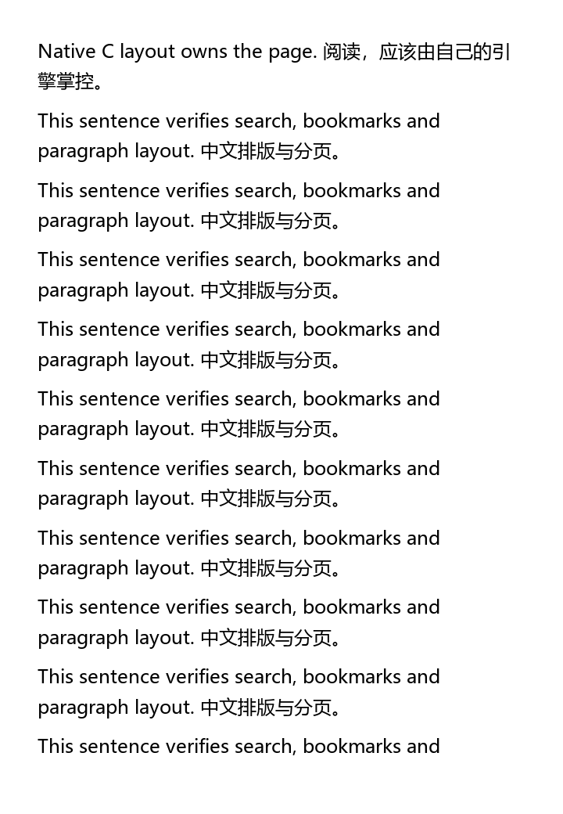

# EXReader — native C ebook engine

主项目已从 JavaScript 阅读框架重建为 **C11 原生阅读引擎**，当前版本 **0.4.0，开发中**。GPL-3.0-only。直接编译成 DLL / SO / dylib，以 C 接口供宿主调用。

文本解码、格式解析、文档模型、字体度量接入、换行、分页、文字位置、命中测试、页面像素输出和书库都在本项目 C 代码中。底层使用 FreeType、Expat、miniz 和 SQLite 四个 C 组件；不需要 Node、浏览器、DOM、WebView、Foliate 或 PDF.js。

## 当前实现

| 模块 | 当前能力 |
| --- | --- |
| 文档输入 | TXT（UTF-8、带 BOM 的 UTF-16）、HTML、FB2、EPUB spine、DOCX 正文、RTF 正文、基础 MOBI / PalmDOC |
| EPUB 文档结构 | XHTML 文档树保留章节、标题、内联元素、嵌套列表、图片、表格、脚注、全部属性与原始解码文本；保留 EPUB 3 导航树、非线性章节和辅助 XHTML |
| EPUB 资源与链接 | manifest 资源清单、图片 / CSS / 字体等资源按需解压；支持章节相对路径、Unicode / 百分号转义与片段 ID 定位 |
| 自有排版 | 字体实际 advance / kerning、段落、标题字号、自动换行、基础中文标点规则、分页；页面宽高、字号、行距、段间距、页边距可调 |
| 原生渲染 | FreeType 字形栅格化，C 合成灰度像素；BMP / PNG 输出，无图形界面依赖 |
| 文字定位 | UTF-8 字节位置、全文查找、坐标命中测试、按位置查页；改变页宽和字号后可重新定位 |
| 原生书库 | SQLite 单文件保存原书、书名、作者、标签、收藏、已读状态、阅读位置、封面和笔记；删除书籍时级联删除标注；事务备份 |
| 文字转换 | C 输出 TXT、HTML、FB2、RTF、EPUB、DOCX；覆盖 Unicode 与文本转义往返，不保留复杂排版和图片 |

当前流式排版支持基础横排拉丁文字和中日韩文字。EPUB 图片、表格和 CSS 已保存在文档模型中，视觉排版尚未接入；其他格式目前通过同一树接口提供段落与标题。完整 CSS、图片 / 表格布局、双向文字、复杂文字 shaping、UAX #14 / #29 的完整规则、竖排、连字符、EPUB CFI / 跨引擎标注迁移均待实现。PDF 固定版面引擎、KF8 / Huffman MOBI、CBZ、音频播放和 OCR 也尚未完成；PDF 文件当前会明确返回不支持。这里列出的格式能力是正文解析和基础原生排版，不等于完整出版物兼容性。

接下来的实现顺序：基于文档树的样式与图片 / 表格排版 → 稳定标注 → 大书按需加载 → PDF。0.4 的 EPUB 正文使用严格 XHTML 解析，未实现 HTML5 错误恢复、EPUB 2 NCX 目录解析、远程资源和元素级 base URI；原始 NCX 可通过资源接口读取。当前转换器仍输出正文，不保留文档树结构。

## 构建

需要 C11 编译器与 CMake 3.24+。首次配置联网下载四个固定版本的 C 组件，并验证 SHA-256；后续复用构建缓存。

```sh
cmake -S . -B build/native -DCMAKE_BUILD_TYPE=Release
cmake --build build/native --config Release --parallel 4
ctest --test-dir build/native -C Release --output-on-failure
cmake --install build/native --config Release --prefix stage
```

Windows 推荐 Visual Studio C 工具链；MinGW 的部分 Ninja 发行版无法处理中文构建路径，需要通过 ASCII 路径的目录联接配置工程。MSVC 使用静态 CRT；所有库分配的内存由对应的 `exr_*_free()` 释放。

配置 `-DEXR_BUILD_TOOLS=OFF -DEXR_BUILD_TESTS=OFF` 只构建库。Linux 可用 `-DEXR_SANITIZE=ON` 启用 AddressSanitizer / UndefinedBehaviorSanitizer。Android、iOS 和 iPadOS 使用 CMake 对应工具链编译；该工程输出引擎库，不输出手机阅读器安装包。跨平台验证状态见 [验证记录](docs/NATIVE_VALIDATION.md)。

## 直接运行

```sh
exreader-render book.epub /path/to/font.ttf page.png 0 720 1040
```

Windows 的示例：

```powershell
.\stage\bin\exreader-render.exe tests/fixtures/sample.txt C:/Windows/Fonts/msyh.ttc page.png
```

字体由宿主或用户提供，系统字体文件不随项目分发。命令行可使用 UTF-8 / Unicode 路径；Windows 参数通过宽字符入口转换。

这是 C 引擎实际生成的页面：



## C 接入

```c
#include <exreader.h>

exr_document *doc = NULL;
exr_font *font = NULL;
exr_layout *layout = NULL;
exr_bitmap image = {0};
exr_error error = {0};
exr_status status;

status = exr_document_open("book.epub", &doc, &error);
if (status == EXR_OK) status = exr_font_open("font.ttf", &font, &error);
if (status == EXR_OK) status = exr_layout_create(doc, font, NULL, &layout, &error);
if (status == EXR_OK) status = exr_render_page(layout, font, 0, &image, &error);
if (status == EXR_OK) status = exr_bitmap_write_png(&image, "page.png", &error);

exr_bitmap_free(&image);
exr_layout_free(layout);
exr_font_free(font);
exr_document_free(doc);
```

[公开头文件](include/exreader.h) · [接口与内存约定](docs/NATIVE_API.md) · [第三方许可](THIRD_PARTY_NOTICES.md)

## 版本保留

当前默认开发线直接使用 C 工程。此前的 [JavaScript 框架](https://github.com/NoGod3524/EXReader/commit/4533185)、[带 UI 的阅读器](https://github.com/NoGod3524/EXReader/tree/codex/reader-app) 和 [MIT 版 0.1.1](https://github.com/NoGod3524/EXReader/tree/codex/reader-0.1.1) 保留为历史版本。现有下载页仍是 0.1.1 阅读器；原生引擎目前与旧 UI、IndexedDB 书库和旧标注尚未接通。

Copyright (c) 2026 EXReader contributors. 自有代码为 GPL-3.0-only，第三方组件保留原许可；既有版本的 MIT 授权不撤回。
