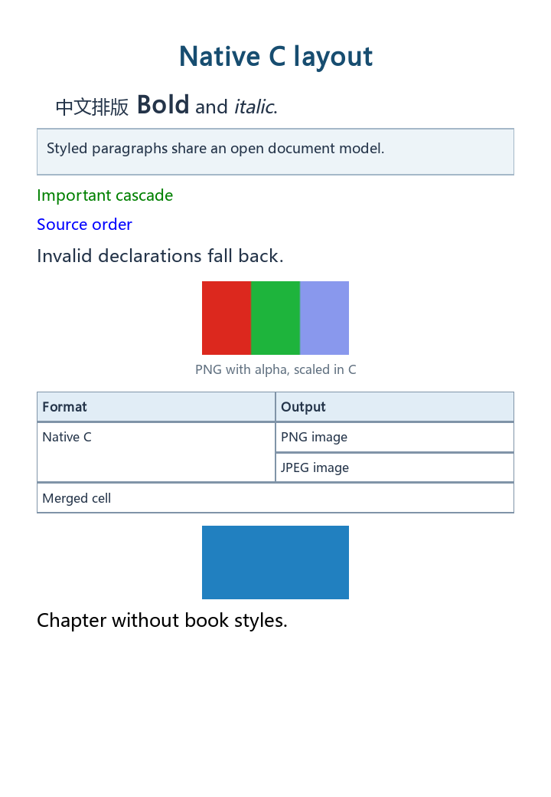

# EXReader — native C ebook engine

主项目已从 JavaScript 阅读框架重建为 **C11 原生阅读引擎**，当前版本 **0.18.0，开发中**。GPL-3.0-only。直接编译成 DLL / SO / dylib，以 C 接口供宿主调用。

版本按完整功能里程碑编号；旧 0.13–0.100 的开发步骤已归并，见 [版本分配与历史映射](docs/VERSIONING.md)。内部实现步骤和示例验证通过提交记录追踪。

0.12.1 修复全库审计确认的七项缺陷，覆盖长附标塑形、重复章节标注、备注长度、XML 导出、跨行塑形、RTF fallback 和 HTML script/style。每项有独立回归测试与提交；[验证记录](docs/NATIVE_VALIDATION.md#0121-audit-fixes) 列出覆盖范围与资源上限。

文本解码、格式解析、文档模型、CSS 子集、字素边界、双向文字、OpenType 替换与定位、换行、分页、文字位置、命中测试、页面像素合成和书库都在本项目 C 代码中。底层使用 FreeType、Expat、miniz、SQLite 和 stb_image 五个 C 组件，分别处理字体、XML、ZIP、数据库和 PNG/JPEG 解码。MP3 使用可关闭的 CC0 minimp3 C 解码器，按需读取与精确续扫由本框架处理。

框架面向通用宿主：宿主可以直接构造文档树和资源，将自己的解析结果交给引擎；文档树、资源、字形、行、图片和单元格坐标均可读取。宿主可以覆盖样式、关闭书内 CSS、替换图片解码器，或直接使用布局数据自行绘制。文档构造、解析和排版可独立于 SQLite 书库使用，UI、账号、同步和平台事件由宿主决定。

## 当前实现

| 模块 | 当前能力 |
| --- | --- |
| 固定版面构造 | `exr_layout_create_positioned()` 保留定位字形、图片/色块和源范围；`exr_fixed_create()` 接收任意格式的页目录和按需绘制提供者 |
| C 原生 PDF | `exr_fixed_open()` / `exr_fixed_open_memory(EXR_PDF,...)` 打开页目录，`exr_fixed_render()` 按页绘制，`exr_fixed_load_text()` 返回语义文字与源坐标字格；对象/流、字体、文字、路径、Form、JPEG、调色板和图像遮罩由 C 核处理 |
| SDK 兼容 | ABI epoch 1 运行时查询；安装后可通过 CMake `EXReader::exreader` 接入，含独立宿主示例与明确的布局/所有权约定 |
| JNI 接入 | 可选 Java/Android 桥接库，提供串行 AutoCloseable 重排文档、EPUB 分章加载、分页、PDF/WAV/PCM 句柄；开放节点、字形/行/框、字体与图片快照 |
| Swift 接入 | SDK 内置 C 模块映射，提供 ARC 通用文档、EPUB 分章加载、分页、字体、PDF 和 WAV/PCM 封装；布局记录、字体与图片可独立复制 |
| 有声书模型 | 宿主轨道、毫秒时间线、嵌套章节、双向图文同步；可接宿主播放/倍速/跨轨后端并按稳定 ID 续播，WAV/FLAC/MP3 按需解码，开放 PCM 提供者；原生 waveOut/AudioQueue/OpenSL ES/ALSA 声音输出，续播与时间书签可保存、备份 |
| M4B 容器信息 | 无需 AAC 解码器即可按需读取 iTunes 文本元数据、PNG/JPEG 封面与 Nero chpl 章节；返回独立快照，可接通用有声书时间线，附 Swift/Java 包装 |
| PDF 书库 | 保存原书、Info/XMP 标题/作者、页进度与固定页备注，支持 NUL 引用、稳定锚点、备份恢复和旧库事务迁移 |
| 固定页交互 | 语义文字快照、线性精确搜索、字格选择、源坐标命中、PDF 原生标注数据读取、页 ID 与引用/上下文稳定标注锚点，支持宿主固定格式 |
| PDF 标注编辑 | 按页和 NM 新增、更新 Text/Highlight/Underline/StrikeOut/Squiggly，删除标注及同页 Popup；追加修订并返回完整 PDF，保留原字节；绘制已有与新写入的 normal Form 外观，SDK 书库备注由宿主显式同步 |
| 通用绘制接口 | 开放 Bézier 字形轮廓、路径/描边、分层图片、裁切、正逆视口矩阵和流式绘制回调；可用内置 C 画布或宿主绘制后端 |
| 文档输入 | TXT（UTF-8、带 BOM 的 UTF-16）、HTML、FB2、EPUB spine、DOCX 结构、RTF 正文、MOBI / PalmDOC / HUFF-CDIC、KF8 章节、CSS、图片与字体 |
| 宿主文档构造 | `exr_document_create()` 接收通用节点、章节和资源字节，复制输入并生成规范化正文；宿主解析器无需注册，可直接接入现有搜索、布局、渲染和正文导出 |
| 操作控制 | 随机读取、样式、分页、OpenType 塑形和绘制的协作取消与进度回调；取消未命中页面时保留已有缓存，可清除取消后恢复 |
| 随机读取源 | 文件或宿主 read_at 回调按需读取 EPUB 目录、章节和资源，不常驻复制整个压缩文件；共享源保持到最后一个章节释放 |
| 分段按需加载 | 通用 publication / loader 接口；内置 EPUB 打开时只索引，访问某章时才解析和排版；session 以 LRU 保留 1–64 个分段 |
| 分页检查点 | 借用页模式按间隔保存有数量/字节预算的恢复点，支持原始行、双向段落和表格组；未命中旧页从最近检查点续排，可关闭并查询统计 |
| 页级续排 | `exr_pager` 在页边界暂停；长段落逐字素推进，表格逐 rowspan 连通组测量；输出独立单页布局 |
| 缓存字节预算 | 页缓存与章节 session 均支持 LRU 数量/载荷字节双限制；超限的新页或章节保留旧缓存；可查询计量值 |
| 通用导航目录 | 可复制宿主目录；EPUB 3 nav / EPUB 2 NCX 按需解析、缓存，保留父子关系、目标分段、相对 URI 和开放 role；重复路径不猜测目标 |
| EPUB 文档结构 | XHTML 文档树保留章节、标题、内联元素、嵌套列表、图片、表格、脚注、全部属性与原始解码文本；保留 EPUB 3 导航树、非线性章节和辅助 XHTML |
| EPUB 资源与链接 | manifest 资源清单、图片 / CSS / 字体等资源按需解压；支持章节相对路径、Unicode / 百分号转义与片段 ID 定位 |
| 自有排版 | 字体实际 advance / kerning、段落、标题字号、自动换行、Unicode 字素簇保护、中文标点与不换行空格约束、分页；页面宽高、字号、行距、段间距、页边距可调 |
| 开放文字边界 | `exr_text_analyze()` 输出按 UTF-8 字节索引的 Unicode 17.0 扩展字素边界、Unicode 17 默认 UAX #14 换行机会、强制换行和禁止紧急换行标志；无需文档、字体或书库 |
| 双向文字 | 原生 Unicode 17 UAX #9 分析与逐行视觉重排，支持嵌入、隔离、括号配对和镜像；完整 861,948 个官方方向用例回归；提供独立 bidi API |
| OpenType 塑形 | 原生 GSUB 1–8 / GPOS 1–9 lookup 引擎，拉丁连字、阿拉伯连接形与 lam-alef、字偶距、附标与连写定位；开放 script / language / feature 和字形偏移 |
| 竖排 | 统一页面 vertical-rl / vertical-lr、Unicode 17 字形朝向、vert / vrt2 / vkrn 与 vmtx、混合直立/侧排、横竖/反向列块上下文、物理命中、分页和检查点 |
| 可变字体 | 只读轴查询、按 tag/face 创建独立坐标实例；gvar/HVAR/VVAR、avar、原生 GDEF VariationIndex 与 GSUB/GPOS 条件特征替换 |
| CSS 子集 | 章节样式表、内嵌和内联样式；元素 / 类 / ID / 后代 / 子选择器，优先级和继承；混合字号、粗斜体、颜色、段落方向、对齐、缩进、边距、背景、实线边框和强制分页 |
| 图片与表格 | PNG/JPEG 解码、透明合成和等比缩放；等宽表格、单元格换行、colspan / rowspan、按行组跨页 |
| 字体回退 | 宿主提供有序字体字节和集合 face index；优先整字素簇覆盖，必要时逐标量回退；可查询 cmap 覆盖，布局输出字体索引与缺字标记 |
| 书内字体与匹配 | 本地 `@font-face` TTF/OTF、CSS `font-family` 列表与转义、粗斜体选脸、章节作用域与宿主禁用开关；布局保留有效字体集，可读取编码字节自行绘制 |
| 原生渲染 | FreeType 字形栅格化，C 合成灰度或 RGBA 像素；BMP / PNG 输出，无图形界面依赖 |
| 文字定位 | UTF-8 字节位置、全文查找、按字素簇命中测试、按位置查页；字形输出保留簇范围；改变页宽和字号后可重新定位 |
| EPUB CFI | 按原始 OPF spine 和章节 XML 树生成/解析整书位置与跨章范围，按需入口只加载目标章，保留重复 spine、ID 修正、UTF-16 偏移、前后文断言与 side bias；也可独立使用章节内容路径 |
| 稳定文本锚点 | 保存选文、前后文和可选章节路径；正文前方增删后可重新查找范围，重复或失配明确报告；支持点书签，可独立于书库使用 |
| 全文索引 | 可选 SQLite FTS5 trigram 候选索引与 C 精确匹配；按宿主 source/part 接入，支持中文短查询、NUL、重叠命中、流式结果与按来源原子分段重建，不自动绑定书库格式 |
| 原生书库 | SQLite 单文件保存原书、书名、作者、标签、收藏、已读状态、阅读位置、封面和笔记、带上下文的阅读进度与事务式标注/进度重定位；可选择按格式与原文件字节精确去重导入；删除书籍时级联删除标注；事务备份 |
| 结构导出 | 新接口输出 EPUB 或带目录入口的 HTML 资源 ZIP，保留章节树、属性、图片、CSS、字体、链接、嵌套目录及资源原字节；校验路径、缺失资源和 XML 合法性 |
| 原文件元数据 | PDF Info/XMP 同步增量写回；EPUB 书名等 DC 元数据及 PNG/JPEG 封面写回，保留未改章节与资源的压缩字节 |
| 文字转换 | C 输出 TXT、HTML、FB2、RTF、EPUB、DOCX；覆盖 Unicode 与文本转义往返，不保留复杂排版和图片 |

当前横排覆盖拉丁文字、中日韩文字和阿拉伯 / 希伯来双向混排。EPUB 和宿主构造的文档使用文档树进行样式、图片和表格布局；FB2 还保留内嵌图片、封面、表格、强调文字和脚注；DOCX 保留段落与字符样式、图片、合并表格、链接、编号列表及脚注/尾注；RTF 保留列表层级、原显示标签与多级自动编号、横向/纵向/矩形合并表格、多段落单元格、脚注/尾注与回链、图片、链接、书签、字体名称、粗斜体、字号、颜色与段落属性；MOBI 目前提供段落与标题，KF8 可重建章节 XHTML，接通 CSS、图片、SVG 内部资源、嵌入字体、定位链接、NCX 层级目录和 guide 地标，也可读取声明边界的 MOBI/KF8 混合文件。图片按块排版，表格采用等宽列，超过一页高度的行或 rowspan 行组返回 `EXR_LIMIT`。OpenType lookup 引擎已有拉丁与阿拉伯预处理；Devanagari 已有 deva/dev2 音节预处理、前置元音/reph 重排和分阶段塑形；ruby 已有横竖排、单段/多段与多层注音。其余 Indic 脚本专用处理、彩色 emoji、字典连字符、完整 CSS、浮动绕排仍待实现；已有基于 TextQuoteSelector 的单条纯文本 Web Annotation JSON 导入导出。PDF 已通过独立固定页面入口支持打开、绘制、文字搜索、选择、SDK 自有固定页备注、Type3 字形绘制/文字语义和 Text/Highlight/Underline/StrikeOut/Squiggly 原生标注编辑；CalGray/CalRGB/Lab/Indexed 已统一转换为固定 sRGB，ICCBased 使用声明的 Alternate；完整 ICC 配置转换、专色/DeviceN、加密、复杂透明度和部分图像编解码仍待补充；内联图片已复用现有 RAW/JPEG/无损 filter 解码路径。有声书已提供时间线、同步、宿主播放控制、续播与书签持久化、原生 WAV/FLAC 与可选 MP3、ADTS AAC、M4A/M4B 解码、开放 PCM 接口和六平台原生声音输出；已补无依赖的流式 WSOLA 保音高变速；移动音频会话/真机验收继续补齐。CBZ 和 OCR 尚未实现。具体范围见 [接口文档](docs/NATIVE_API.md)。

0.7 提供稳定标注的文本锚点基础：精确选文至少需要一侧完整上下文或文档 / 章节边界佐证，同分候选返回歧义，不猜测旧偏移附近的位置。锚点仍按 Unicode 标量边界捕获，不自动扩展为字素簇；不提供模糊改字匹配、Unicode 规范化或文档指纹。旧书库标注保留为仅偏移的 legacy 记录，不自动认定已迁移。宿主可自行持久化选择器字段，正文格式转换不携带标注。

0.8 新增分段加载和逐段排版。宿主可提供任意格式的独立分段文档；EPUB 内置 loader 共享一份压缩书籍，按需解析 XHTML。原 `session_get` 完整解析和排版请求分段，临时加载可多占一个分段；0.11 增加页级续排和载荷字节预算。页号、节点索引和正文偏移均为分段局部值，整书页数需逐段排版后才能确定；现有 SQLite 书库仍使用全书文档模型。

0.9 补上 Unicode 17.0.0 的 UAX #29 扩展字素规则，包括组合字符、Hangul、Indic 辅音连接边界、emoji ZWJ 和旗帜配对，完整官方 766 项字素测试通过。布局可跨内联样式节点识别同一字素簇，换行和命中测试使用簇边界。0.18 开发中已完成 Unicode 17 默认 UAX #14 规则，包括数字、引号、Brahmic 与 emoji 上下文；19,338 项官方断行测试通过。公开边界与 UAX #29 字素保护取交集，断行时的软连字符已接入字体回退、宽度拟合、RTL 与页级恢复；未断行保持不可见。字典断词继续补齐。禁止拆分的字素簇或硬组过宽时保留整组并裁剪。正文归一化和 ASCII 空白处理保持原有规则。

0.10 新增不可变的有序字体集，宿主通过内存字节提供 1–32 个可缩放 Unicode 字体。引擎优先选择能覆盖整个可见字素簇的首个字体，缺少整簇覆盖时逐标量回退；所有字体均缺字时使用主字体的缺字字形并设置 `EXR_GLYPH_MISSING`。布局、行高、字距与栅格器使用同一字体选择，`font_index` 供自定义渲染器使用。框架不扫描系统字体；0.13 可自动加载书籍 CSS 实际引用的本地 TTF/OTF 字体，也可关闭该功能。

0.11 新增可暂停的页级状态机和双重缓存预算。顺序读取只为当前页和换行前瞻保存字形；已淘汰的旧页按需从章节开头重放。共享图片通过引用计数保留，返回页可在 pager 释放后独立渲染。章节文档仍完整解析，缓存预算计量常驻载荷，字体、源书和临时工作区另计。真实性能数据见 [性能记录](docs/PERFORMANCE.md)。

0.12 新增独立 `exr_shape()`、`exr_bidi_analyze()` / `exr_bidi_reorder()`，并接入页级布局。字形按视觉顺序输出，保留源簇范围、字体索引、双向级别及偏移；逐行命中按视觉簇映射回源文字。配置方向、段落 `dir` 和 CSS `direction` 决定段落方向；内联隔离目前通过文本中的显式 Unicode 控制字符表达。同字体同字号的簇内颜色 / 粗斜体变化使用簇首样式；不同字号仍分开塑形，跨字号附标定位有限。

带 OpenType 的连续无断点塑形段当前最多 8192 个标量，超过返回 `EXR_LIMIT`。双向分析先读取整个可见段落，其元数据内存不在页面缓存预算内；页级续排减少布局驻留量，文件解析、双向分析和不可拆组仍有各自工作区。

C 原生 PDF 打开与整页绘制已接入公开固定页面接口，按页输出通用绘制回调或 RGBA/灰度图像；固定页文字几何、搜索选择、SDK 标注与有声书基础已接通。0.18 开发中继续补入 PDF Text/Highlight 写回、删除和原生标注 Form 外观绘制，沿用当前版本。写回要求 PDF 文件头版本至少 1.4；删除没有该版本限制。增量删除保留历史原文，不是安全擦除；认证权限、其余标注编辑与表单范围见 [接口文档](docs/NATIVE_API.md#pdf-原生标注编辑与外观绘制018-开发补充)。当前已支持带预算的分页检查点和随机读取源；大书后续继续完善章节增量解析。EPUB 正文使用严格 XHTML 解析，未实现 HTML5 错误恢复、远程资源和元素级 base URI；原始 NCX 可通过资源接口读取。EPUB 导出保留已支持的文档树、资源、导航和元数据；其他格式的转换仍以正文为主。

## 构建

需要 C11 编译器与 CMake 3.24+。首次配置联网下载五个固定版本的 C 组件，并验证 SHA-256；后续复用构建缓存。

Unicode 属性表已编入 C，普通构建无需 Python，也不下载 Unicode 数据。表和官方测试的固定来源、SHA-256、重现命令与 Unicode-3.0 数据许可见 [第三方许可](THIRD_PARTY_NOTICES.md)；SDK 同时附带许可文本。

```sh
cmake -S . -B build/native -DCMAKE_BUILD_TYPE=Release
cmake --build build/native --config Release --parallel 4
ctest --test-dir build/native -C Release --output-on-failure
cmake --install build/native --config Release --prefix stage
```

Windows 推荐 Visual Studio C 工具链；MinGW 的部分 Ninja 发行版无法处理中文构建路径，需要通过 ASCII 路径的目录联接配置工程。MSVC 使用静态 CRT；所有库分配的内存由对应的 `exr_*_free()` 释放。

配置 `-DEXR_BUILD_TOOLS=OFF -DEXR_BUILD_TESTS=OFF` 只构建库。Linux 可用 `-DEXR_SANITIZE=ON` 启用 AddressSanitizer / UndefinedBehaviorSanitizer。Android、iOS 和 iPadOS 使用 CMake 对应工具链编译；该工程输出引擎库，不输出手机阅读器安装包。跨平台验证状态见 [验证记录](docs/NATIVE_VALIDATION.md)。

## 直接运行

```sh
exreader-render book.epub /path/to/font.ttf page.png 0 720 1040
```

Windows 的示例：

```powershell
.\stage\bin\exreader-render.exe tests/fixtures/sample.txt C:/Windows/Fonts/msyh.ttc page.png
```

字体由宿主或用户提供，系统字体文件不随项目分发。命令行可使用 UTF-8 / Unicode 路径；Windows 参数通过宽字符入口转换。

这是 C 引擎实际生成的页面：



## 性能基准

默认工具构建同时生成 `exreader-benchmark`，输出打开、首章解析排版、首画、逐页续排 / 渲染 / 完整翻页 p50 / p95 和进程峰值 RSS 的 JSON；直接运行不需要 Python。

```sh
stage/bin/exreader-benchmark book.epub /path/to/font.ttf --max-pages 64
stage/bin/exreader-benchmark book.epub /path/to/font.ttf --max-pages 64 --paging
python tools/run_benchmarks.py stage/bin/exreader-benchmark /path/to/font.ttf build/benchmarks --runs 3
```

Windows 使用 `stage/bin/exreader-benchmark.exe`。Python runner 生成固定的短书、单段长章和多章 EPUB，每轮启动新进程并保存明细与汇总。测量口径、复现方法和已归档的 0.10 / 0.11 / 0.12 实测结果见 [性能记录](docs/PERFORMANCE.md)。

## C 接入

```c
#include <exreader.h>

exr_document *doc = NULL;
exr_font *font = NULL;
exr_layout *layout = NULL;
exr_bitmap image = {0};
exr_error error = {0};
exr_status status;

status = exr_document_open("book.epub", &doc, &error);
if (status == EXR_OK) status = exr_font_open("font.ttf", &font, &error);
if (status == EXR_OK) status = exr_layout_create(doc, font, NULL, &layout, &error);
if (status == EXR_OK) status = exr_render_page_color(layout, font, 0, &image, &error);
if (status == EXR_OK) status = exr_bitmap_write_png(&image, "page.png", &error);

exr_bitmap_free(&image);
exr_layout_free(layout);
exr_font_free(font);
exr_document_free(doc);
```

接入自己的解析器时，将解析结果写入前序节点数组，再调用构造入口：

```c
exr_node_input nodes[] = {
    {EXR_NODE_DOCUMENT, SIZE_MAX, NULL, NULL, NULL, 0},
    {EXR_NODE_CHAPTER, 0, NULL, NULL, NULL, 0},
    {EXR_NODE_PARAGRAPH, 1, NULL, NULL, NULL, 0},
    {EXR_NODE_TEXT, 2, NULL, "Hello from a host parser.", NULL, 0}
};
exr_chapter_input chapter = {"main", "chapters/main", 1, 1};
exr_document_input input = {"Host document", nodes, 4, &chapter, 1, NULL, 0};
exr_document *doc = NULL;
exr_error error = {0};
exr_status status = exr_document_create(&input, &doc, &error);
/* On success, doc owns copies; pass it to the same layout/search/export APIs. */
exr_document_free(doc);
```

创建后的文档格式为 `EXR_CUSTOM`，输入数组、字符串和资源字节可在调用返回后释放。此入口不需要全局解析器注册表。自定义文档尚未提供结构化持久化；SQLite 书库仍按原文件字节导入。

SDK 附带完整宿主示例，可只使用安装后的头文件和库编译：

```sh
cmake -S stage/examples -B build/host -DEXR_SDK=/absolute/path/to/stage -DCMAKE_BUILD_TYPE=Release
cmake --build build/host --config Release
```

运行生成的 `exreader-construct-example`，传入字体文件和输出 PNG 路径，即可将自建文档排版为页面。`exreader-anchor-example` 无需字体和参数，演示保存选文并在正文插入内容后重新定位。构造接口的节点命名与 XHTML 行为约定见 [接口文档](docs/NATIVE_API.md)。

`exreader-lazy-example` 演示分段加载；默认创建三个宿主分段，只请求索引 1。提供 EPUB 和从 0 开始的分段索引时，改用内置 EPUB 索引：

```sh
exreader-lazy-example font.ttf host-part.png
exreader-lazy-example font.ttf epub-part.png book.epub 0
```

`exreader-text-example` 无需参数或字体，演示独立文字边界 API。示例验证 25 字节的组合字符、emoji ZWJ、旗帜和中文输入，输出 4 个字素簇及其 UTF-8 范围。

`exreader-font-example primary.ttf fallback.ttf output.png` 演示从宿主字节创建字体集、打印每个字符所选字体并输出页面。SDK 的 `examples/fonts` 附带小型测试字体，使用矩形字形验证回退；实际阅读字体由宿主提供。

`exreader-page-example book.epub font.ttf output.png [page] [part]` 演示按章节索引加载、页级续排、三页 / 8 MiB 载荷预算以及独立绘制；页和章节索引从 0 开始。

[公开头文件](include/exreader.h) · [接口与内存约定](docs/NATIVE_API.md) · [第三方许可](THIRD_PARTY_NOTICES.md)

## 版本保留

当前默认开发线直接使用 C 工程。此前的 [JavaScript 框架](https://github.com/NoGod3524/EXReader/commit/4533185)、[带 UI 的阅读器](https://github.com/NoGod3524/EXReader/tree/codex/reader-app) 和 [MIT 版 0.1.1](https://github.com/NoGod3524/EXReader/tree/codex/reader-0.1.1) 保留为历史版本。现有下载页仍是 0.1.1 阅读器；原生引擎目前与旧 UI、IndexedDB 书库和旧标注尚未接通。

Copyright (c) 2026 EXReader contributors. 自有代码为 GPL-3.0-only，第三方组件保留原许可；既有版本的 MIT 授权不撤回。


固定页面宿主示例（仅使用公开 SDK）：

```sh
exreader-fixed-example book.pdf page.png 0
# 未嵌入字体的 PDF 可显式提供宿主字体：
exreader-fixed-example book.pdf page.png 0 fallback.ttf
```

该入口使用固定页面模型；重排文档仍使用 `exr_document_open` 和 layout/pager 接口。
