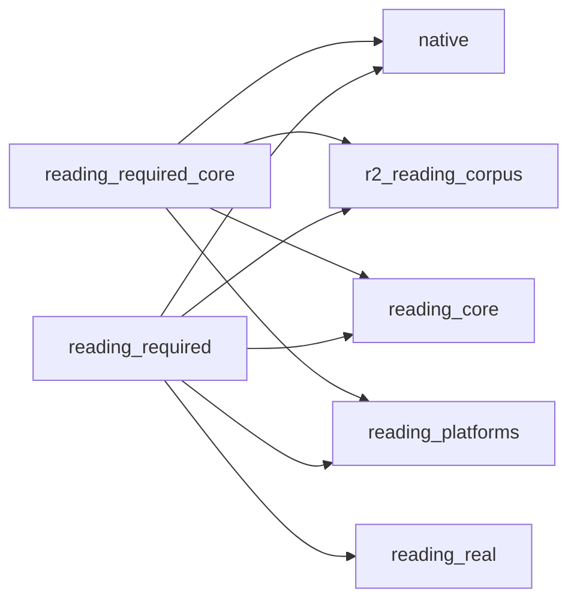

# Workflow dependency inventory

基线：main `f22a764979ff14b23b407a438a4387c5eeae6434`（PR #42 已合入）。盘点日期：2026-11-05 America/New_York。

本表完成前，本轮未移动、修改任何 workflow；此前 60239dd6 的机械准备稿未发布、不作为本轮执行依据。

## 结论

**正向 workflow_call 闭包为 11 个。若保留全仓已确认的文件读取点，并只迁移获准的 acroform 测试路径，则至少需保留 35 个，超过 ≤12 的验收上限。步骤 2–5 尚未执行。**

需区分 workflow_call、真实文件读取、Git 历史对象路径、Actions run 身份字符串及登记表项；不能把 grep 命中一律当作活跃调用，也不能把未被 core 调用的历史读取自动免除。

## 复核命令

```sh
git grep -n -I -F "uses: ./.github/workflows/" f22a764979ff14b23b407a438a4387c5eeae6434 -- .github/workflows
git grep -n -I -F ".github/workflows/" f22a764979ff14b23b407a438a4387c5eeae6434 -- tests tools apps
git grep -n -I -F ".github/workflows/" f22a764979ff14b23b407a438a4387c5eeae6434
```

正向逐轮集合取并集至不动点；反向逐条区分读取行为与元数据字符串。Python 文件读取检查包含 read_text/read_bytes/open、局部路径变量及 WORKFLOWS 文件名循环；动态/跨模块来源保留为引用清单，不擅自推定执行覆盖。

## 正向保留集：11 个

| Workflow | 保留理由：调用者 / 读取者 |
|---|---|
| `ledger-authority.yml` | owner 明确保留 |
| `ledger-evidence-custody.yml` | owner 明确保留 |
| `native.yml` | owner 明确保留；被 `reading-required-core.yml`, `reading-required.yml` 调用；读取：`tests/check_ci_hygiene.py:21`, `tests/check_ci_hygiene.py:139`, `tools/measure_reading_real.py:37` |
| `r2-reading-corpus.yml` | owner 明确保留；被 `reading-required-core.yml`, `reading-required.yml` 调用 |
| `reader-total-progress.yml` | owner 明确保留 |
| `reading-core.yml` | owner 明确保留；被 `reading-required-core.yml`, `reading-required.yml` 调用 |
| `reading-platforms.yml` | owner 明确保留；被 `reading-required-core.yml`, `reading-required.yml` 调用 |
| `reading-real.yml` | 被 `reading-required.yml` 调用 |
| `reading-required-core.yml` | owner 明确保留；读取：`tests/check_perf_policy.py:23` |
| `reading-required.yml` | owner 明确保留 |
| `reliability.yml` | owner 明确保留；读取：`tools/measure_reading_real.py:37` |

### 调用边



## 全仓读取约束：额外 24 个

保留这些文件会使保留集达到 35。若它们归档，必须明确历史读取的处置，或扩大路径迁移范围；本次不自行改变这条边界。

| Workflow | 确认的读取位置 / 原因 |
|---|---|
| `reader-android-page-theme.yml` | `tests/reader_hosts_341/guard_android.py:51`（read_text） |
| `reader-apple-import-mapping.yml` | `tests/apple_host/page_theme/guard.py:133`（read_text） |
| `reader-apple-navigation.yml` | `tests/apple_host/page_theme/guard.py:133`（read_text） |
| `reader-apple-raw3-ios-ready.yml` | `tests/reader_apple_records_ready/raw3_guard.py:81`（read_text） |
| `reader-apple-reading-records.yml` | `tests/apple_host/page_theme/guard.py:133`（read_text） |
| `reader-apple-record-compatibility.yml` | `tools/version_literal_exceptions.json` 的 7 条 migration_compat 证明由 `tools/check_version_consistency.py:126` 实际读取，且要求生效工作流引用迁移测试 |
| `reader-apple-records-ready.yml` | `tests/reader_apple_records_ready/guard.py:62`（read_text） |
| `reader-apple-search.yml` | `tests/apple_host/page_theme/guard.py:133`（read_text） |
| `reader-apple-shelf.yml` | `tests/apple_host/navigation/test_container_reports.py:63`（read_text）；`tests/apple_host/page_theme/guard.py:133`（read_text） |
| `reader-apple-simulator-ready.yml` | `tests/apple_host/page_theme/simulator_ready.py:41`（read_text） |
| `reader-composition-341.yml` | `tests/reader_hosts_341/guard_composition.py:47`（read_text） |
| `reader-gtk-341-final.yml` | `tests/reader_gtk_341_final/guard.py:41`（read_text）；`tests/reader_hosts_341/guard_gtk.py:47`（read_text） |
| `reader-gtk-compact.yml` | `tests/reader_gtk_compact/guard.py:73`（read_text） |
| `reader-gtk-raw3.yml` | `tests/reader_gtk_raw3/guard.py:59`（read_text） |
| `reader-wave3-c10.yml` | `tests/reader_gtk_raw_wave3/guard.py:69`（read_bytes） |
| `reader-windows-341-common.yml` | `tests/reader_windows_341/guard.py:29`（read_text） |
| `reader-windows-compact.yml` | `tests/reader_windows_compact/guard.py:37`（read_text） |
| `reader-windows-preferences-ui.yml` | `tests/reader_windows_preferences/guard.py:59`（open） |
| `wp13-android.yml` | `tools/check_android_host.py:40`（read_text）；另被 `tools/android_host_evidence.py:98-100` 源文件哈希采集读取 |
| `wp13-apple.yml` | `tests/apple_host/page_theme/guard.py:133`（read_text） |
| `wp15-opds.yml` | `tools/check_parallel_integration.py:349`（read_text） |
| `r5-android-bounded-candidate.yml` | `tools/android_host_evidence.py:98-100` 的 SOURCE_PATHS 文件哈希采集，最终由 lines 72-78 的 Path.open 实际读文件 |
| `reader-owner-android.yml` | `tools/android_host_evidence.py:98-100` 的 SOURCE_PATHS 文件哈希采集，最终由 lines 72-78 的 Path.open 实际读文件 |
| `reader-organization-android.yml` | `tools/android_host_evidence.py:98-100` 的 SOURCE_PATHS 文件哈希采集，最终由 lines 72-78 的 Path.open 实际读文件 |

## 改测试路径后才可归档

| Workflow | 允许的路径修改 | 其他引用 |
|---|---|
| `acroform.yml` | `tests/check_ci_hygiene.py:167` 的读取路径改为 `archive/workflows/acroform.yml`；line 168 的断言及逻辑文件名保持原文 | `tools/check_parallel_integration.py` 的 BASELINE_EVIDENCE / run.path 是历史证据身份，不能改成归档文件路径 |

上表仅列目前明确授权的一处。额外 24 个读取约束均未迁移。

## 可归档集

在保留上面的 35 个、完成 acroform 路径迁移和登记自衰减的前提下，共可归档候选 221 个：220 个无需更改已确认的工作树读取路径，acroform 1 个需先改测试路径。该集合不满足 ≤12 活跃文件；这里只盘点，不执行。

| Workflow | 分类 / 已有代码测试引用 |
|---|---|
| `acroform.yml` | 先改 acroform 测试读取路径；其他引用（身份、历史或作用域，未改）：`tests/check_ci_hygiene.py:167`, `tests/check_ci_hygiene.py:168`, `tools/check_parallel_integration.py:261`, `tools/check_parallel_integration.py:41` |
| `android-composition-candidate.yml` | 正向闭包及已确认读取集以外 |
| `android-composition-legacy-340.yml` | 正向闭包及已确认读取集以外 |
| `android-current-owner-340.yml` | 正向闭包及已确认读取集以外 |
| `android-organization-sync.yml` | 正向闭包及已确认读取集以外 |
| `android-real-original-save.yml` | 正向闭包及已确认读取集以外；其他引用（身份、历史或作用域，未改）：`tests/android_font_reader/guard.py:22`, `tests/reader_android_receive_d22/guard.py:31`, `tests/reader_d21_apple_receive/guard.py:24`, `tests/reader_d25_real_formats/run.py:41` |
| `annotation-failure-409114.yml` | 正向闭包及已确认读取集以外 |
| `annotation-ipad-failure-409114.yml` | 正向闭包及已确认读取集以外 |
| `annotation-iphone-failure-409114.yml` | 正向闭包及已确认读取集以外 |
| `apple-annotation-macos-independent.yml` | 正向闭包及已确认读取集以外 |
| `apple-four-evidence-audit-20261029.yml` | 正向闭包及已确认读取集以外 |
| `apple-ios-save-evidence-audit.yml` | 正向闭包及已确认读取集以外 |
| `apple-sync-details-independent.yml` | 正向闭包及已确认读取集以外 |
| `bounded-library.yml` | 正向闭包及已确认读取集以外 |
| `combined-wal-profile.yml` | 正向闭包及已确认读取集以外 |
| `compat-corpus.yml` | 正向闭包及已确认读取集以外 |
| `conversion-memory.yml` | 正向闭包及已确认读取集以外 |
| `f07-authoritative-symbols-20261103.yml` | 正向闭包及已确认读取集以外 |
| `gtk-organization-projection.yml` | 正向闭包及已确认读取集以外 |
| `gtk-raw-retained.yml` | 正向闭包及已确认读取集以外 |
| `integrated-bounded-txt-android.yml` | 正向闭包及已确认读取集以外；其他引用（身份、历史或作用域，未改）：`tests/reader_same_source/bounded_txt_guard.py:16` |
| `integrated-bounded-txt-apple.yml` | 正向闭包及已确认读取集以外；其他引用（身份、历史或作用域，未改）：`tests/reader_same_source/bounded_txt_guard.py:18` |
| `integrated-bounded-txt-gtk.yml` | 正向闭包及已确认读取集以外；其他引用（身份、历史或作用域，未改）：`tests/reader_same_source/bounded_txt_guard.py:17` |
| `integrated-bounded-txt-windows.yml` | 正向闭包及已确认读取集以外；其他引用（身份、历史或作用域，未改）：`tests/reader_same_source/bounded_txt_guard.py:19` |
| `parallel-integration.yml` | 正向闭包及已确认读取集以外；其他引用（身份、历史或作用域，未改）：`tests/reader_next_s14/guard.py:81` |
| `r2-corpus-diagnostic.yml` | 正向闭包及已确认读取集以外 |
| `r2-image-cache.yml` | 正向闭包及已确认读取集以外 |
| `r2-jpx-dependency.yml` | 正向闭包及已确认读取集以外 |
| `r2-pdf-cache.yml` | 正向闭包及已确认读取集以外 |
| `r4-cid.yml` | 正向闭包及已确认读取集以外 |
| `r4-cmap-diagnose.yml` | 正向闭包及已确认读取集以外 |
| `r4-core.yml` | 正向闭包及已确认读取集以外 |
| `r4-jpx.yml` | 正向闭包及已确认读取集以外 |
| `r4-real-pdf.yml` | 正向闭包及已确认读取集以外 |
| `r4-softmask.yml` | 正向闭包及已确认读取集以外 |
| `r6-jpx-reference-diagnostic.yml` | 正向闭包及已确认读取集以外 |
| `r6-pdf-jpx.yml` | 正向闭包及已确认读取集以外 |
| `r6-reading-candidates.yml` | 正向闭包及已确认读取集以外 |
| `r6-reading-required-protocol.yml` | 正向闭包及已确认读取集以外 |
| `r6-ruleset-observe.yml` | 正向闭包及已确认读取集以外 |
| `reader-a11y-android.yml` | 正向闭包及已确认读取集以外；其他引用（身份、历史或作用域，未改）：`tests/reader_a11y_android/README.md:33` |
| `reader-a11y-apple.yml` | 正向闭包及已确认读取集以外 |
| `reader-a11y-gtk.yml` | 正向闭包及已确认读取集以外 |
| `reader-a11y-windows.yml` | 正向闭包及已确认读取集以外；其他引用（身份、历史或作用域，未改）：`tests/reader_a11y_windows/run_audit.py:38` |
| `reader-account-linux.yml` | 正向闭包及已确认读取集以外 |
| `reader-account-profiles.yml` | 正向闭包及已确认读取集以外；其他引用（身份、历史或作用域，未改）：`tests/reader_account_profiles/check_artifacts.py:26` |
| `reader-android-cbz-reading.yml` | 正向闭包及已确认读取集以外 |
| `reader-android-fixed-pan.yml` | 正向闭包及已确认读取集以外 |
| `reader-android-font-reader.yml` | 正向闭包及已确认读取集以外；其他引用（身份、历史或作用域，未改）：`tests/android_font_reader/common_guard.py:19`, `tests/android_font_reader/guard.py:9`, `tests/reader_android_receive_d22/guard.py:20`, `tests/reader_d21_apple_receive/guard.py:13`, `tests/reader_d25_real_formats/run.py:30` |
| `reader-android-host-import.yml` | 正向闭包及已确认读取集以外 |
| `reader-android-import-entry.yml` | 正向闭包及已确认读取集以外；其他引用（身份、历史或作用域，未改）：`tests/reader_android_import_entry/check_guards.py:64`, `tests/reader_android_import_entry/check_guards.py:96` |
| `reader-android-navigation.yml` | 正向闭包及已确认读取集以外 |
| `reader-android-path-access.yml` | 正向闭包及已确认读取集以外；其他引用（身份、历史或作用域，未改）：`tests/reader_android_path_access/guard.py:22` |
| `reader-android-preferences.yml` | 正向闭包及已确认读取集以外 |
| `reader-android-raw3.yml` | 正向闭包及已确认读取集以外；其他引用（身份、历史或作用域，未改）：`tests/reader_android_raw3/guard.py:33`, `tests/reader_raw3_common/composition.json:25`, `tests/reader_raw3_common_android/projection.py:3`, `tests/reader_raw3_common_runtime/combined-composition.json:64` |
| `reader-android-reading.yml` | 正向闭包及已确认读取集以外 |
| `reader-android-record-interop.yml` | 正向闭包及已确认读取集以外 |
| `reader-android-search.yml` | 正向闭包及已确认读取集以外 |
| `reader-annotation-export.yml` | 正向闭包及已确认读取集以外；其他引用（身份、历史或作用域，未改）：`tests/reader_annotation_export/check_artifacts.py:33` |
| `reader-annotation-view.yml` | 正向闭包及已确认读取集以外 |
| `reader-apple-android-relay.yml` | 正向闭包及已确认读取集以外；其他引用（身份、历史或作用域，未改）：`tests/apple_android_relay/guard.py:15`, `tests/opentype_cache_acceptance/run.py:61` |
| `reader-apple-hosts-preflight.yml` | 正向闭包及已确认读取集以外；其他引用（身份、历史或作用域，未改）：`tests/apple_host/page_theme/guard.py:48` |
| `reader-apple-page-theme.yml` | 正向闭包及已确认读取集以外；其他引用（身份、历史或作用域，未改）：`tests/apple_host/page_theme/guard.py:40`, `tests/apple_host/page_theme/simulator_ready.py:10` |
| `reader-apple-raw3-ios.yml` | 正向闭包及已确认读取集以外；其他引用（身份、历史或作用域，未改）：`tests/apple_host/raw3/ios/reading/guard.py:36`, `tests/reader_apple_records_ready/raw3_guard.py:82`, `tests/reader_raw3_common/composition.json:29`, `tests/reader_raw3_common_runtime/combined-composition.json:78` |
| `reader-apple-raw3.yml` | 正向闭包及已确认读取集以外；其他引用（身份、历史或作用域，未改）：`tests/apple_host/raw3/guard.py:18`, `tests/reader_raw3_common/composition.json:29`, `tests/reader_raw3_common_runtime/combined-composition.json:77` |
| `reader-apple-reading-records-diagnostic.yml` | 正向闭包及已确认读取集以外 |
| `reader-apple-shelf-diagnostic.yml` | 正向闭包及已确认读取集以外 |
| `reader-apple-shelf-publication.yml` | 正向闭包及已确认读取集以外；其他引用（身份、历史或作用域，未改）：`tests/apple_host/page_theme/fast_import/run.py:57`, `tests/apple_host/page_theme/guard.py:48` |
| `reader-batch-import.yml` | 正向闭包及已确认读取集以外；其他引用（身份、历史或作用域，未改）：`apps/reader/batch-import/README.md:60` |
| `reader-book-information.yml` | 正向闭包及已确认读取集以外；其他引用（身份、历史或作用域，未改）：`apps/reader/book-information/README.md:105`, `tests/reader_book_information/check_artifacts.py:50` |
| `reader-bulk-organization.yml` | 正向闭包及已确认读取集以外；其他引用（身份、历史或作用域，未改）：`tests/reader_bulk_organization/check_artifacts.py:125`, `tests/reader_windows_import_organize/guard.py:9` |
| `reader-catalog-android.yml` | 正向闭包及已确认读取集以外 |
| `reader-catalog-apple.yml` | 正向闭包及已确认读取集以外 |
| `reader-catalog-native.yml` | 正向闭包及已确认读取集以外 |
| `reader-cloud-content-binding.yml` | 正向闭包及已确认读取集以外；其他引用（身份、历史或作用域，未改）：`tests/reader_cloud_content/run.py:30`, `tests/reader_cloud_content/strict.py:23` |
| `reader-cloud-pinned-source.yml` | 正向闭包及已确认读取集以外；其他引用（身份、历史或作用域，未改）：`tests/reader_cloud_content/run.py:19`, `tests/reader_cloud_pinned/run.py:19`, `tests/reader_cloud_pinned/strict.py:23` |
| `reader-commands.yml` | 正向闭包及已确认读取集以外；其他引用（身份、历史或作用域，未改）：`tests/reader_integration/check_gate.py:51` |
| `reader-common-source-apple.yml` | 正向闭包及已确认读取集以外；其他引用（身份、历史或作用域，未改）：`tools/reader_composition/guard.py:21` |
| `reader-composition-perf-gtk.yml` | 正向闭包及已确认读取集以外；其他引用（身份、历史或作用域，未改）：`tests/reader_perf_gtk/composition/summarize.py:322`, `tests/reader_perf_gtk/composition/verify.py:21` |
| `reader-composition-perf-protocol.yml` | 正向闭包及已确认读取集以外 |
| `reader-composition-perf-windows.yml` | 正向闭包及已确认读取集以外 |
| `reader-credentials-review.yml` | 正向闭包及已确认读取集以外 |
| `reader-credentials.yml` | 正向闭包及已确认读取集以外；其他引用（身份、历史或作用域，未改）：`tests/reader_credentials/check_aggregate.py:52`, `tests/reader_credentials/strict_contract.py:284` |
| `reader-d21-apple-receive.yml` | 正向闭包及已确认读取集以外；其他引用（身份、历史或作用域，未改）：`tests/reader_android_receive_d22/guard.py:56`, `tests/reader_d21_apple_receive/guard.py:49`, `tests/reader_d21_apple_receive/guard.py:9`, `tests/reader_d25_real_formats/run.py:66` |
| `reader-d22-android-receive.yml` | 正向闭包及已确认读取集以外；其他引用（身份、历史或作用域，未改）：`tests/reader_android_receive_d22/guard.py:11`, `tests/reader_android_receive_d22/guard.py:56`, `tests/reader_d21_apple_receive/guard.py:49`, `tests/reader_d25_real_formats/run.py:66` |
| `reader-d23-relay.yml` | 正向闭包及已确认读取集以外；其他引用（身份、历史或作用域，未改）：`tests/android_font_reader/guard.py:12`, `tests/reader_android_receive_d22/guard.py:56`, `tests/reader_d21_apple_receive/guard.py:49`, `tests/reader_d25_real_formats/run.py:66` |
| `reader-d24-apple-large-type.yml` | 正向闭包及已确认读取集以外；其他引用（身份、历史或作用域，未改）：`tests/android_font_reader/guard.py:14`, `tests/android_font_reader/guard.py:51`, `tests/reader_android_receive_d22/guard.py:28`, `tests/reader_android_receive_d22/guard.py:56`, `tests/reader_d21_apple_receive/guard.py:21`, `tests/reader_d21_apple_receive/guard.py:49`, `tests/reader_d25_real_formats/run.py:38`, `tests/reader_d25_real_formats/run.py:66` |
| `reader-d25-real-formats.yml` | 正向闭包及已确认读取集以外；其他引用（身份、历史或作用域，未改）：`tests/reader_android_receive_d22/guard.py:56`, `tests/reader_d21_apple_receive/guard.py:49`, `tests/reader_d25_real_formats/run.py:66` |
| `reader-d26-accessibility.yml` | 正向闭包及已确认读取集以外；其他引用（身份、历史或作用域，未改）：`tests/android_font_reader/guard.py:13`, `tests/android_font_reader/guard.py:51`, `tests/reader_android_receive_d22/guard.py:28`, `tests/reader_android_receive_d22/guard.py:56`, `tests/reader_d21_apple_receive/guard.py:21`, `tests/reader_d21_apple_receive/guard.py:49`, `tests/reader_d25_real_formats/run.py:38`, `tests/reader_d25_real_formats/run.py:66` |
| `reader-desktop-drop.yml` | 正向闭包及已确认读取集以外；其他引用（身份、历史或作用域，未改）：`tests/reader_gtk_drop_import/guard.py:23` |
| `reader-desktop-sdk.yml` | 正向闭包及已确认读取集以外 |
| `reader-desktop-shelf.yml` | 正向闭包及已确认读取集以外 |
| `reader-distribution-inventory.yml` | 正向闭包及已确认读取集以外；其他引用（身份、历史或作用域，未改）：`tests/reader_distribution_inventory/aggregate.py:29` |
| `reader-external-link-policy.yml` | 正向闭包及已确认读取集以外 |
| `reader-g1-integration.yml` | 正向闭包及已确认读取集以外；其他引用（身份、历史或作用域，未改）：`tests/reader_g1_integration/aggregate.py:16`, `tests/reader_g1_integration/final.py:30`, `tests/reader_g1_integration/inputs.json:106` |
| `reader-gtk-batch-import.yml` | 正向闭包及已确认读取集以外；其他引用（身份、历史或作用域，未改）：`tests/reader_gtk_batch_import/reuse_diagnostic.py:31`, `tests/reader_wave3_c10/guard.py:46` |
| `reader-gtk-drop-import.yml` | 正向闭包及已确认读取集以外；其他引用（身份、历史或作用域，未改）：`tests/reader_gtk_drop_import/aggregate.py:49`, `tests/reader_gtk_drop_import/aggregate.py:64`, `tests/reader_gtk_drop_import/guard.py:28`, `tests/reader_gtk_page_background/guard.py:28`, `tests/reader_wave3_c10/guard.py:47` |
| `reader-gtk-navigation-frame-proof.yml` | 正向闭包及已确认读取集以外；其他引用（身份、历史或作用域，未改）：`tests/reader_gtk_navigation/frame_proof.py:18` |
| `reader-gtk-navigation.yml` | 正向闭包及已确认读取集以外；其他引用（身份、历史或作用域，未改）：`tests/reader_wave3_c10/guard.py:45` |
| `reader-gtk-page-background.yml` | 正向闭包及已确认读取集以外；其他引用（身份、历史或作用域，未改）：`tests/reader_gtk_page_background/aggregate.py:53`, `tests/reader_gtk_page_background/guard.py:31` |
| `reader-gtk-preferences.yml` | 正向闭包及已确认读取集以外 |
| `reader-gtk-raw-wave3.yml` | 正向闭包及已确认读取集以外；其他引用（身份、历史或作用域，未改）：`tests/reader_gtk_raw_wave3/guard.py:24` |
| `reader-gtk-reading-records.yml` | 正向闭包及已确认读取集以外；其他引用（身份、历史或作用域，未改）：`tests/reader_wave3_c10/guard.py:43` |
| `reader-gtk-record-compatibility.yml` | 正向闭包及已确认读取集以外；其他引用（身份、历史或作用域，未改）：`tests/reader_gtk_341_final/guard.py:40`, `tests/reader_gtk_record_compatibility/aggregate.py:56`, `tests/reader_gtk_record_compatibility/diagnose.py:23`, `tests/reader_gtk_record_compatibility/guard.py:20` |
| `reader-gtk-search.yml` | 正向闭包及已确认读取集以外；其他引用（身份、历史或作用域，未改）：`tests/reader_wave3_c10/guard.py:44` |
| `reader-host-session-android.yml` | 正向闭包及已确认读取集以外 |
| `reader-hosts-integration.yml` | 正向闭包及已确认读取集以外；其他引用（身份、历史或作用域，未改）：`tests/reader_hosts_341/guard_composition.py:42`, `tests/reader_hosts_integration/aggregate.py:7`, `tests/reader_hosts_integration/final.py:23`, `tests/reader_hosts_integration/guard.py:31`, `tests/reader_hosts_integration/probe_navigation.py:39` |
| `reader-import-android.yml` | 正向闭包及已确认读取集以外 |
| `reader-jump-history.yml` | 正向闭包及已确认读取集以外；其他引用（身份、历史或作用域，未改）：`tests/reader_jump_history/check_artifacts.py:22` |
| `reader-keyboard-actions.yml` | 正向闭包及已确认读取集以外；其他引用（身份、历史或作用域，未改）：`tests/reader_keyboard_actions/check_artifacts.py:32` |
| `reader-later-module-sdk.yml` | 正向闭包及已确认读取集以外；其他引用（身份、历史或作用域，未改）：`tests/reader_hosts_341/later_modules.py:46` |
| `reader-local-downloads.yml` | 正向闭包及已确认读取集以外 |
| `reader-module-composition.yml` | 正向闭包及已确认读取集以外；其他引用（身份、历史或作用域，未改）：`tests/reader_module_composition/check_artifacts.py:22` |
| `reader-modules.yml` | 正向闭包及已确认读取集以外；其他引用（身份、历史或作用域，未改）：`tests/reader_android_import_entry/check_guards.py:67` |
| `reader-native-341-summary.yml` | 正向闭包及已确认读取集以外 |
| `reader-native-owner-repairs.yml` | 正向闭包及已确认读取集以外；其他引用（身份、历史或作用域，未改）：`tests/reader_native_owner_repairs/guard.py:20` |
| `reader-next-c06.yml` | 正向闭包及已确认读取集以外；其他引用（身份、历史或作用域，未改）：`tests/reader_next_c06/check_artifacts.py:16`, `tests/reader_next_c06/run.py:291` |
| `reader-next-s14.yml` | 正向闭包及已确认读取集以外；其他引用（身份、历史或作用域，未改）：`tests/reader_next_s14/guard.py:77`, `tests/reader_next_s14/verify.py:21` |
| `reader-next-s15.yml` | 正向闭包及已确认读取集以外；其他引用（身份、历史或作用域，未改）：`tests/reader_next_s15/check_artifacts.py:238` |
| `reader-next-s16.yml` | 正向闭包及已确认读取集以外；其他引用（身份、历史或作用域，未改）：`tests/reader_next_s16/check_artifacts.py:121`, `tests/reader_next_s16/run.py:33` |
| `reader-next-s17.yml` | 正向闭包及已确认读取集以外；其他引用（身份、历史或作用域，未改）：`tests/reader_next_s17/run.py:59` |
| `reader-organization-projection.yml` | 正向闭包及已确认读取集以外 |
| `reader-perf-gtk.yml` | 正向闭包及已确认读取集以外；其他引用（身份、历史或作用域，未改）：`tests/reader_perf_gtk/summarize.py:22`, `tests/reader_perf_gtk/summarize.py:335`, `tests/reader_perf_gtk/verify.py:21` |
| `reader-perf-windows-inspect.yml` | 正向闭包及已确认读取集以外 |
| `reader-perf-windows.yml` | 正向闭包及已确认读取集以外；其他引用（身份、历史或作用域，未改）：`tests/reader_perf_windows/verify_perf_windows.py:21` |
| `reader-preferences.yml` | 正向闭包及已确认读取集以外；其他引用（身份、历史或作用域，未改）：`tests/reader_preferences/check_artifacts.py:48` |
| `reader-private-capture.yml` | 正向闭包及已确认读取集以外；其他引用（身份、历史或作用域，未改）：`tests/reader_gtk_raw3/guard.py:42`, `tests/reader_private_capture/run.py:18`, `tests/reader_windows_raw3/guard.py:76` |
| `reader-product-integration.yml` | 正向闭包及已确认读取集以外；其他引用（身份、历史或作用域，未改）：`tools/check_reader_product_integration.py:16` |
| `reader-projection.yml` | 正向闭包及已确认读取集以外 |
| `reader-raw-store-companions.yml` | 正向闭包及已确认读取集以外；其他引用（身份、历史或作用域，未改）：`tests/reader_raw_store_companions/run.py:25` |
| `reader-raw3-common-android.yml` | 正向闭包及已确认读取集以外；其他引用（身份、历史或作用域，未改）：`tests/reader_android_navigation_cache/adapter.py:161`, `tests/reader_raw3_common_android/projection.py:4`, `tests/reader_raw3_common_runtime/combined.py:29` |
| `reader-raw3-common-apple-ios.yml` | 正向闭包及已确认读取集以外；其他引用（身份、历史或作用域，未改）：`tests/reader_raw3_common_runtime/combined.py:44` |
| `reader-raw3-common-apple-macos.yml` | 正向闭包及已确认读取集以外；其他引用（身份、历史或作用域，未改）：`tests/reader_raw3_common_runtime/combined.py:43` |
| `reader-raw3-common-apple-records.yml` | 正向闭包及已确认读取集以外；其他引用（身份、历史或作用域，未改）：`tests/reader_raw3_common_runtime/combined.py:42` |
| `reader-raw3-common-final-preflight.yml` | 正向闭包及已确认读取集以外；其他引用（身份、历史或作用域，未改）：`tests/reader_raw3_common_runtime/combined.py:12` |
| `reader-raw3-common-gtk.yml` | 正向闭包及已确认读取集以外；其他引用（身份、历史或作用域，未改）：`tests/reader_raw3_common_gtk/guard.py:19`, `tests/reader_raw3_common_runtime/combined.py:36`, `tests/reader_wave3_c10/guard.py:41` |
| `reader-raw3-common-windows-owner.yml` | 正向闭包及已确认读取集以外；其他引用（身份、历史或作用域，未改）：`tests/reader_raw3_common_runtime/combined.py:49`, `tests/reader_raw3_common_windows_owner/projection.py:5` |
| `reader-raw3-common-windows.yml` | 正向闭包及已确认读取集以外；其他引用（身份、历史或作用域，未改）：`tests/reader_raw3_common/selftest.py:27`, `tests/reader_raw3_common_runtime/combined.py:15`, `tests/reader_raw3_common_runtime/guard.py:11`, `tests/reader_raw3_common_runtime/windows_verify.py:8` |
| `reader-raw3-common.yml` | 正向闭包及已确认读取集以外；其他引用（身份、历史或作用域，未改）：`tests/reader_raw3_common/guard.py:13`, `tests/reader_raw3_common_runtime/combined.py:14`, `tests/reader_raw3_common_runtime/combined.py:73` |
| `reader-reading-commands.yml` | 正向闭包及已确认读取集以外 |
| `reader-reading-state.yml` | 正向闭包及已确认读取集以外 |
| `reader-reading-v2.yml` | 正向闭包及已确认读取集以外；其他引用（身份、历史或作用域，未改）：`tests/reader_reading_v2/check_artifacts.py:27` |
| `reader-receive-linux.yml` | 正向闭包及已确认读取集以外 |
| `reader-reviewed-composition.yml` | 正向闭包及已确认读取集以外；其他引用（身份、历史或作用域，未改）：`tests/reader_reviewed_composition/check_artifacts.py:19`, `tests/reader_reviewed_composition/guards.py:38` |
| `reader-revisions.yml` | 正向闭包及已确认读取集以外 |
| `reader-same-source-android.yml` | 正向闭包及已确认读取集以外；其他引用（身份、历史或作用域，未改）：`tests/reader_same_source/guard.py:16` |
| `reader-same-source-apple.yml` | 正向闭包及已确认读取集以外；其他引用（身份、历史或作用域，未改）：`tests/reader_same_source/guard.py:18` |
| `reader-same-source-gtk.yml` | 正向闭包及已确认读取集以外；其他引用（身份、历史或作用域，未改）：`tests/reader_same_source/guard.py:17` |
| `reader-same-source-windows.yml` | 正向闭包及已确认读取集以外；其他引用（身份、历史或作用域，未改）：`tests/reader_same_source/guard.py:15` |
| `reader-sdk-version-support.yml` | 正向闭包及已确认读取集以外；其他引用（身份、历史或作用域，未改）：`tests/reader_sdk_version/guard.py:16` |
| `reader-search.yml` | 正向闭包及已确认读取集以外；其他引用（身份、历史或作用域，未改）：`tests/reader_search/check_artifacts.py:25` |
| `reader-selector-bytes.yml` | 正向闭包及已确认读取集以外；其他引用（身份、历史或作用域，未改）：`tests/reader_selector_bytes/run.py:145` |
| `reader-session-android.yml` | 正向闭包及已确认读取集以外 |
| `reader-session.yml` | 正向闭包及已确认读取集以外 |
| `reader-shelf-android.yml` | 正向闭包及已确认读取集以外 |
| `reader-shelf-inspect.yml` | 正向闭包及已确认读取集以外 |
| `reader-sync-apple.yml` | 正向闭包及已确认读取集以外；其他引用（身份、历史或作用域，未改）：`tests/reader_sync/check_apple_artifacts.py:27` |
| `reader-sync-resilience.yml` | 正向闭包及已确认读取集以外 |
| `reader-sync-status-view.yml` | 正向闭包及已确认读取集以外；其他引用（身份、历史或作用域，未改）：`tests/reader_sync_status_view/aggregate.py:47` |
| `reader-sync.yml` | 正向闭包及已确认读取集以外 |
| `reader-team24-composition.yml` | 正向闭包及已确认读取集以外；其他引用（身份、历史或作用域，未改）：`tools/reader_composition/guard.py:20` |
| `reader-team24-windows.yml` | 正向闭包及已确认读取集以外；其他引用（身份、历史或作用域，未改）：`tests/reader_wave3_c09/team24_guard.py:10` |
| `reader-thumbnails.yml` | 正向闭包及已确认读取集以外；其他引用（身份、历史或作用域，未改）：`tests/reader_thumbnails/check_artifacts.py:27` |
| `reader-txt-mixed-export.yml` | 正向闭包及已确认读取集以外；其他引用（身份、历史或作用域，未改）：`tests/reader_android_receive_d22/guard.py:56`, `tests/reader_d21_apple_receive/guard.py:49`, `tests/reader_d25_real_formats/run.py:66` |
| `reader-unicode-interop.yml` | 正向闭包及已确认读取集以外 |
| `reader-wave3-c11-java.yml` | 正向闭包及已确认读取集以外；其他引用（身份、历史或作用域，未改）：`tests/reader_wave3_c11/guard.py:19` |
| `reader-wave3-c11.yml` | 正向闭包及已确认读取集以外；其他引用（身份、历史或作用域，未改）：`tests/reader_wave3_c11/guard.py:18` |
| `reader-wave3-s20.yml` | 正向闭包及已确认读取集以外；其他引用（身份、历史或作用域，未改）：`tests/reader_wave3_s20/guard.py:18` |
| `reader-webdav-android.yml` | 正向闭包及已确认读取集以外 |
| `reader-webdav-apple.yml` | 正向闭包及已确认读取集以外；其他引用（身份、历史或作用域，未改）：`tests/reader_sync/check_apple_artifacts.py:27` |
| `reader-webdav-import.yml` | 正向闭包及已确认读取集以外；其他引用（身份、历史或作用域，未改）：`tests/reader_webdav_import/check_artifacts.py:147`, `tests/reader_webdav_import/check_guards.py:37`, `tests/reader_windows_import_organize/guard.py:8` |
| `reader-webdav-interop.yml` | 正向闭包及已确认读取集以外；其他引用（身份、历史或作用域，未改）：`tools/check_reader_webdav_interop.py:22` |
| `reader-webdav-sigpipe.yml` | 正向闭包及已确认读取集以外；其他引用（身份、历史或作用域，未改）：`tests/reader_raw3_common/composition.json:33`, `tests/reader_raw3_common_runtime/combined-composition.json:88` |
| `reader-webdav.yml` | 正向闭包及已确认读取集以外；其他引用（身份、历史或作用域，未改）：`tests/reader_webdav_import/check_guards.py:41` |
| `reader-windows-account.yml` | 正向闭包及已确认读取集以外 |
| `reader-windows-import-organize.yml` | 正向闭包及已确认读取集以外；其他引用（身份、历史或作用域，未改）：`tests/reader_windows_import_organize/guard.py:11`, `tests/reader_windows_import_organize/verify.py:35`, `tests/reader_windows_preferences/guard.py:28` |
| `reader-windows-navigation-ui.yml` | 正向闭包及已确认读取集以外；其他引用（身份、历史或作用域，未改）：`tests/reader_windows_navigation/guard.py:13`, `tests/reader_windows_navigation/verify.py:59`, `tests/reader_windows_preferences/guard.py:30` |
| `reader-windows-preferences-commit.yml` | 正向闭包及已确认读取集以外；其他引用（身份、历史或作用域，未改）：`tests/reader_windows_preferences/verify_commit.py:63` |
| `reader-windows-raw3-authenticate.yml` | 正向闭包及已确认读取集以外；其他引用（身份、历史或作用域，未改）：`tests/reader_raw3_common/composition.json:21`, `tests/reader_raw3_common_runtime/combined-composition.json:56`, `tests/reader_windows_raw3/guard.py:70` |
| `reader-windows-raw3-host.yml` | 正向闭包及已确认读取集以外；其他引用（身份、历史或作用域，未改）：`tests/reader_raw3_common/composition.json:21`, `tests/reader_raw3_common_runtime/combined-composition.json:55`, `tests/reader_raw3_common_windows_owner/projection.py:3`, `tests/reader_raw3_common_windows_owner/projection.py:50`, `tests/reader_windows_raw3/authenticate.py:30`, `tests/reader_windows_raw3/guard.py:70` |
| `reader-windows-raw3-original-full.yml` | 正向闭包及已确认读取集以外；其他引用（身份、历史或作用域，未改）：`tests/reader_raw3_common/composition.json:21`, `tests/reader_raw3_common_runtime/combined-composition.json:54`, `tests/reader_raw3_common_runtime/guard.py:10`, `tests/reader_windows_raw3/guard.py:70`, `tests/reader_windows_raw3/original_full.py:8`, `tests/reader_windows_raw3/original_full_guard.py:13`, `tests/reader_windows_raw3/original_full_guard.py:15` |
| `reader-windows-raw3-preflight.yml` | 正向闭包及已确认读取集以外；其他引用（身份、历史或作用域，未改）：`tests/reader_windows_raw3/guard.py:70` |
| `reader-windows-reading-records.yml` | 正向闭包及已确认读取集以外；其他引用（身份、历史或作用域，未改）：`tests/reader_windows_preferences/guard.py:31`, `tests/reader_windows_records/guard.py:9`, `tests/reader_windows_records/verify.py:58` |
| `reader-windows-search-ui.yml` | 正向闭包及已确认读取集以外；其他引用（身份、历史或作用域，未改）：`tests/reader_windows_preferences/guard.py:29`, `tests/reader_windows_search/guard.py:9`, `tests/reader_windows_search/verify.py:89` |
| `reading-cpu-baseline-export.yml` | 正向闭包及已确认读取集以外；其他引用（身份、历史或作用域，未改）：`tools/join_reading_cpu_exports.py:71` |
| `reading-cpu-enforcing-audit.yml` | 正向闭包及已确认读取集以外 |
| `reading-docs.yml` | 正向闭包及已确认读取集以外 |
| `reading-licenses.yml` | 正向闭包及已确认读取集以外 |
| `reading-pdf.yml` | 正向闭包及已确认读取集以外 |
| `reading-pixel-diagnostic.yml` | 正向闭包及已确认读取集以外 |
| `reading-release-candidate.yml` | 正向闭包及已确认读取集以外 |
| `reading-release-plan.yml` | 正向闭包及已确认读取集以外 |
| `reading-state-codec.yml` | 正向闭包及已确认读取集以外 |
| `sdk-bounded-txt-scan.yml` | 正向闭包及已确认读取集以外 |
| `sdk-bounded-txt-windows-host.yml` | 正向闭包及已确认读取集以外；其他引用（身份、历史或作用域，未改）：`tests/reader_same_source/bounded_txt_guard.py:15` |
| `sdk-bulk-baseline.yml` | 正向闭包及已确认读取集以外 |
| `sdk-candidate-catalog-integration.yml` | 正向闭包及已确认读取集以外 |
| `sdk-ot-cache-acceptance.yml` | 正向闭包及已确认读取集以外；其他引用（身份、历史或作用域，未改）：`tests/apple_android_relay/guard.py:17`, `tests/opentype_cache_acceptance/run.py:60` |
| `sdk-page-background.yml` | 正向闭包及已确认读取集以外；其他引用（身份、历史或作用域，未改）：`tests/sdk_page_background/aggregate.py:24`, `tests/sdk_page_background/guard.py:12` |
| `sdk-product-originals.yml` | 正向闭包及已确认读取集以外 |
| `sdk-revisions-compat.yml` | 正向闭包及已确认读取集以外 |
| `sdk-txt-anchor-resolve.yml` | 正向闭包及已确认读取集以外；其他引用（身份、历史或作用域，未改）：`tests/android_font_reader/guard.py:14`, `tests/android_font_reader/guard.py:51`, `tests/reader_android_receive_d22/guard.py:28`, `tests/reader_android_receive_d22/guard.py:56`, `tests/reader_d21_apple_receive/guard.py:21`, `tests/reader_d21_apple_receive/guard.py:49`, `tests/reader_d25_real_formats/run.py:38`, `tests/reader_d25_real_formats/run.py:66` |
| `sdk-version-consistency.yml` | 正向闭包及已确认读取集以外 |
| `team24-apple.yml` | 正向闭包及已确认读取集以外；其他引用（身份、历史或作用域，未改）：`tests/reader_team24_apple/guard.py:17`, `tests/reader_team24_apple/guard_owner.py:24` |
| `windows-cloud-ui-binding.yml` | 正向闭包及已确认读取集以外 |
| `windows-group-anchor-recovery.yml` | 正向闭包及已确认读取集以外 |
| `windows-gtk-organization-interop.yml` | 正向闭包及已确认读取集以外 |
| `windows-organization-projection.yml` | 正向闭包及已确认读取集以外 |
| `windows-organization-wal-composition.yml` | 正向闭包及已确认读取集以外 |
| `windows-txt-progress.yml` | 正向闭包及已确认读取集以外 |
| `windows-wave3-txt-progress.yml` | 正向闭包及已确认读取集以外；其他引用（身份、历史或作用域，未改）：`tests/android_font_reader/guard.py:15`, `tests/android_font_reader/guard.py:48`, `tests/apple_android_relay/guard.py:16`, `tests/opentype_cache_acceptance/run.py:62`, `tests/reader_android_receive_d22/guard.py:22`, `tests/reader_android_receive_d22/guard.py:56`, `tests/reader_d21_apple_receive/guard.py:15`, `tests/reader_d21_apple_receive/guard.py:49`, `tests/reader_d25_real_formats/run.py:32`, `tests/reader_d25_real_formats/run.py:66` |
| `wp11-ocr.yml` | 正向闭包及已确认读取集以外 |
| `wp12-migration.yml` | 正向闭包及已确认读取集以外 |
| `wp13-android-diagnostics.yml` | 正向闭包及已确认读取集以外；其他引用（身份、历史或作用域，未改）：`tools/android_host_evidence.py:58` |
| `wp13-apple-bounded-diagnostic.yml` | 正向闭包及已确认读取集以外 |
| `wp13-apple-diagnostics.yml` | 正向闭包及已确认读取集以外 |
| `wp13-linux.yml` | 正向闭包及已确认读取集以外 |
| `wp13-windows-evidence.yml` | 正向闭包及已确认读取集以外 |
| `wp13-windows-worker.yml` | 正向闭包及已确认读取集以外 |
| `wp13-windows.yml` | 正向闭包及已确认读取集以外 |
| `wp5-border-spacing.yml` | 正向闭包及已确认读取集以外；其他引用（身份、历史或作用域，未改）：`tools/check_parallel_integration.py:267`, `tools/check_parallel_integration.py:42` |

## 基线及版本登记联动（只读计算）

| 方案 | 活跃 workflow | 归档数 | 卫生基线保留 entry / rule | 删除 entry / rule |
|---|---:|---:|---:|---:|
| 当前基线 | 256 | 0 | 531 / 533 | 0 / 0 |
| 仅正向闭包 | 11 | 245 | 26 / 26 | 505 / 507 |
| 正向闭包 + migration 活证明 | 12 | 244 | 26 / 26 | 505 / 507 |
| 全仓读取保持 + acroform 路径迁移 | 35 | 221 | 116 / 116 | 415 / 417 |

- 原基线为 531 个内容身份条目、533 个规则绑定；entry 与 rule 不能混计。卫生基线只删除指向已归档 workflow 的条目，不扩大豁免，不改规则。
- 144 条 frozen_baseline 登记涉及 workflow 当前路径；若对应文件移出活跃扫描域，须逐条自衰减。冻结对象、Git 历史路径和原始 literal 不得改写。
- reader-apple-record-compatibility.yml 的 7 条 migration_compat 是活证明，不能仅把证明路径指向已停用的归档目录。
- sdk-version-consistency.yml 不在 owner 初始保留集，且不在本次正向调用闭包；归档它会移除独立版本校验 workflow。它现有的断言和测试代码未改。

## 本轮执行状态

- 仅生成依赖盘点文件；未移动任何 workflow，未改 native.yml / reliability.yml、测试、基线、catalog、规则集或产品路径。
- 未重生成基线，未创建 PR，未运行 core。
- 当前约束需要 owner 选择：保留所有读取文件并放宽活跃上限，或明确历史读取的范围/额外路径迁移权限后重新计算闭包。

