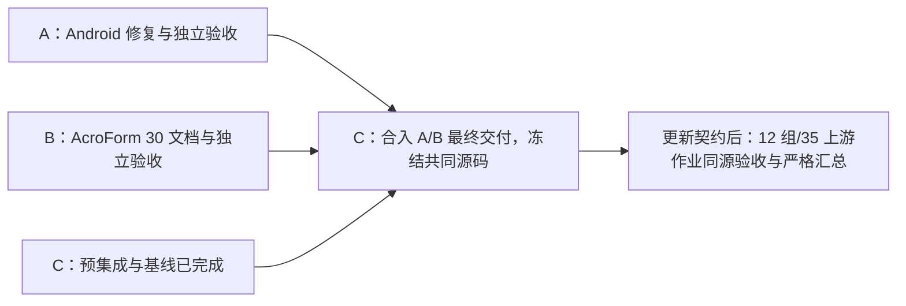

# 三个可并行执行的交接包

此处为既有 A/B/C 组合交付的收口契约。下一核心版本改用 [六个工作包](../CORE-ROADMAP.md)；
B 属于可选 PDF 编辑验收，未来只读核心发布不等待全部扩展。现有组合门禁保持完整。

当前 [A/B/C 联合验收](2026-10-22-ABC-accepted.md) 已通过：S=`686ce2fe`，12 组/35 上游作业及严格汇总成功。
下文保留分工与交接范围；R1–R6 尚未启动。

把 A、B、C 分别交给三个 AI。每份文件包含独立执行所需的基线、工作树、文件范围、出口和交付格式。
本次只编制交接文件，未启动代理或恢复先前限时轮次。

| 包 | 文件 | 主要职责 | 可以何时开始 |
| --- | --- | --- | --- |
| A | [Android 修复](2026-10-22-A-android.md) | 独立通过，交付 `31b36f30` | 已在 S 完成联合复验 |
| B | [AcroForm 独立文档验收](2026-10-22-B-acroform-corpus.md) | 75 文件出口通过，交付 `97e33452` | 已在 S 完成联合复验 |
| C | [SDK 集成与联合验收](2026-10-22-C-integration.md) | 阶段一至四完成，交付 `1480b03` | S 的 12 组/35 作业及严格汇总通过 |

A 只写 Android 分支，B 只写 AcroForm 分支，C 只写集成分支。C 不得进入 A/B 工作树修改文件。
三者都可编写自己的测试与专用工作流；执行均在 GitHub Actions，不能在用户电脑跑测试。
发现跨包依赖时在交付说明登记，由集成负责人处理，不直接覆盖其他包。

建议分档：A/B 的明确实现用 Medium，生命周期、PDF 语义和独立审查用 High；C 的关键集成判断用 High，
常规文档/证据工作用 Low。这里只记录建议，没有更改模型配置。会话若只有四个并发槽，采用三个子代理加主代理协调。

完整历史：[总 handoff](2026-10-22-after-deadline.md)；历史十五项能力现按 [核心路线](../CORE-ROADMAP.md) 重新筛选。
