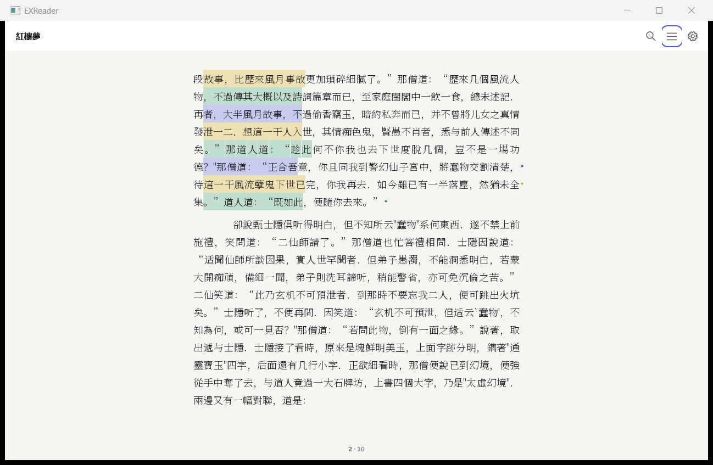
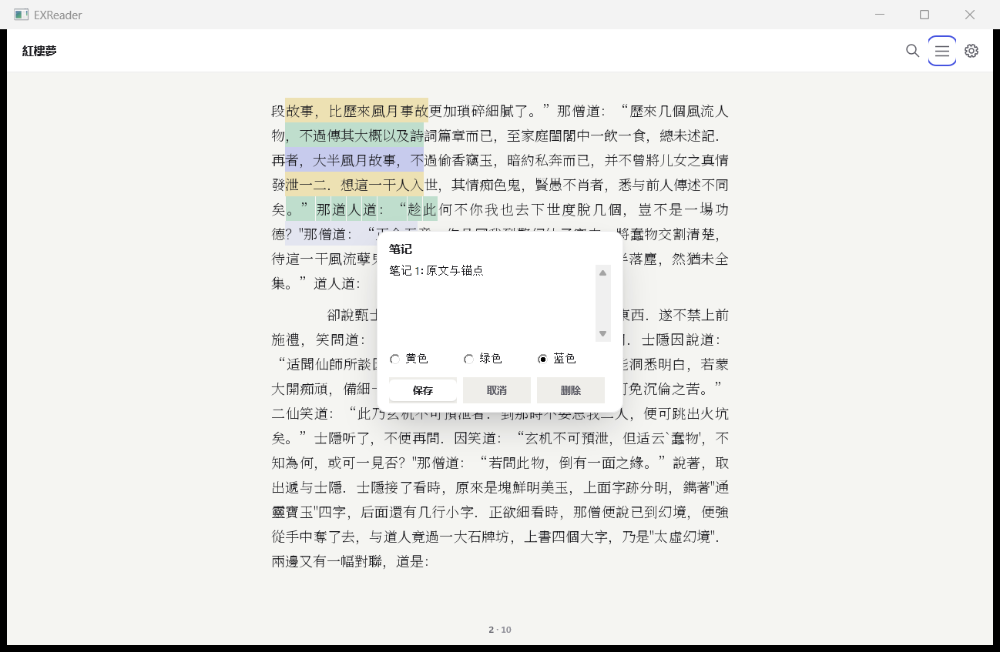
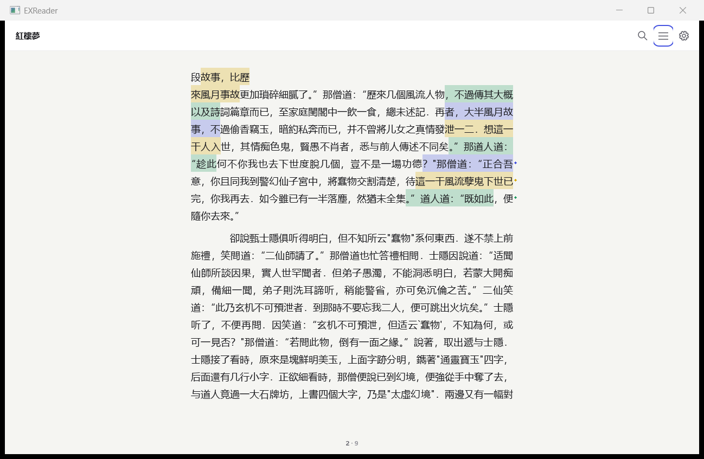
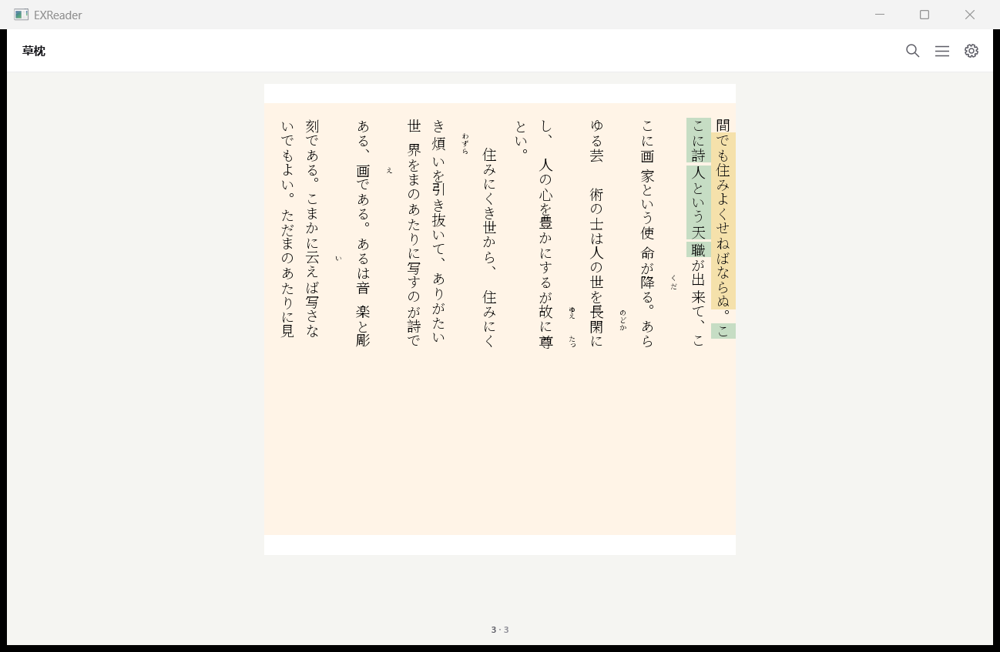
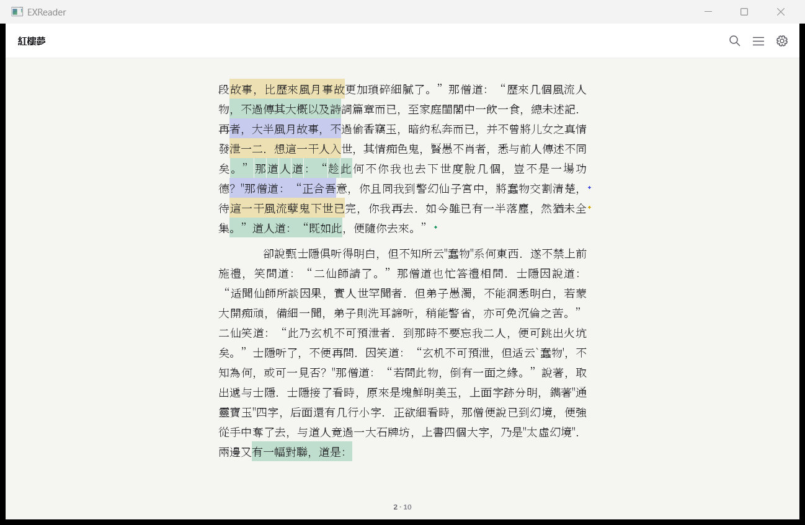
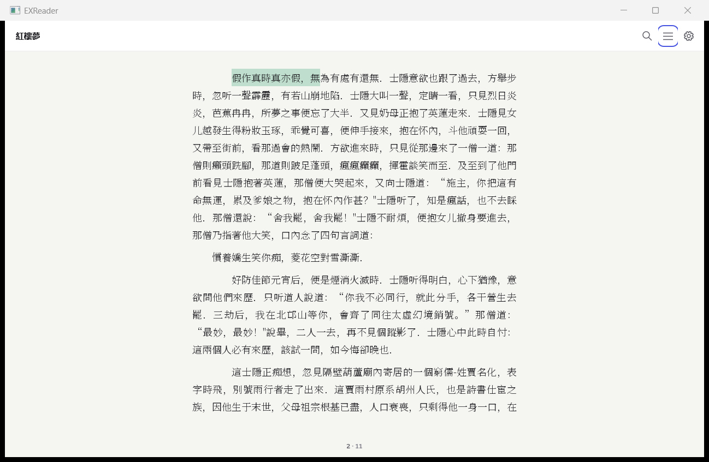

# 标注与笔记宿主 UI 验收（2026-11-08）

A–C 完成；可选 D 侧栏未实现。改动限于 `examples/`、`docs/ui/` 和 `ANNOT-OUT.txt`，引擎及 `.github/` 未改。

## 实现

- **A 高亮**：右键黄/绿/蓝三项，`Ctrl+H` 加黄色高亮；点击高亮选中，`Delete` 或右键删除。新选区及 Esc 清除旧标注选择。共享既有字形簇并集区域，横排取行带、竖排沿字形 advance；在临时显示 DIB 中先合成高亮纸面，再保留文字覆盖率。SDK 位图、分页和显示缓存不被标注改写。
- **颜色理由**：蓝色继承 accent 色系；新增语义黄 `#d7a900`、绿 `#249b62` 用于区分阅读标注类别，避免把三个类别都画成原交互选区色。深色令牌分别为 `#f1cc54` / `#66c795` / `#7c88ff`；浅/深覆盖率 .26/.28。定义集中在 `shell_tokens.h`。
- **B 笔记**：右键“笔记”或 `Ctrl+N` 打开原生多行 EDIT。内容面宽 320 DIP、surface 底、shadow-lg、圆角 14 DIP，按 DPI 缩放。保存、取消、删除、三色选择；`Ctrl+Enter` 保存，Esc 取消。笔记末端所在行的行尾有 6 DIP 圆点（竖排是列尾），点击打开编辑。原生按钮与 EDIT 保留 Tab 导航及控件名称。输入上限 8192 UTF-16 单元。
- **C 存储**：原始书籍字节的 SHA-256 为书 id；默认 `%APPDATA%\EXReader\annotations\<sha256>.json`，宿主可通过 `EXREADER_ANNOTATIONS_DIR` 指定目录。利用现有严格 JSON 解析器；完整保存 `exr_content_anchor`，没有页码或持久化 part 序号。写入临时文件、FlushFileBuffers、原子替换；失败回滚内存。格式损坏、版本不支持或身份不符时保留原文件并阻止覆盖，提示错误。

主要入口：`shell_annotations.inc`（UI/存储）、`shell_selection.inc`（菜单/绘制）、`shell_d2d.cpp`（弹层）。自检注册复用 `selection_tests.cmake`，加入 annotations 一组。同步整理搜索 include 的三处缩进并调用既有退出清理，以通过严格编译。

## 九项验收

| # | 验收 | 最终数字 |
|---|---|---|
| 1 | 紅樓夢 5 高亮 + 3 笔记，退出并重开 | **8/8**，两个端点的 part/UTF-8 偏移全部相等，8/8 均有可见字形区域。创建/恢复截图全窗口 RGB 差异 **0 像素**。 |
| 2 | 18→24→18 | **8/8、8/8、8/8**；每阶段解析 FOUND、两端点相等、可见区域非空。 |
| 3 | Noto Serif SC→Microsoft YaHei→Noto Serif SC | **8/8、8/8、8/8**，同一进程实际替换字体并重建 pager。衬线/无衬线截图差异 **167,059 像素**。 |
| 4 | 跨两页高亮 | 两个视图均显示 **2/2**；点击区域选中后删除，两侧都恢复至 8 条记录 **2/2**，两侧删除后截图留存。 |
| 5 | 草枕正文 vertical-rl | **2/2** 正确；关闭并重开后 **2/2** 端点相同。两条范围含竖排列间延续，截图已检查。 |
| 6 | JSON | **8 条**，纯高亮 **5**、笔记 **3**；完整端点序列化，页码字段 **0**；改路径、另建书库仍 **8/8**，相同 SHA-256。 |
| 7 | 19 本真书回归 | **19/19，共 11,484 页**；页数变化 **0**、字形数变化 **0**、逐页 SHA-256 变化 **0**。 |
| 8 | ctest / 原宿主自检 | **211/211**（205 引擎 + 6 宿主组），**26/26**；严格 `-Wall -Wextra -Werror` 宿主编译通过。 |
| 9 | 截图 | 三色、笔记框、3 个笔记标记、重开恢复、字号、字体、跨页前后、竖排及竖排恢复共 **13 张**，全部通过 `ops/capture_window.py` 抓取并检查。 |

`ctest.txt`：最终 26.47s。新增宿主组还检查：8 条往返、Unicode/引号/反斜线转义、保存/删除失败回滚 **2/2**、横竖排原 SDK 位图不变、编辑/删除、损坏/未知版本/NUL 拒绝，以及新键盘选区清除旧标注选择。

验收中的首轮 `Reader.otf` 经 name 表核对实际为 Noto Sans CJK SC；本目录最终证据已全部替换为 **Noto Serif SC** 完整重跑结果，`startup-font.txt` 记录启动字体。自检使用生成的两页以上 EPUB 与四页 PDF，结果在 `selftest.json`。

## JSON 格式

以下是实际存储文件的字段片段；两个 endpoint 的完整上下文见 [sample.json](evidence/annotations/sample.json)。

```json
{
  "color": 2,
  "created_ms": 1794135596608,
  "updated_ms": 1794135607579,
  "text": "编辑后的笔记 😀",
  "anchor": {
    "start": {
      "part_id": "pg-header",
      "part_path": "OEBPS/2878037014660817796_24264-0-0.txt.html",
      "text_revision": "9ebbe1d40adc30cb",
      "text_size": 85273,
      "selector": {
        "start": 11445,
        "end": 11445,
        "exact": ""
      }
    },
    "end": {
      "part_id": "pg-header",
      "part_path": "OEBPS/2878037014660817796_24264-0-0.txt.html",
      "text_revision": "9ebbe1d40adc30cb",
      "text_size": 85273,
      "selector": {
        "start": 11473,
        "end": 11473,
        "exact": ""
      }
    }
  }
}
```

`anchor.start/end` 是引擎 `exr_content_anchor` 的两个端点，合成半开范围 `[start,end)`。每个端点：

| 字段 | 含义 |
|---|---|
| part_id / part_path | publication 中稳定的内容单元 id 和包内路径；不是书籍的磁盘路径。 |
| text_revision / text_size | 引擎生成的规范化文本 FNV-1a 64 位修订指纹及 UTF-8 字节数。revision 用 16 位十六进制字符串保存，避免 JSON 数值精度损失。 |
| selector.start/end | 此端点在 part 逻辑 UTF-8 文本中的字节偏移；点锚的 start=end。 |
| selector.exact/prefix/suffix/chapter | 引擎原样输出；点锚 exact 为空，前后各 32 Unicode scalars 上下文及可选章节约束供内容变更后定位。 |
| created_ms / updated_ms | UTC Unix 毫秒，创建/最近编辑时间。 |
| color / text | 0 黄、1 绿、2 蓝；空文本为纯高亮。 |

读入后调用 `exr_range_from_anchor`；仅 FOUND 用于绘制，缺失或歧义的记录仍保留，不能用旧偏移冒充定位成功。

## 复跑与证据

```powershell
# SDK 按现有本地依赖配置构建；宿主仍使用任务所给三个编译单元。
$registration = (Resolve-Path examples/windows/selection_tests.cmake).Path
cmake -S . -B out/sdk "-DCMAKE_PROJECT_EXReader_INCLUDE=$registration"
cmake --build out/sdk -j 8
ctest --test-dir out/sdk --output-on-failure -j 6
python -X utf8 docs/ui/acceptance/check_annotations.py out/EXReader.exe C:/Windows/Fonts/NotoSerifSC-VF.ttf out/annotation-new
```

实际 SDK 配置见 [build-config.txt](evidence/annotations/build-config.txt)，编译与二进制哈希见 [metadata.json](evidence/annotations/metadata.json)。验收目录应使用一个新的路径。驱动通过真实 page HWND 发拖选、Ctrl 键与点击，再执行与右键菜单共用的标注命令；笔记内容经原生 EDIT 和保存 handler。`annotgoto` 仅用于确定测试视口，通过既有 JOB_GO 内容锚点导航；`annotfont` 通过 JOB_LAYOUT 实际更换字体。

数字原始证据：[result.json](evidence/annotations/result.json)、各阶段 `*.annotations.json`、`run.drive`、`drive.log` 与 DPI 抓图元数据 `captures.json`。字体及字号阶段同时核对两端点与可见区域，恢复截图逐像素比较；未用页码判定标注原位。

19 书复用 `check_font_manager_host.py`：基线字体桥来自变更前宿主，候选桥来自当前 `check_typography_font.c`，二者链接相同最终 SDK DLL。逐页原始 RGBA8 哈希见 [books-before.json](evidence/annotations/books-before.json) / [books-after.json](evidence/annotations/books-after.json)，差异见 [books-after.diff.json](evidence/annotations/books-after.diff.json)。内容 fingerprint：`dcceb19c8ea43ba4db5ac57a7ea2b3bbbc127a105f3451490f2ffe2eff7f44fa`。原始位图不变另由生产绘制函数的宿主检查验证。








