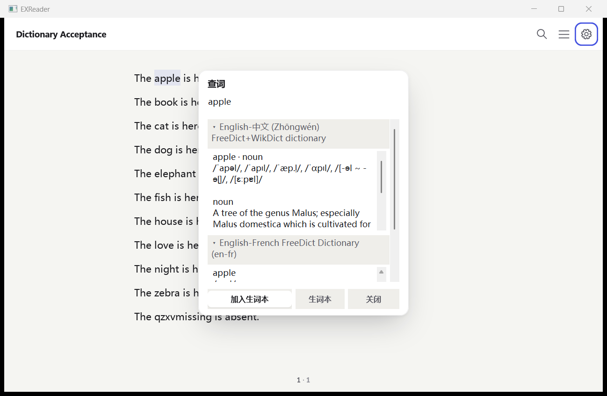
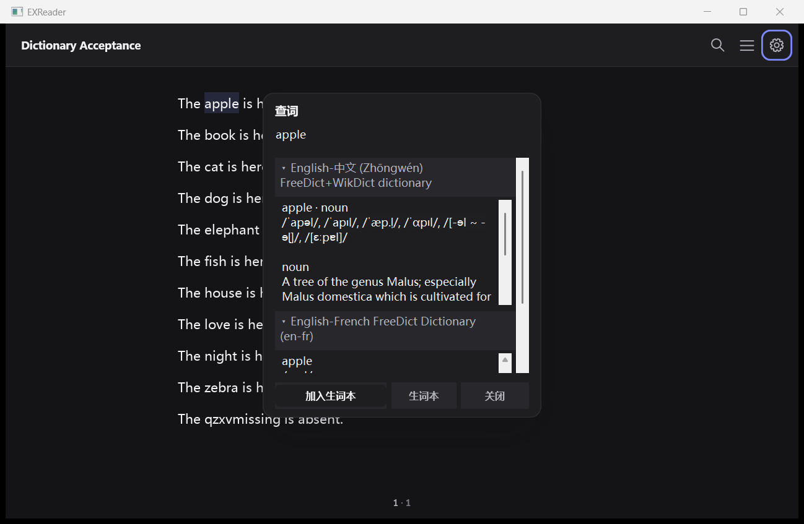
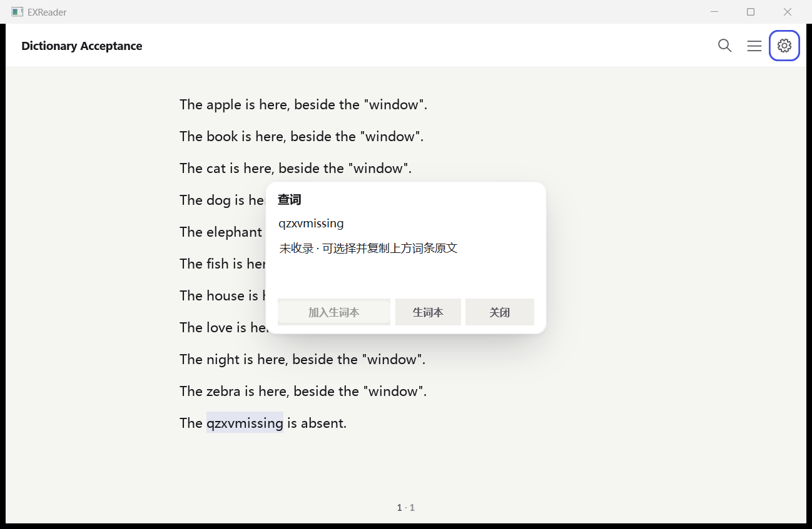
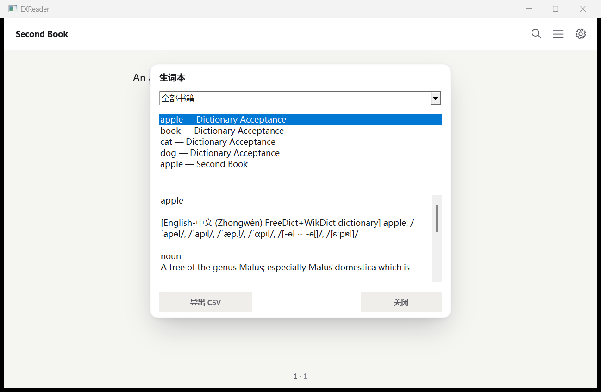
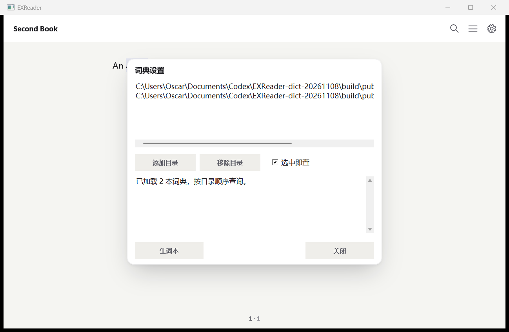

# 词典与划词查询验收（2026-11-08）

A–D 均已实现，包括可选的本地 dictd。基线 `db9bab66`，分支 `codex/dictionary-20261108`。引擎复用现有 miniz 和 Unicode 折叠表；词典数据只留在忽略的 `build/public-dictionaries/`，证据入库包含路径、元数据、校验值及 UI 截图。

## 实现与使用

- **A / StarDict**：`include/exr/dictionary.h` 提供打开、查询、释放和 I/O 统计接口；`src/dictionary.c` 登记在 text 层。支持 2.4.2 / 3.0.0、32/64 位大端 `.idx`、`.idx.gz`、`.dict` / `.dict.dz`、`.syn`。只载入索引和 dictzip RA 块表；释义通过文件偏移读取，跨块词条逐块解压。每本词典按“精确 → 前缀 → 同义词 → Unicode 完整大小写折叠”选择第一个有结果的阶段，再按调用方词典顺序合并。结果含词条、释义、可识别的词性和来源；保留换行、段落、列表、音标，HTML/Pango/XDXF 转纯文本，非文本媒体跳过。
- **B / dictd**：支持本地 `.index` 的 Base64 偏移/长度及 `.dict.dz` / `.dict`，复用同一随机读取和查询路径。词典名取文件基名；不连接 DICT 网络服务器。
- **C / 宿主**：Windows 阅读器现有逻辑选区右键“查词”，或 `Ctrl+D`；设置 →“词典与生词本”可添加/移除目录、启用“选中即查”。目录递归扫描 `.ifo` / `.index`，按添加顺序和目录内路径排序加载。查询卡片宽 **360 DIP**，复用 surface / shadow-lg / **14 DIP** 圆角；每本词典一组，可折叠，释义与分组区域均可滚动。未命中显示“未收录”，原文是可选择复制的只读输入框。`shelf.json` 保留其他字段，存 `dictionary_directories` 和 `dictionary_auto_lookup`。
- **D / 生词本**：结果卡片“加入生词本”保存词、释义摘要、书名、完整范围锚点、UTC 毫秒时间及例句到 `vocab.json`。保存时解析选区锚点并通过 `EXR_RANGE_SENTENCE` 取得所在句子，保留例句快照；列表可按书筛选，导出当前筛选结果为 UTF-8 BOM CSV，包含“词 / 释义摘要 / 书名 / 锚点 / 时间 / 例句”。JSON 使用临时文件、FlushFileBuffers、原子替换，写入失败回滚，损坏文件保留并停止覆盖。

默认数据目录为宿主的 `%APPDATA%\EXReader`。本次 UI 接入的是现有逻辑文本选区；PDF 的固定版式选区没有新增查词入口。普通 gzip 冒充 `.dict.dz` 会明确报缺少 RA 表，不整本展开。每次查询最多 64 本词典、每本最多 256 条；宿主每本取 8 条。读取错误会显示错误内容。

构建接线在根 `CMakeLists.txt` 注册四组引擎测试，`cmake/modules.cmake` 加入公共 API 导出扫描；`.github/` 未改。

## 八项数字验收

| # | 项目 | 结果 |
|---|---|---|
| 1 | 公开 StarDict、元数据、随机访问 | 英汉 **26,660** 条与 `.ifo` 一致；原始英法 dictzip **8,799** 条 / **16** 块，跨字母位置查询 **10/10**，每次只解压 **1** 块 |
| 2 | 查询正确性 | 英汉精确 **30/30**；前缀 **10/10**；大小写 **5/5** |
| 3 | `.syn` | 公开 Wikizionario 原生 **10,698** 条同义词中抽样 **10/10**，不是临时生成别名 |
| 4 | 多词典 | 英汉 + 英法查询 apple，来源及顺序 **2/2**；原生弹窗也核对两个分组 |
| 5 | 选词查词 | 原生 page HWND 双击选词 **10/10**：快捷键 **5**、选中即查 **5**；缺词提示/复制 **1/1**，折叠与展开 **2/2** |
| 6 | 生词本及 CSV | 保存 **5/5**；例句 **5/5**，引号/逗号正确转义；按两书筛选 **4/1**；重启后锚点重新定位 **5/5** |
| 7 | 19 本真书 | **19/19**，共 **11,223 页 / 8,662,455 字形**；页数变化 **0**、字形数变化 **0**、逐页像素 SHA-256 变化 **0** |
| 8 | ctest | **216/216**：引擎 **209**、Windows 宿主 **7**；新增 **5 组**（StarDict、dictzip、异常契约、dictd、宿主词典存储）。宿主通过 `-Wall -Wextra -Werror` 编译 |

完整 ctest 用时 **203.77 s**。最后增加复制/列表截图驱动后重新编译并运行 7 组宿主测试；补上查询输出条数断言后，4 组词典测试和公开语料再次通过。详见 [ctest.txt](evidence/dictionary-20261108/ctest.txt)、[host-ctest.txt](evidence/dictionary-20261108/host-ctest.txt) 和 [dictionary-ctest.txt](evidence/dictionary-20261108/dictionary-ctest.txt)。

公开数据验证由独立 Python 大端索引 / `.syn` 解析器、gzip、HTMLParser 对照引擎完成。释义比对忽略空白与列表符号差异，单元测试另对换行、段落、列表、实体、多字段和音标做精确断言。独立 oracle 全量解压只发生在测试进程；被测引擎通过读取计数证明按块访问。原生驱动使用真实选区事件，比较原生控件中的释义与已验证引擎结果，保存/筛选/导出均调用生产 handler。

## 公开词典元数据

| 字段 | FreeDict 英汉 | FreeDict 英法 | Wikizionario 英意 |
|---|---|---|---|
| version | 3.0.0 | 3.0.0 | 3.0.0 |
| bookname | English-中文 (Zhōngwén) FreeDict+WikDict dictionary | English-French FreeDict Dictionary (en-fr) | Wikizionario Inglese-Italiano |
| wordcount / 实读 `.idx` 条数 | 26660 / 26660 | 8799 / 8799 | 26448 / 26448 |
| idxfilesize（解压后字节） | 464739 | 147368 | 448836 |
| idxoffsetbits | 32（默认） | 32（默认） | 32 |
| sametypesequence | h | h | h |
| synwordcount / 实读 `.syn` 条数 | 0 / 0 | 0 / 0 | 10698 / 10698 |
| 释义未压缩大小 | 8,124,281 B | 904,096 B | 18,188,477 B |
| 数据格式 | `.dict` | `.dict.dz` | `.dict.dz` |
| dictzip 块长 / 块数 | — | 58,315 B / 16 | 58,315 B / 312 |

下载来源：[FreeDict 英汉 2025.11.23](https://download.freedict.org/dictionaries/eng-zho/2025.11.23/freedict-eng-zho-2025.11.23.stardict.tar.xz)、[FreeDict 英法 0.1.6](https://download.freedict.org/dictionaries/eng-fra/0.1.6/freedict-eng-fra-0.1.6.stardict.tar.xz)、[Wikizionario 英意 20261029](https://github.com/xxyzz/wiktionary_stardict/releases/download/20261029/en-it.tar.zst)。许可分别为 CC BY-SA 3.0、GPL 2.0 或后续版本、CC BY-SA 4.0；原始 metadata 和各文件 SHA-256 保存在 [public.json](evidence/dictionary-20261108/public.json)。

格式核对：[StarDict 原始格式说明](https://github.com/huzheng001/stardict-3/blob/master/dict/doc/StarDictFileFormat)、[foliate-js dict.js](https://github.com/johnfactotum/foliate-js/blob/main/dict.js)。

## 随机访问逐词耗时

测试原始 FreeDict 英法 `.dict.dz`，没有重新打包。首次列：每词新进程打开词典后第一次查询，不含加载索引时间；未清 OS 文件缓存。重复列：同一进程打乱顺序查询 100 次，每词 10 次的中位数。引擎没有解压块缓存。时间来自 QueryPerformanceCounter。

| 词 | 未压缩偏移 B | 首次 ms | 重复中位数 ms | 解压块数 | 读取压缩字节 |
|---|---:|---:|---:|---:|---:|
| apple | 93,725 | 0.2789 | 0.21505 | 1 | 8,560 |
| book | 164,788 | 0.3245 | 0.21085 | 1 | 8,562 |
| cat | 195,925 | 0.2975 | 0.21025 | 1 | 8,690 |
| dog | 295,132 | 0.2971 | 0.20820 | 1 | 8,891 |
| elephant | 312,935 | 0.3117 | 0.20835 | 1 | 8,891 |
| fish | 352,435 | 0.3118 | 0.21630 | 1 | 8,564 |
| house | 431,574 | 0.2838 | 0.20925 | 1 | 8,556 |
| love | 502,315 | 0.3008 | 0.23455 | 1 | 8,780 |
| night | 562,018 | 0.2837 | 0.21340 | 1 | 8,728 |
| zebra | 902,706 | 0.1924 | 0.13695 | 1 | 4,342 |

偏移首尾相差 **9.63 倍**，末尾查询时间是首个的 **0.69 倍**，没有随词位置线性增长。每次解压 58,315 B，末块 29,371 B；全书为 904,096 B。单元测试另覆盖跨两块、多块、块边界恰好结束、损坏压缩块及损坏 RA 表。

## 复跑与证据

在现有依赖配置上启用 Windows 测试注册；本次 Release 配置关闭 ICC / AVIF / TIFF / WebP / MP3 / PDF crypto / JNI，其余配置与无修改基线一致。确切开关、依赖路径和二进制/源码哈希见 [metadata.json](evidence/dictionary-20261108/metadata.json) 与 [build-config.txt](evidence/dictionary-20261108/build-config.txt)。

```powershell
$registration = (Resolve-Path examples/windows/selection_tests.cmake).Path
cmake -S . -B build/dict "-DCMAKE_PROJECT_EXReader_INCLUDE=$registration"
cmake --build build/dict -j 6
ctest --test-dir build/dict --output-on-failure -j 4

# 下载并解包上述三本公开词典，文件留在 build/ 下。
$zh = 'build/public-dictionaries/eng-zho/eng-zho/eng-zho.ifo'
$fr = 'build/public-dictionaries/eng-fra/eng-fra/eng-fra.ifo'
$it = 'build/public-dictionaries/en-it/en-it.ifo'
python -X utf8 tests/check_dictionary_public.py build/dict/exreader-dictionary-probe.exe $zh $fr $it build/public-rerun.json
python -X utf8 examples/windows/check_shell_dictionary.py build/host/EXReader.exe C:/Windows/Fonts/msyh.ttc $zh $fr build/ui-rerun

# 在相同布局、字体、源书条件下对比干净基线与候选 DLL。
python tools/regress/run_realbooks.py --manifest tools/regress/corpus.json --dll build/baseline/libexreader.dll --font C:/Windows/Fonts/msyh.ttc --layout tools/regress/layout.json --source-revision db9bab66 --output build/books-before.json --workers 4
python tools/regress/run_realbooks.py --manifest tools/regress/corpus.json --dll build/dict/libexreader.dll --font C:/Windows/Fonts/msyh.ttc --layout tools/regress/layout.json --source-revision dictionary-worktree --output build/books-after.json --baseline build/books-before.json --workers 4
```

UI 验收目录用新的路径，避免旧生词本累计影响计数。公开词典元数据及 30/10/5/10 查询结果校验值在 `public.json`；UI 汇总在 [host.json](evidence/dictionary-20261108/host.json)，每次选区、来源、定义哈希和 CSV 例句核验在 [host-checks.json](evidence/dictionary-20261108/host-checks.json)，操作与日志保存在同目录。19 书逐页元数据保存在 `books-before.json.gz` / `books-after.json.gz`，[books.diff.json](evidence/dictionary-20261108/books.diff.json) 可直接查看全部差异。






