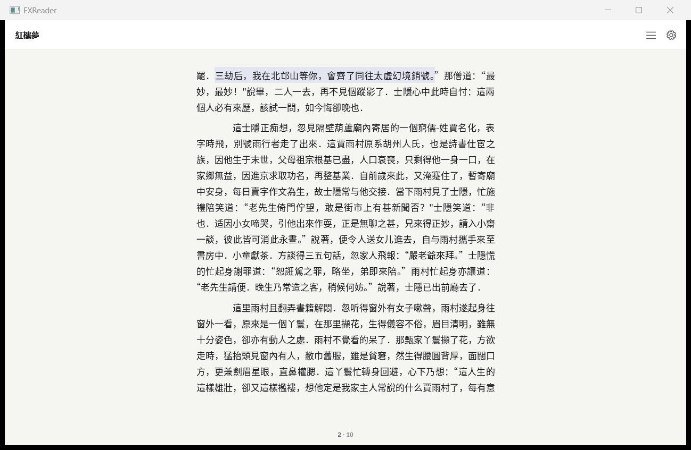
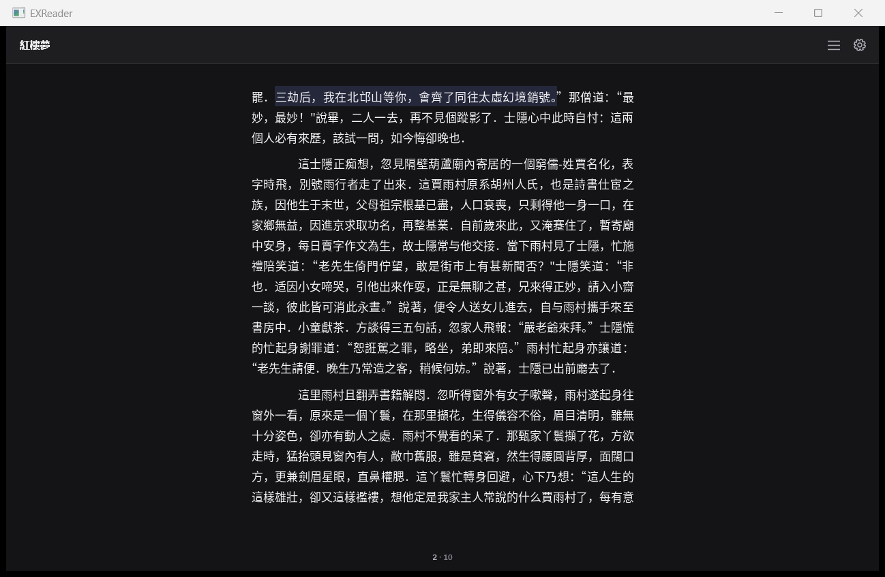
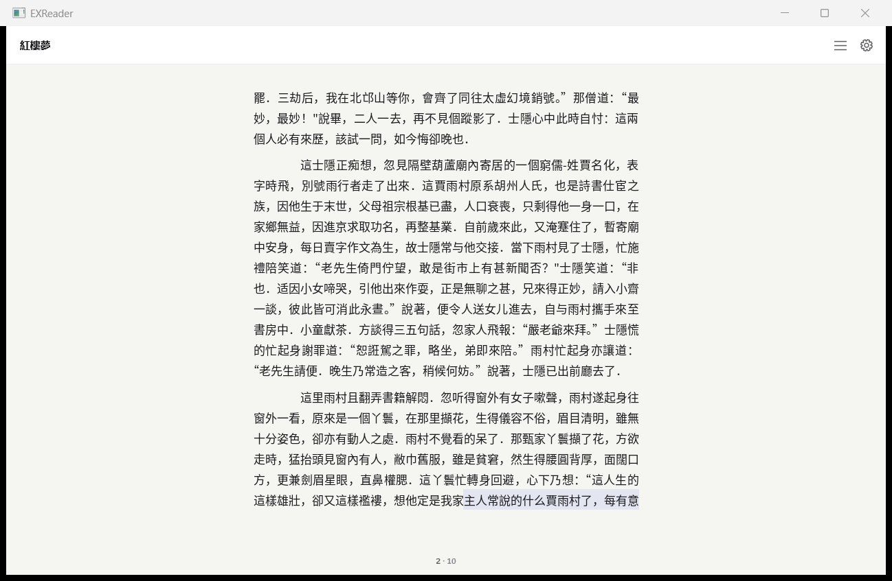
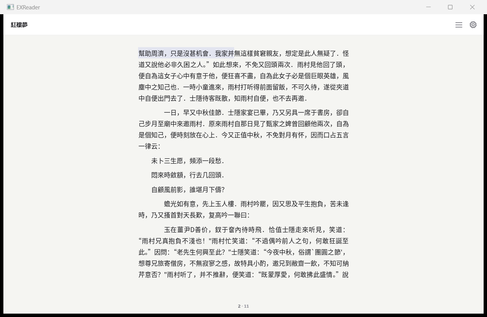
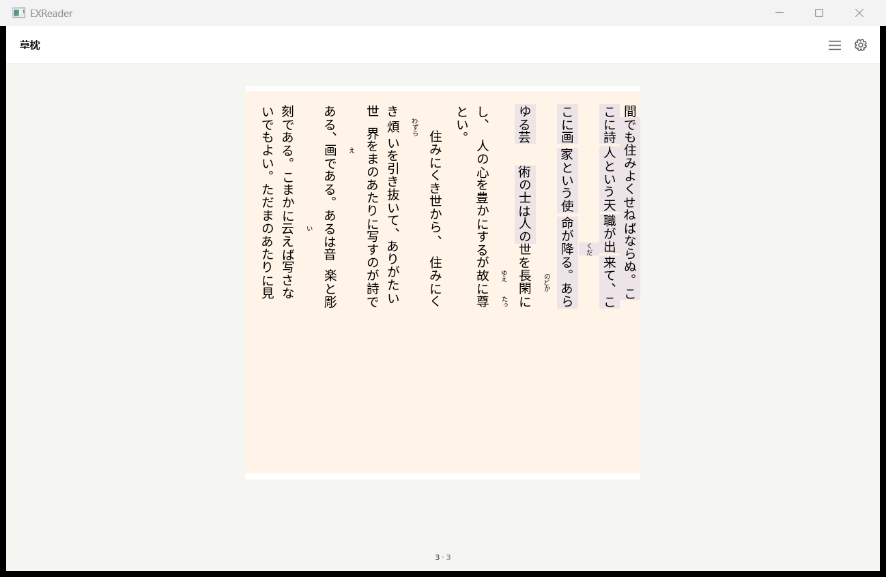
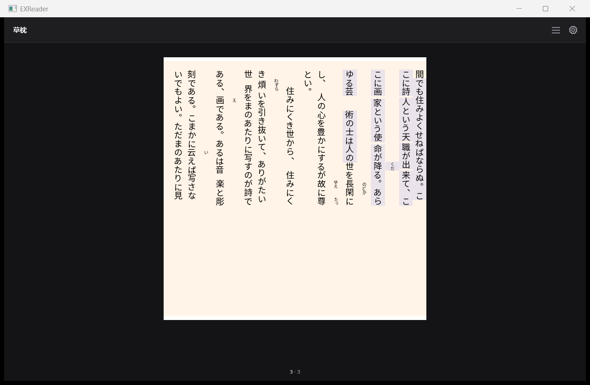

# Windows 宿主：选中与复制验收（2026-11-08）

实现入口：`examples/windows/shell_selection.inc`，由 `examples/reader.c` 的 page HWND 接收事件。引擎 API 与语义未改。

## A–D 实现

- **A 鼠标**：按下保存 `(part, offset)` 和方向；`exr_hit_test` 使用页面局部物理坐标；移动用 `exr_range_expand(WORD)` 向外扩展。抬起通过 `exr_anchor_from_range` 固定范围。双击 WORD，第三击 PARAGRAPH。窗口捕获与 350ms 边缘定时器延续跨页拖选；翻页、页面缓存、几何重排保留内容范围，换书清除。锚点重组视口使用重组后的行/字形坐标命中。
- **B 绘制**：行带内的字形簇矩形先做区域并集，避免重复叠加。横排沿 x，竖排按 `EXR_GLYPH_VERTICAL` 沿 y（列）计算；使用临时 DIB，把纸面覆盖率合成到 accent-soft，保持原 SDK 位图及缓存不变。浅色 `rgba(69,83,224,.10)`，深色 `rgba(124,136,255,.16)`。书内有色纸面保留其自身墨色，修复米色纸面在深色模式出现白色字心的宿主重着色问题。
- **C 复制**：从 publication 加载原逻辑文本，按半开范围复制 UTF-8；跨页不插入字符，跨 part 连续拼接。字形数组不作为文本来源，因此生成的断词 U+2010 和合成块显示内容不进入剪贴板。Windows 使用 `CF_UNICODETEXT`。右键菜单为复制、全选当前章节、禁用的标注；空选区不复制旧标注。
- **D 键盘**：Shift+左右沿横排字素，Shift+上下沿竖排字素；垂直于阅读方向时移动到相邻行/列并保留内联坐标。Ctrl+A 选择当前 part；Esc 清除范围、锚点和拖动。Ctrl+A 的范围对应用户当前阅读单元，也符合宿主按 part 惰性加载的模型，不触发全书解析。

## 九项验收

| 项目 | 最终数字与证据 |
|---|---|
| 1 紅樓夢句子 | **72 UTF-8 字节**，part 1 `[13852,13924)`；原文切片、选区、剪贴板字节完全相同；锚点还原相同。 |
| 2 第 10→11 页 | 当前 part 1 内 page index 9→10，边界 **15756**；范围 `[15711,15801)`，**90 字节**；缺失/新增字节 **0**，页间新增换行 **0**。两页分别抓图。 |
| 3 吸附 | 中文 **5/5**，英文 **5/5**；具体 UTF-8 边界见下表。 |
| 4 双/三击 | 真实 HWND 双击选词 **5/5**；五个不同段落三击 **5/5**；逐字节验证整段，不限于可见页。 |
| 5 草枕 | `vertical-rl`，选区 **165 字节**；高亮改变 **30353 像素**，窗口坐标包围框 `[754,153,938,453]`；浅/深色截图已检查。 |
| 6 生成字符 | 真实 `hyphen-long.epub` 开启 auto：可见页 **4** 个生成断词字形，复制 U+2010 **0**，与原逻辑文本相同；另验证竖排合成 **2** 字形 → **2** 字节 `12`，额外字节 **0**。 |
| 7 键盘 | 紅樓夢 Shift 右/右/左 **3/3**，选区分别 **3/6/3 字节**；Ctrl+A 在第 2/6/10 页 **3/3** 均等于整个当前 part；宿主检查另覆盖上下、Esc、右键菜单项启用状态。 |
| 8 真书回归 | **19/19，11484 页**；页数、字形数、逐页像素 SHA-256 变化全部 **0**，紅樓夢 **1684→1684**。 |
| 9 ctest | **191 基线 + 5 宿主组 = 196/196**，失败 **0**，54.88s。详见 `ctest-final.txt`。 |

浅色纸面选区 RGB 为 **(227,229,240)**，深色为 **(37,39,59)**，符合指定 alpha；句子选区改变 **11785** 个背景像素，原不透明墨色改变 **0**。

## 边界规则与实测

复用引擎 `EXR_RANGE_WORD`：汉字（含扩展区）、全角字符及引擎标点类为单个字素；其他连续非空白、非标点字素为词；空白连续成组。判定复用 `src/publication.c:content_word_class`：先检查 `exr_projection_space`，再检查 ASCII `ispunct`、U+2000–206F/U+3000–303F/全角标点区及 `exr_projection_cjk`，最后归入连续词类。边界按 UTF-8 字节计，结尾不包含在范围内。英文撇号、连字符是独立标点，例如 `can't` → `can` / `'` / `t`，`co-operate` → `co` / `-` / `operate`。组合音标和 emoji ZWJ 保留为完整字素；这不是词典分词。

| 操作 | 预期文本 | `[start,end)` |
|---|---|---|
| 中文拖选 | 三 | `[13852,13855)` |
| 中文拖选 | 劫 | `[13855,13858)` |
| 中文拖选 | 后 | `[13858,13861)` |
| 中文拖选 | 我 | `[13864,13867)` |
| 中文拖选 | 在 | `[13867,13870)` |
| 英文拖选 | Alpha | `[0,5)` |
| 英文拖选 | bravo | `[6,11)` |
| 英文拖选 | reader | `[12,18)` |
| 英文拖选 | selection | `[19,28)` |
| 英文拖选 | English | `[29,36)` |
| 双击 | 三 | `[13852,13855)` |
| 双击 | 劫 | `[13855,13858)` |
| 双击 | 后 | `[13858,13861)` |
| 双击 | 我 | `[13864,13867)` |
| 双击 | 在 | `[13867,13870)` |

三击段落（与源逻辑段落逐字节比较）：

| 例 | 范围 | 字节数 | SHA-256 |
|---|---|---|---|
| 1 | `[0,40)` | 40 | `bf322a1e4c19271cc4309a1433f688dbb10b7a3a65ed8f48897000046a57f59c` |
| 2 | `[762,825)` | 63 | `13fb8d49615c4151989e2cd2cfdb395b657fe70abd84f42941f0e781325deeb8` |
| 3 | `[2264,2645)` | 381 | `fa08dffc13be52cf03789c6e358838dd0e5b525371a6e226216873153d91b4b2` |
| 4 | `[2646,4909)` | 2263 | `2d764a8ca32c20bf6c3bff13a45df68f42ba647d2d046688c07a8721ce630ecb` |
| 5 | `[5594,7847)` | 2253 | `0603569111c41d683434abbcb7cf5de54bd09955534e932306bddc3bb2b361a2` |

## 复制校验方法

原文基准是引擎解析 EPUB 后的逻辑 UTF-8 投影（不是包含标签/实体的 XHTML 源字节）。脚本先加载该 part，独立切出 `[start,end)`；真实鼠标选区复制后，读取 `CF_UNICODETEXT` 并重新编码为无 BOM UTF-8，三方比较长度、全部字节和 SHA-256。跨页预期切片直接横跨逻辑偏移 15756，不按页拼接。

在仓库根目录可直接复核已提交证据：

```python
from pathlib import Path
import hashlib
p = Path('docs/ui/evidence/selection')
for name in ('sentence', 'cross-page'):
    expected = (p / (name + '.expected.utf8')).read_bytes()
    selected = (p / (name + '.utf8')).read_bytes()
    clipboard = (p / (name + '.clipboard.utf8')).read_bytes()
    assert expected == selected == clipboard
    print(name, len(expected), hashlib.sha256(expected).hexdigest())
```

句子 SHA-256：`181733f479cb675c3312f52caba6d5391e7f40fc4e4c545c4fa6940dccd930b6`。跨页 SHA-256：`bc43458239aaa3c9f38bdcfa1f1882247114a4b0a91793a33c991036149e35ea`。

## 可复跑

先按宿主现有构建方式编译当前源代码与同版 SDK；本次 SDK 构建在 `out/sdk`，独立链接所用依赖与配置保存在 evidence 元数据。

```powershell
$registration = (Resolve-Path examples/windows/selection_tests.cmake).Path
cmake -S . -B out/sdk "-DCMAKE_PROJECT_EXReader_INCLUDE=$registration"
cmake --build out/sdk -j 8
ctest --test-dir out/sdk --output-on-failure -j 6
python -X utf8 docs/ui/acceptance/check_selection.py out/EXReader.exe out/Reader.otf out/selection-acceptance
```

宿主测试的注册放在 `examples/windows/selection_tests.cmake`，无需修改引擎测试注册。五组为 boundaries、copy、keyboard、raster、generated。原始库测试 191 项保持不变。真实书籍从 `tools/regress/corpus.json` 读取，英文五例使用脚本生成的原创测试 EPUB。

19 书回归复用 `check_font_manager_host.py`，分别编译基线 HEAD 与当前宿主字体桥并链接同一 SDK；逐页原始 RGBA8 SHA-256、输入书哈希、字号/版心参数存于 `books-before.json` / `books-after.json`，差异见 `books-after.diff.json`。UI 另验证选区绘制不改 SDK 位图；无选区/选区的句子截图用于墨色与背景像素比较。

抓图全部调用仓库 **`ops/capture_window.py`**（PMv2、PrintWindow、物理像素）。`hong-captures.json` / `vertical-captures.json` 记录窗口尺寸和 DPI，`*-run.drive` / `*-drive.log` 记录真实事件。所有书与宿主均在 offscreen 窗口运行。

## 截图







