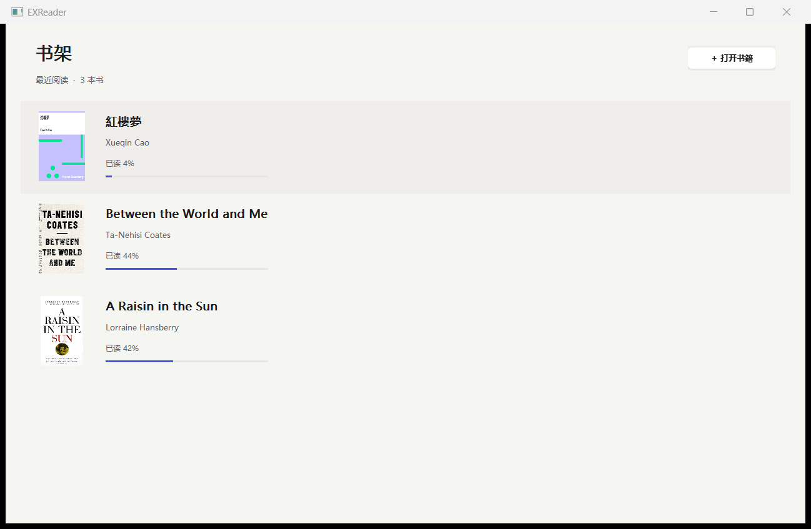
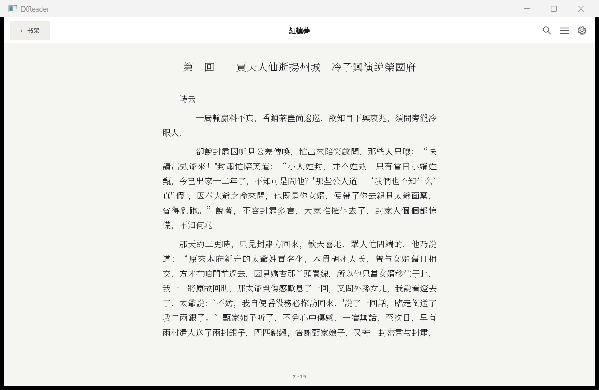
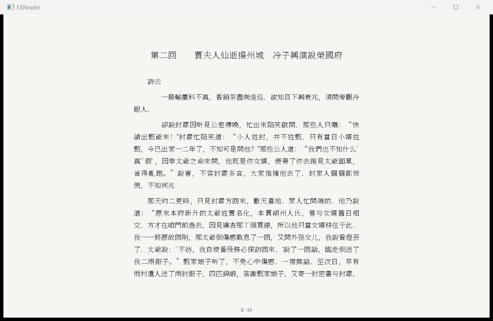
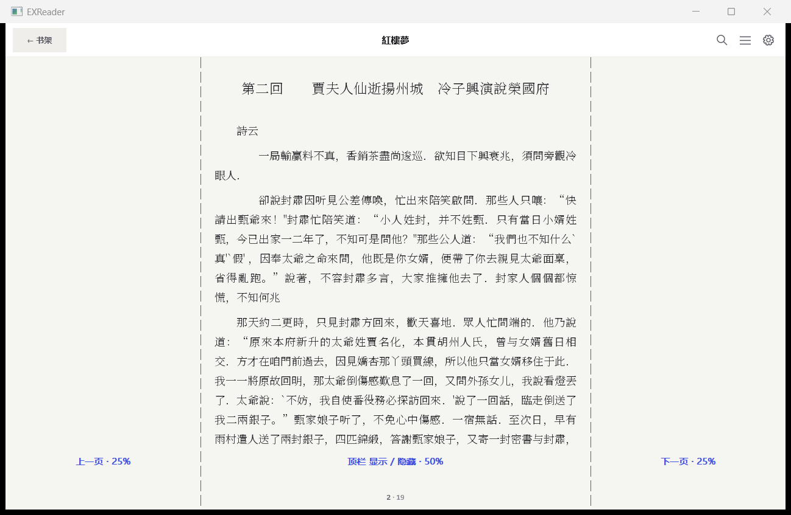

# 书架 ↔ 阅读、点击分区与横滑验收

2026-11-08。宿主 `EXR_READER_WINDOWS_SHELL=1`，基线 `b7bad7f0`。交互与存储改动位于 `examples/`，测试与证据位于 `docs/ui/`；引擎源码、排版配置及 `.github/` 无改动。

## A–D 实现

- **A 书架**：无活动书籍时展示最近阅读列表；单击或 Enter 开书。每行包含原书封面缩略图、书名、作者、进度。阅读顶栏左侧「← 书架」、中间书名、右侧搜索／目录／设置。按钮、无选区时 Esc、Ctrl+W 均返回书架。
- **B 点击**：默认左 25% 上一页、中 50% 切换顶栏、右 25% 下一页；设置提供 20/60/20 和 25/50/25，保存在 `host.ini`。竖排 `vertical-rl` 左／右映射反转。移动超过 4 DIP 后锁定拖动意图，正文上的鼠标拖动进入原有文字选择；长选区不会被认作翻页。快速点击留白产生的 Windows `WM_LBUTTONDBLCLK` 仍按点击处理。
- **C 横滑**：鼠标从留白起拖，或触摸横滑；距离大于 60 DIP 且水平位移大于垂直位移两倍时翻一页。横排左滑下一页、右滑上一页，竖排反转。首末页直接忽略越界滑动，不回弹。顶栏隐藏只改变显示，不调整正文区域，不触发重排。
- **D 退出**：退出书籍先提交可见的笔记编辑草稿，再保存锚点、等待进度保存完成；失败则保留阅读界面。返回书架保留当前会话，再进同书复用帧和分页器；切换其他书后重进则解析持久化锚点。Alt+F4／窗口关闭按钮继续走窗口退出流程。

`recent-books.json` 最多保存 64 本，包含绝对来源路径、标题、作者、封面 SHA-256、最后打开时间、进度及 `exr_content_anchor`。内容身份与位置分别通过已有 API 获取、解析；固定页用提供方的稳定 `fixed_page_id`。JSON 不写页码。写入先刷新临时文件，再原子替换；损坏 JSON 保留原文件并停止覆盖。书籍字节及封面仍由现有 SQLite 书库保存。进度百分比由章节序号与章内文本偏移计算。

跨进程开书时，解析后的锚点继续传给启动阶段的 DPI／窗口重排；避免先打开旧视图再进入阅读界面时退到包含锚点的页首。

## 十项结果

测试脚本直接向真实 EXReader HWND 发送鼠标／键盘消息，由生产事件处理器执行；计数来自每步落定后的状态。滑动计数使用鼠标留白拖动路径。所有截图通过 `ops/capture_window.py` 的 DPI 感知 `PrintWindow` 抓取。

| # | 验收 | 结果 |
|---|---|---|
| 1 | ≥3 本真书书架 | **3/3**：《紅樓夢》《Between the World and Me》《A Raisin in the Sun》，封面、标题、作者及非零进度可见 |
| 2 | 进→退→再进 | **3/3**：按钮、Esc、Ctrl+W 各一次；同书、章节、页内范围、页索引及原始位图 FNV 完全相同，分页器重建次数不增加 |
| 3 | 两档分区各左／右／中 5 次 | **15/15 + 15/15**；另外比例边界覆盖横排及两种竖排 **36/36** |
| 4 | 单击／拖选 | **10/10 + 10/10**；拖选过程中原页范围与位图保持，选区有效 |
| 5 | 左右横滑各 10 次 | **20/20** |
| 6 | 草枕竖排左右映射 | **10/10**；额外竖排横滑 **10/10** |
| 7 | 未保存标注退出落盘 | **1/1**，Ctrl+W 提交草稿后新进程读回；见下方验证方法 |
| 8 | 19 本真书回归 | **19/19，11,484 页**；页数、字形数与逐页 SHA-256 均一致，变化 **0 页** |
| 9 | ctest／宿主自检 | **212/212**（原 211 + 新书架组），**26/26** |
| 10 | 四类截图 | **4/4**：书架、顶栏显示、顶栏隐藏、分区示意；另附竖排截图 |

额外：跨进程恢复 **1/1**（先等待旧视图开书完成，再切入阅读界面）；切换另一本书后重进 **1/1**；退出本书后重新启动显示书架 **1/1**；首末页越界滑动 **6/6** 保持原位；固定页缓存／重启恢复 **2/2**；快速留白点击 **2/2**。

提交前以 `-Wall -Wextra -Werror` 独立重新编译，并完整重跑上述交互、自检与 ctest，全部通过；另从 gzip 原始记录重新逐页核对 19 本书的像素哈希。新构建指纹与复测数字见 [final-audit.json](evidence/shelf/final-audit.json)。

未保存标注验证：在原生笔记 EDIT 输入 `退出前尚未按保存的笔记 😀`，不按「保存」，发送 Ctrl+W；断言书架可见，再打开本书检查标注内容与锚点解析成功。关闭进程后再启动，仍读回同样的笔记。记录见 [notes.json](evidence/shelf/notes.json)，对应脚本在 [scripts/selection.drive](evidence/shelf/scripts/selection.drive) 与 [scripts/note-restart.drive](evidence/shelf/scripts/note-restart.drive)。

JSON 验证还覆盖 Unicode／引号、内容锚点往返、写入失败保留旧文件、损坏 JSON 禁止覆盖。窗口退出沿用 `WM_CLOSE`，不会把 Ctrl+W 映射为关闭应用。

## 截图与原始证据



| 顶栏显示 | 顶栏隐藏 |
|---|---|
|  |  |



[草枕竖排](evidence/shelf/vertical.png) · [交互结果](evidence/shelf/result.json) · [逐步状态](evidence/shelf/states.json) · [构建与文件哈希](evidence/shelf/provenance.json) · [ctest 完整输出](evidence/shelf/ctest.txt) · [自检结果](evidence/shelf/selftest.json) · [19 本对比](evidence/shelf/books.diff.json)

全页哈希分别保存在 [books-before.json.gz](evidence/shelf/books-before.json.gz) 与 [books-after.json.gz](evidence/shelf/books-after.json.gz)。两次使用相同 SDK DLL、字体及布局参数，基线桥从 `b7bad7f0` 的宿主字体入口编译，候选桥使用当前入口；两者内容指纹相同。源码不含排版改动。

## 复现

在仓库根目录运行用户给定的三个编译命令和链接命令。PowerShell 的库目录用独立参数 `-L "$b"`，或直接传入 `"$b/libexreader.dll.a"`。运行目录放置与当前头文件匹配的 `libexreader.dll` 和正文字体。本轮候选 EXE／SDK／字体哈希见 provenance。

```powershell
python -X utf8 docs/ui/acceptance/check_shelf_flow.py out/EXReader.exe out/Reader.otf out/shelf-new-run

# 已配置的当前源码 SDK 构建，加载 examples/windows/selection_tests.cmake
cmake --build out/sdk --target exreader-shell-selection-test
ctest --test-dir out/sdk -j 4 --output-on-failure

python -X utf8 docs/ui/acceptance/check_font_manager_host.py --dll out/libexreader.dll --bridge out/shelf-bridge.dll --font out/Reader.otf --output out/books-after.json --baseline out/books-before.json --workers 3
```

交互脚本使用 `tools/regress/corpus.json` 中已在本地的真书；输出目录应为新目录。宿主 26 项自检沿用打包工具的 `make_epub(..., 3, 16384, single_paragraph=True)` 样本与 `tests/fixtures/pdf-public.pdf`，命令记录于 [selftest-command.json](evidence/shelf/selftest-command.json)。
