# 排版样式扩展 + 弹窗脚注 验收（2026-11-08）

分支 `codex/style-footnotes-20261108`，基于 `b7bad7f0`。

## 实现要点

**A 样式参数**
- 引擎新增 `exr_reader_style` 和 `exr_reader_style_defaults()` / `exr_reader_style_config()`（`include/exr/layout.h`、`src/layout.c`），都是追加的 API；原有 `exr_layout_config`/`exr_layout_options` 的 ABI 和默认值保持不变。
- 参数范围：字号 12–32px，行距 1.2–2.2，段距 0–1.5em，上/右/下/左边距 0–120px，字距 -0.02–0.06em。默认值依次为 18、1.75、0.5em、40/48/40/48、0。超出范围返回 `EXR_ARGUMENT`。
- 四边距是物理边距，作用在内容矩形上：`page.width = W-(left+right)·scale`，`page.height = H-(top+bottom)·scale`。宿主把页面位图贴在 `(left, top)`，命中测试使用同一原点。行距、字距、段距通过 CSS 覆盖实现（`!important`）。
- 宿主设置面板（`shell_settings.inc`）有 8 个字段，每个字段带 −/+ 按钮和原生 EDIT，另有主题、预设下拉框、"保存为预设"和"恢复默认"。任何改动都会立即触发 `shell_request_layout` 重排，不需要重启。
- 预设和当前样式都写在 `shelf.json` 的 `settings.reader_style` 与 `settings.style_presets` 下（`shell_style_store.inc`）。写入时保留无关键，先写临时文件再原子替换。shelf.json 损坏时拒绝覆盖，非法值回退到默认。

**B 弹窗脚注**
- 引擎 `exr_publication_footnotes()`（`src/publication.c`）在首次调用时懒扫描，结果由 publication 持有，不影响阅读顺序、偏移、布局和导航。识别以下几类：
  - `epub:type` 为 footnote / endnote / rearnote；
  - `role` 为 doc-footnote / doc-endnote；
  - 链接到 `#fn*` 的目标。
- 输出两组数据：
  - `exr_footnote{id,label,target_part,target_offset,text}`；
  - 正文引用点 `exr_footnote_reference{part,start,end,footnote}`，`footnote` 字段就是"第 N 条"的下标。引用范围会去掉折叠空白，只覆盖标记本身。
- 宿主（`shell_footnotes.inc`）：点击引用点打开子窗口，复用 `--surface`、`--shadow-lg` 和圆角 14 的绘制。窗口宽度不超过 360px，高度随内容变化，上限为窗口高度的 50%，超出时可滚动。按 Esc 或点击弹窗外部关闭，不翻页。弹窗正文用横排原生 EDIT，竖排书中也保持横排。

**C 交互**
- 标注锚点使用 #74 的 `exr_content_anchor`，样式变化后通过 `exr_range_from_anchor` 重新定位。
- 合成目录页（`exr_toc_pages_create`）和正文在各种极端样式下都能重排且不破版，由引擎测试组 `toc` 覆盖。

## 九项验收

| # | 项目 | 结果 |
|---|---|---|
| 1 | 六项参数各 3 档立即重排 | 8 个字段（字号/行距/段距/上/右/下/左边距/字距）× 3 档 = **24/24** 次，每次 pager 都重建（`builds` 递增），帧有效，无崩溃；−/+ 按钮 2/2；输入 99px 被拒绝。引擎侧 18/18。 |
| 2 | 只改左边距，右边距不变 | 左边距 0/80/120 时，右侧间隙为 **48/48/48**（基线 48），右侧墨迹间隙为 **57/57/57**（基线 57）；左侧间隙为 0/80/120，左侧墨迹间隙为 9/89/129。四条边分别单独改动时，其他三条边间隙都不变（4×3 组）。测量方法见下。 |
| 3 | 预设 2 套 | 保存"护眼大字"和"紧凑"两套；恢复默认后按 A→B→A 切换，每次 8/8 字段完全一致；重启进程后当前样式 A 和预设 B 都恢复（8/8）。 |
| 4 | 脚注识别 | 章末 **10**，书末 **10**（独立的 notes.xhtml，part 2），无脚注 **0**，竖排附加书 10；引用点数与此相同。 |
| 5 | 弹窗 10 个引用点 | 章末书 **10/10**、书末书 **10/10**、竖排书 **10/10** 弹出内容正确（文本与引擎输出逐字节一致，标题为"脚注 [N]"），part/页/range 打开前、打开中、关闭后都没变；每本书 5 次用 Esc 关闭、5 次点外部关闭；弹窗为 360×400（窗口高 800 的 50%）。 |
| 6 | 18→24→18 标注不漂 | 2 个高亮 + 1 条笔记 **3/3** 在每个阶段都 found+visible，逻辑范围完全相同；回到 18 后像素边界与初始完全相同。引擎侧 9/9。 |
| 7 | 19 本真书默认参数不变 | 19/19，11296 页，8648640 字形，页哈希变化 **0**，content_fingerprint `12b3b76f346ea736f218d8eb5e11af33673ceb31993c9c7ced98724e4689e732` 与 HEAD 基线相同（最终 DLL 复跑，差异见 `realbooks-final.diff.json`）。 |
| 8 | ctest | **216/216**：205 基线引擎 + 4 个新引擎组 + 6 个原宿主组 + 1 个新宿主组 `style`。 |
| 9 | 截图 | 见下。 |

**边距测量方法**：`style_dump` 读取 page HWND 客户区和合成后的页面位图，计算四个间隙：
- 左 = `view.dx`；
- 上 = `view.dy`；
- 右 = `page.right − view.dx − 位图宽`；
- 下 = `page.bottom − view.dy − 位图高`，其中包含固定的 40px 页码条。

墨迹间隙从渲染帧中非背景像素的最左列和最右列算出，与位图位置无关，可独立验证。全部数据见 `evidence/style-footnotes/result.json` 的 `edges` 和 `reflow_rows`，测量均在 96 DPI 下进行。

**19 本真书识别（附加）**：Black Boy 45，Pachinko 16，Crying in H Mart 3，I Know Why the Caged Bird Sings 2，其余 EPUB 为 0。两本非 EPUB（PDF/MOBI）不适用。详见 `footnotes-realbooks.json`。

## 截图

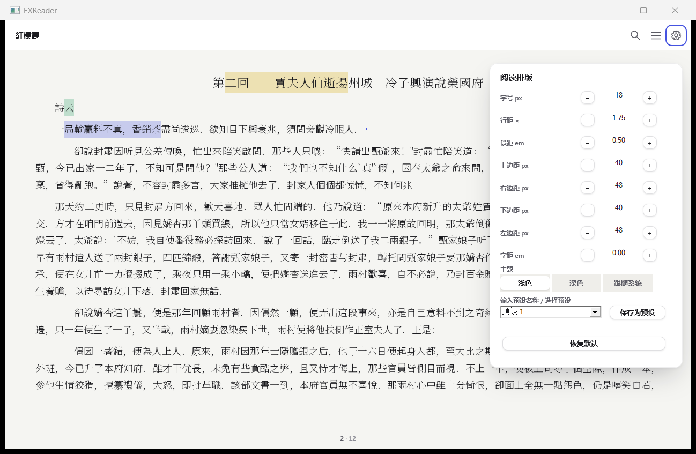
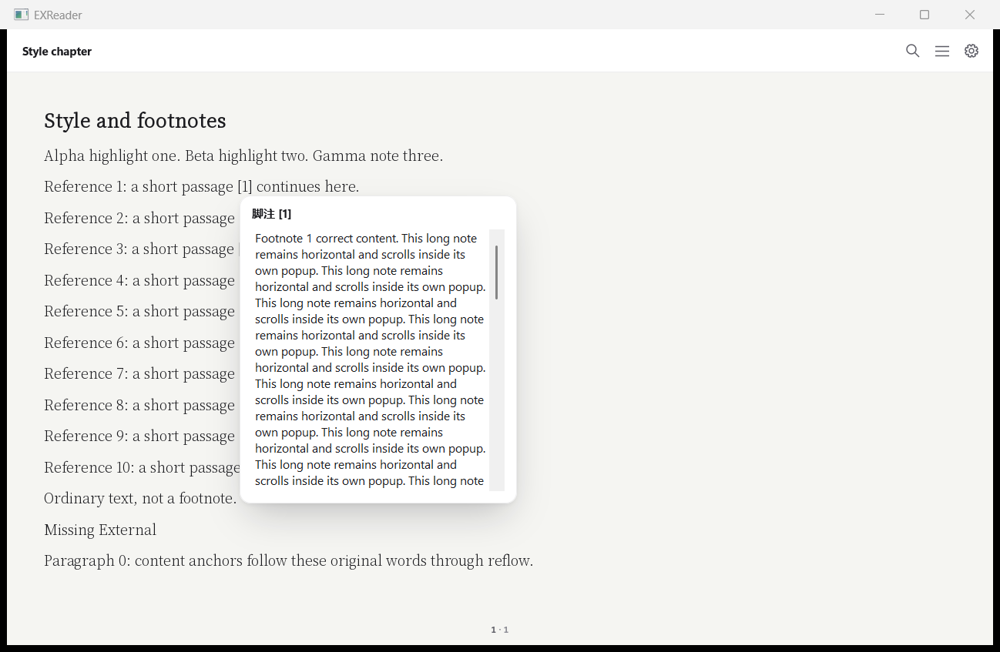
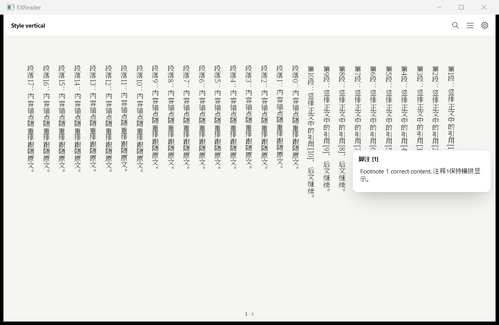
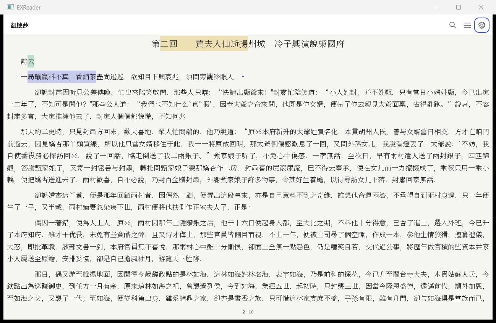
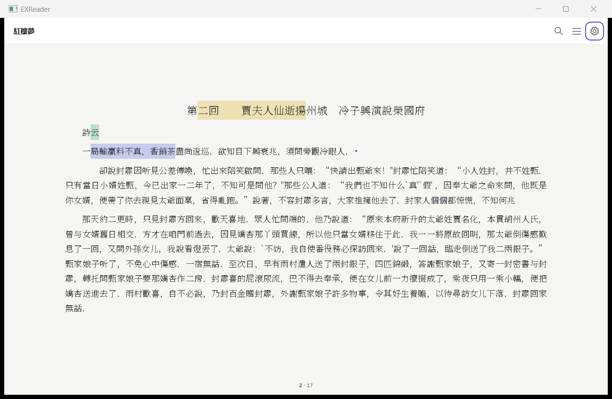
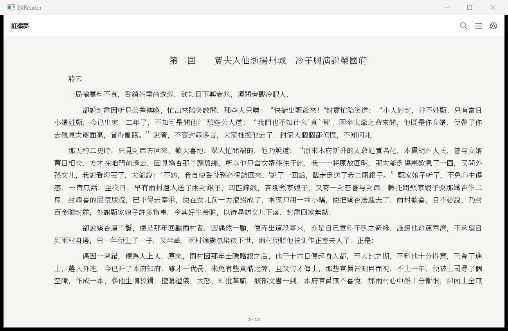
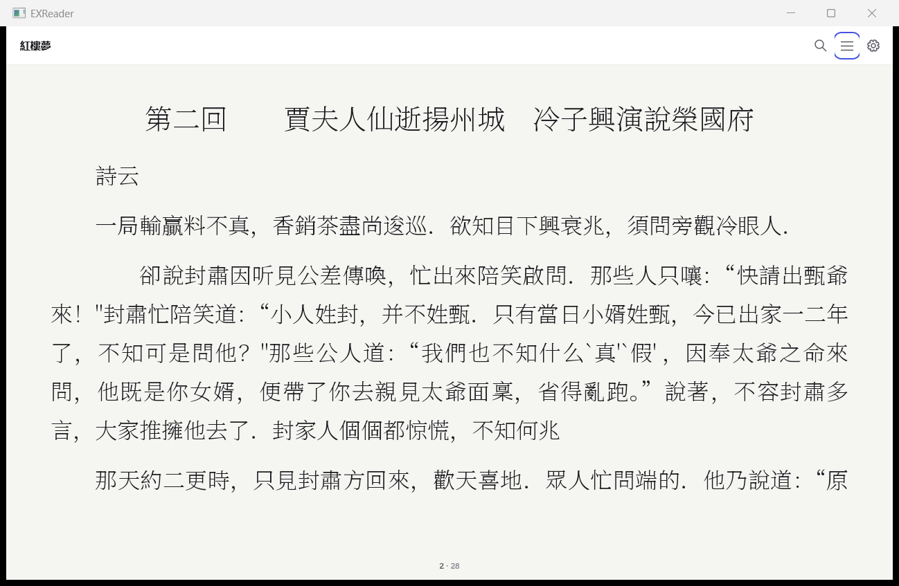
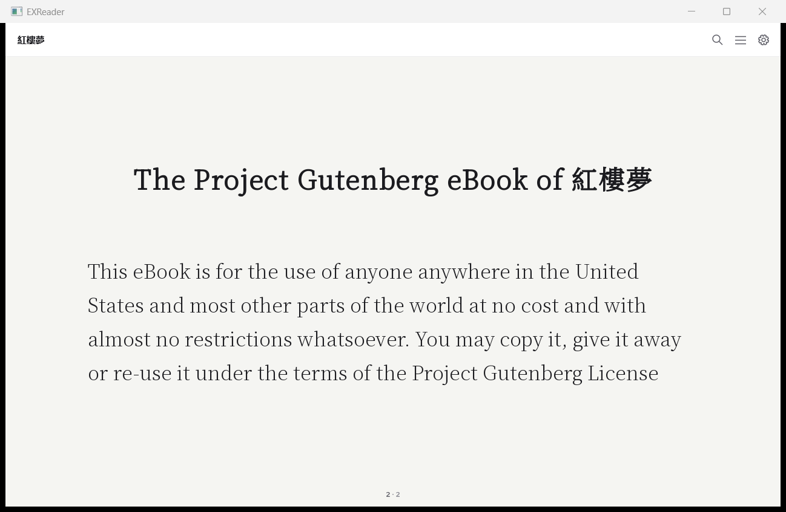
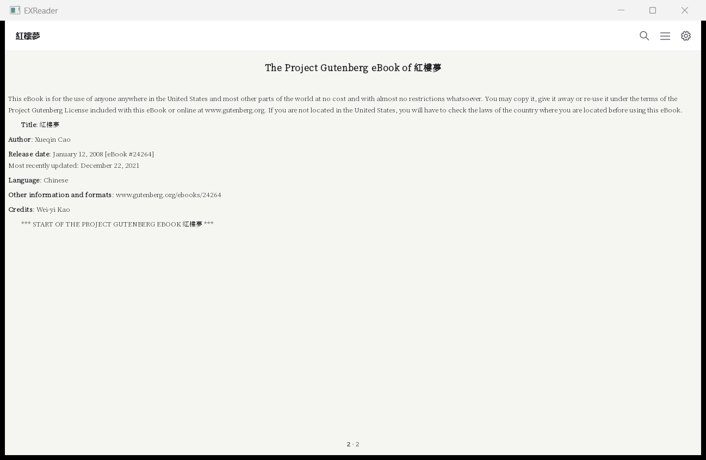
 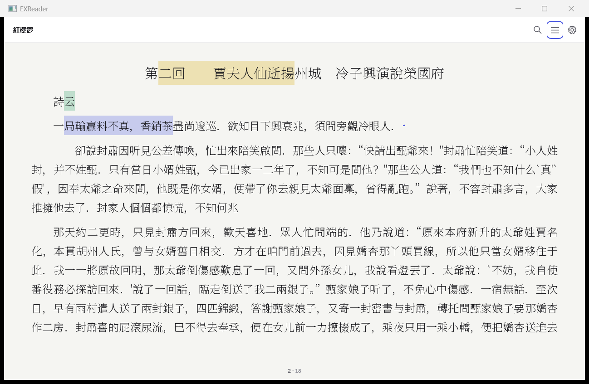 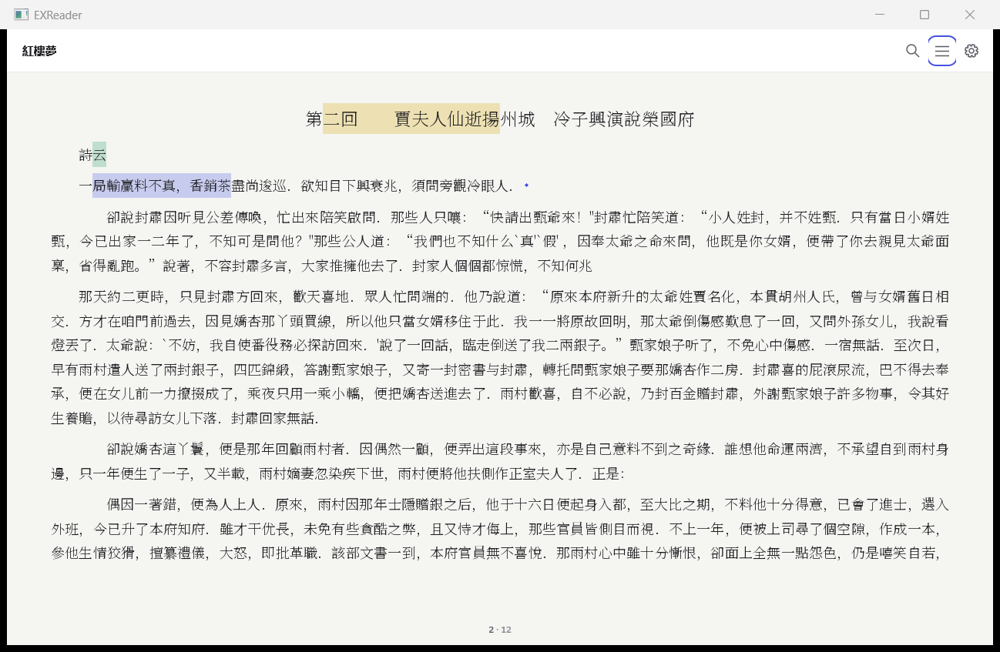

## 已知差异与说明

- **宿主默认外观有意改变**：
  - 字号 17 → 18；
  - 正文不再限制在 34em 宽度内居中，改为物理边距 40/48/40/48；
  - 拉丁正文行距 1.6 和段距 0.8em 统一为 1.75 和 0.5em；
  - 去掉了"首行墨迹对齐"的上移，上边距从内容框顶部起算。

  第 7 项"不变"指的是引擎默认路径，即 `run_realbooks.py` 的逐页哈希。宿主字体桥（`check_typography_font.c`）的像素会随新的默认值变化，这次没有作为不变项复测。
- 宿主没有接入合成目录页，所以"目录页 / 卷首目录页"的重排由引擎测试组 `toc` 验证：7 种样式下 70/70 条目、全部字形都在内容框内。宿主截图里的是紅樓夢的卷首正文页（Gutenberg 版头），不是目录页。
- 受保护树改动：`src`、`include`、`CMakeLists.txt`、`tests/fixtures`。没有新增 `src/*.h`，`tools/layers.json` 无需登记，`.github/` 未改。`docs/validation/sdk-baseline.json` 需要云端运行 ID 才能重新冻结，本 PR 没有改它，做法与此前的引擎 PR 一致。

## 复跑

```powershell
cmake -S . -B build/stylefn "-DCMAKE_PROJECT_EXReader_INCLUDE=$((Resolve-Path examples/windows/selection_tests.cmake).Path)"
cmake --build build/stylefn -j 8; ctest --test-dir build/stylefn -j 6
# 宿主：gcc/g++ -O2 -Wall -Wextra -Werror -DEXR_READER_WINDOWS_SHELL=1 编译 reader.c + shell_d2d.cpp + shell_epub.cpp
python -X utf8 docs/ui/acceptance/check_style_footnotes.py <EXReader.exe> C:/Windows/Fonts/NotoSerifSC-VF.ttf <out>
python -X utf8 docs/ui/acceptance/count_footnotes.py <libexreader.dll> out.json --corpus tools/regress/corpus.json
python tools/regress/run_realbooks.py --manifest tools/regress/corpus.json --dll <dll> --font Reader.otf --layout tools/regress/layout.json --baseline <HEAD baseline> --output <out> --source-revision <rev>
```
