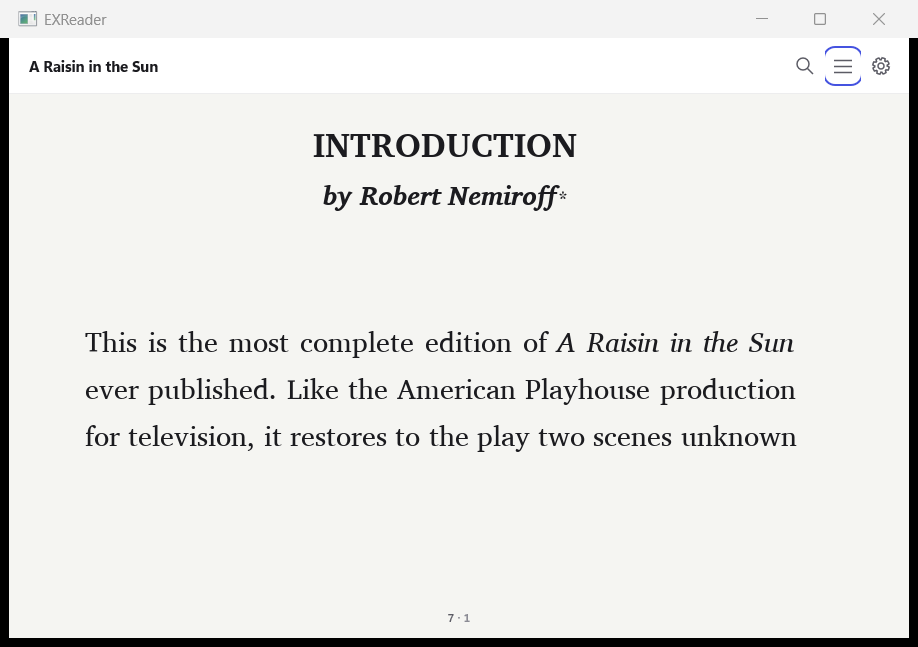
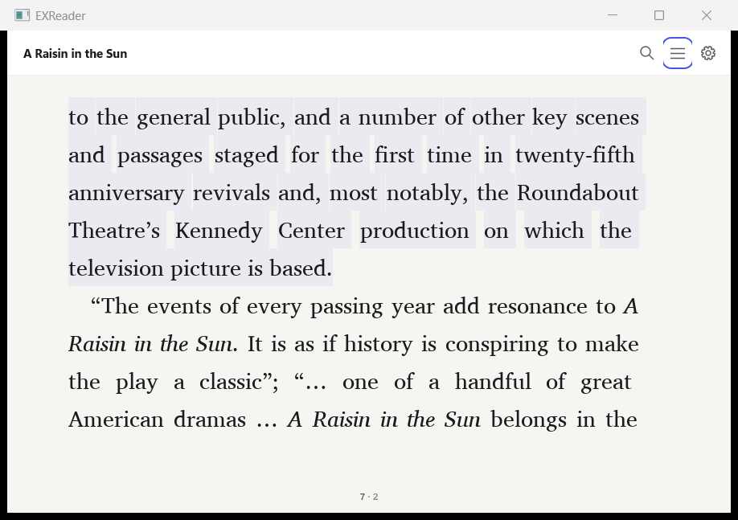

# 朗读：SSML 引擎与 Windows SAPI 宿主

引擎只产生 SSML 和源位置；Windows 参考宿主负责语音设备、控制状态及阅读界面跟随。右键打开「朗读…（音色与语速）」即可从当前页开始。

**A — 引擎。** `exr_document_ssml(publication, cursor, max_chars, &chunk, flags, control, error)` 返回 W3C SSML 1.0、实际 Unicode 字符数、各句源范围及续读游标。`max_chars=0` 表示 800，上限 65536；计数不包含 XML 标记或段落分隔符。句末 `。！？；.!?` 分句，段落用 `<p>` 包围并插入 300ms 停顿。元素 `lang` / `xml:lang` 优先于书籍语言，中文/英文输出 `zh-CN` / `en-US`。默认跳过脚注引用及正文、图片、表格，三个 `EXR_SSML_HINT_*` 位可改为「注。」「图。」「表。」等短提示。输出不包含字体或字号。

初始游标取已有锚点的 `part`、UTF-8 字节 `offset`，令 `node=0`；后续原样传回 `chunk.next`，用 `exr_ssml_chunk_free` 释放结果。`node` 消除同一位置多张零宽图片的歧义。每次只处理一个有正文的线性分册，跳过空/辅助分册，保持源字节范围和 SSML 字节范围对应。

**B — 宿主。** `shell_speech.cpp` 封装 `ISpVoice`、`ISpObjectToken` 枚举、异步 `Speak`、暂停/继续及清队列停止。`shell_tts.inc` 把 SAPI 的 UTF-16 XML 事件位置换回引擎的 UTF-8 源位置，复用已有锚点跳页与选区几何。当前句使用 `--accent-softer` 对应的 `#4553e0 / 6%` 覆盖层，不写入排版或书籍位图。语音流编号隔离停止后到达的旧事件；一块读完后自动提交下一块。面板含四档语速、系统音色下拉及开始/暂停/继续/停止，支持 DPI 和键盘操作。

**C — 边界。** 离开阅读界面、打开另一书籍和关闭窗口时清队列并清除高亮；最小化期间继续语音及位置事件，恢复时跟随。没有系统语音和异步播放失败均显示明确错误。系统音色名称按本机语言读取，并附带可用的英文名。

| 验收项 | 实测结果 |
| --- | --- |
| 1. 紅樓夢五段 SSML | 五个完整原始段落：7,805 / 5,941 / 8,476 / 31 / 5,883 字；XML 5/5 合法，误差均为 **0%**。长段显式设置相应 N。 |
| 2. 连续十块 | 第一回 **7,824 字 = 9×800 + 624**。十次原样续传游标；XML 解码拼接与独立原文逐字相等，重复/遗漏 **0/0**。两侧 SHA-256 均为 `12ed73220b3c864c2a04d5e3ef28a1eb126cbdb323765b47de8bf8c73885d344`。 |
| 3. 状态控制 | 开始/暂停/继续/停止 **各 3/3**，共 **12/12**；核对宿主状态、原生 SAPI 状态与字位置，暂停稳定后位置不动，继续后推进。 |
| 4. 四档语速 | 0.8× → **−2**；1.0× → **0**；1.2× → **2**；1.5× → **4**，均由 `GetRate` 读回确认。 |
| 5. 音色 | **2 个**：Microsoft David Desktop - English (United States)；Microsoft Zira Desktop - English (United States)。两者均实际开始播放。 |
| 6. 跟随 | **30.328 秒**，**77 个**语音事件，自动跳页 **1 次**，章节页 1 → 2；当前源偏移 **443** 落在页面 **[204,677)**。另以 1.5× 播放 45 秒，已自动进入第 **2** 块。 |
| 7. 当前句高亮 | 句子源范围 **[105,449)** 的可见部分高亮；暂停和停止后的同页截图相差 **135,416 像素**，正文位置相同。 |
| 8. 退出及最小化 | 播放中执行退出阅读界面、切书，各 **1/1** 回到 stopped，原生状态 done，句子高亮清空。最小化 **3 秒**，位置 **1180 → 1198**、事件 **4 → 10**，恢复仍在播放。无音色故障注入 **1/1** 显示「没有可用的系统语音」。 |
| 9. 真书排版回归 | **19/19 本，11,296 页，8,648,640 字形**；页数变化 **0**，逐页像素 SHA-256 变化 **0**，书籍源文件变化 **0**。基线 `b7bad7f05cd017de87523ad221d2516ad638259f`，同字体、同布局。 |
| 10. 自动测试 | 完整引擎 **ctest 217/217**，Windows 原有选区回归 **6/6**；新增 **5 组**：结构、分块、跳过内容、参数契约、空/辅助分册。安装 SDK 的独立宿主 CMake 构建通过。 |

SAPI 的速率步长由具体音色引擎决定，四个倍速标签对应上述固定档位；参见 [Microsoft SetRate 文档](https://learn.microsoft.com/en-us/previous-versions/windows/desktop/ms719798%28v%3Dvs.85%29)。暂停在下一个词边界生效，验收留出边界完成时间后检查原生位置，参见 [Microsoft Pause 文档](https://learn.microsoft.com/en-us/previous-versions/windows/desktop/ms719596%28v%3Dvs.85%29)。本机没有中文 SAPI 音色，中文覆盖 SSML 校验，实际发声、跟随和高亮使用英文真书。

以下是五段输出中的一句（外层结构保留，其他句子省略）：

```xml
<speak xmlns="http://www.w3.org/2001/10/synthesis" version="1.0" xml:lang="zh-CN">
  <p><s xml:lang="zh-CN">實愧則有余，悔又無益之大無可如何之日也！</s></p>
  <break time="300ms"/>
</speak>
```

[朗读前](evidence/tts-20261108/follow-before.png) · [30 秒后及当前句高亮](evidence/tts-20261108/follow-after.png) · [停止后同页](evidence/tts-20261108/highlight-cleared.png) · [控制面板](evidence/tts-20261108/controls.png)





数字与原始日志：[引擎](evidence/tts-20261108/engine.json)、[宿主](evidence/tts-20261108/host.json)、[19 本逐书摘要](evidence/tts-20261108/regression.json)、[逐页比较结果](evidence/tts-20261108/regression-diff.json)、[ctest](evidence/tts-20261108/ctest.txt)、[Windows 选区回归](evidence/tts-20261108/windows-selection.txt)、[安装 SDK 的宿主构建](evidence/tts-20261108/package-build.txt)。五个完整 SSML 保存在同目录 `paragraph-1.ssml` 至 `paragraph-5.ssml`。

实际操作记录：[三轮控制](evidence/tts-20261108/controls.txt)、[跟随/最小化/退出](evidence/tts-20261108/follow.txt)、[无音色提示](evidence/tts-20261108/no-voices.txt)。

复现引擎与宿主验收（真书路径来自本机 `tools/regress/corpus.json`，FONT 使用基线的 Reader.otf）：

```powershell
cmake --build build/tts -j 4
ctest --test-dir build/tts --output-on-failure -j 4
python -X utf8 tests/check_ssml_realbook.py build/tts/libexreader.dll docs/ui/evidence/tts-20261108
./docs/ui/acceptance/build_tts_host.ps1
python -X utf8 docs/ui/acceptance/check_tts.py build/tts-host/EXReader.exe FONT build/tts-acceptance
python -X utf8 tools/regress/run_realbooks.py --manifest tools/regress/corpus.json --dll build/tts/libexreader.dll --font FONT --layout tools/regress/layout.json --output build/tts/realbooks.json --baseline build/tts-baseline/realbooks.json --source-revision CANDIDATE --workers 4
```

`check_ssml_realbook.py` 使用 ElementTree 独立解析 SSML，以原始段落切片核对每句的源区间及 Unicode 数量；十块拼接还比较完整字符串和 SHA-256。`check_tts.py` 驱动真实宿主控制路径与真实 SAPI，只有「无音色」分支注入故障；截图由现有 PrintWindow 工具捕获。逐书摘要内的像素汇总哈希是按页顺序以换行连接每页 SHA-256 后再做 SHA-256。
