# Typography rescue — 2026-11-07 continuation

Implementation A–E is present. Manual Windows compilation passed. **Strict acceptance is incomplete:** Sample.epub reflows from 42 to 45 pages, and the provided SDK build passes 166/169 ctests. The PR must remain a draft.

The continuation's measurements, screenshots and hashes live in [`resume/`](resume/). The other files are retained evidence from the interrupted session. `TYPO-OUT3.txt` in the worktree records each completed step and stays outside the commit's allowed paths.

## A–E

| Item | Implementation and result |
| --- | --- |
| A: serif body | `reader.c` searches executable-relative ReaderSerif OTF/TTF/TTC, system then per-user Noto/Source Han Serif, SimSun, then Reader.otf. Each candidate must parse and contain 中. Invalid candidates are skipped. Reader.otf remains the second face for missing glyphs. No absolute font path is embedded. Missing serif produces `字体已回退` in status/debug output and `typography.log`. |
| B: headings | Centre CJK chapter titles and couplets, with no justification or indentation. Centring keeps the two halves of a 回目 together. Strip visible authored heading prefixes in the presentation copy; preserve internal full-em separators. Hide character-based rule rows. |
| C: chapter starts | Recognised 第…回/章/節/卷 blocks get `break-before:page`. Recover paragraphs/headings in hard-wrapped CJK source. Carry trailing chapter headings to the next reading-order spine item when needed, suppressing duplicates. TOC recovery ignores hidden copies. |
| D: indentation | CJK paragraphs get 2em. Authored U+3000 prefixes count toward that width only when the loaded SDK preserves them; a small capability probe handles both SDK behaviours. Source books remain untouched. |
| E: real-book metrics | Noto Serif SC VF defaults to weight 200; set its body weight to 400. Keep the existing 18px nominal size and 1.75 CJK leading after checking the real book: 32px line boxes at 96dpi and 39px at 120dpi; strokes/diacritics do not collide. Paragraph gap remains 0.5em. Headings use 1.25em/1.6 leading. Latin uses the same serif face and existing 1.6 leading. Default title tracking was verified against shaping; body justification remains active. |

Actual default selection: **`C:\Windows\Fonts\NotoSerifSC-VF.ttf`, weight 400**, with Reader.otf as glyph fallback. [`resume/font-chain.json`](resume/font-chain.json) records five passing cases, including invalid earlier candidates and visible sans fallback. The private font-directory overrides are confined to `check_typography_font.c`.

## Seven acceptance checks

| # | Result | Evidence |
| --- | --- | --- |
| 1 | Pass | Real 紅樓夢 body: thin horizontals, heavier verticals, triangular stroke terminals; baseline has nearly uniform stroke widths. Side-by-side below. |
| 2 | Pass | Every adjacent title glyph advance/origin delta matches the selected font's default to **0.000000em**. At native DPI most CJK title advances are 28px (28.125px requested size); at injected 96dpi they are 23px (22.5px requested size), reflecting the SDK's shaping quantisation. See [`resume/title-advances.json`](resume/title-advances.json). |
| 3 | Pass | Footer **7·19 → 7·20** (spine/page, both one-based). The former ends with 下回分解 and leaves 218.25px blank; next has 第二十七回 and 話說林黛玉. A real `next` action produced the second capture. Additional real chapter openings 1, 3, 9 and 53 exercise headings crossing spine boundaries. |
| 4 | Pass | **36px** at 18px/96dpi: first-body-line x=45, continuation x=9. Native 125% display: 45px at 22.5px body size. [`resume/indents.json`](resume/indents.json), screenshot below. |
| 5 | Partial; strict page target fails | Captured all **42 baseline + 45 current** Sample pages. All 42 ordinal body-pixel hashes differ. Wider serif advances wrap the same text earlier; each spine item grows from 14 to 15 pages. Changes in pixels and page breaks are expected after the font change, but the requested 42-page result is not achieved. [`resume/latin-comparison.json`](resume/latin-comparison.json) includes each page's source range, decoded-pixel hash, PNG hash and changed-pixel count, plus all three additional pages. Visually checked 1, 22 and final page in both versions. |
| 6 | Partial; ctest target fails | Fresh self-test **exit 0 / checks=26**. Local ctest **166/169**, exit 8, 216.23s. Failed: native-construct (`test_construct.c:457` text projection), native-text (`test_text.c:614` nonbreaking groups), native-line-boundary (`test_line_boundary.c:439` punctuation advances). These same failures appear in the interrupted session's ctest log; the tests load the supplied SDK and do not link these examples. Fixing those SDK behaviours is outside this task's path boundary. See [`ctest-resume.txt`](ctest-resume.txt), [`resume/selftest/report.json`](resume/selftest/report.json). |
| 7 | Pass | UI captures are under this directory, all made with the owner's DPI-aware `ops/capture_window.py`. Native window captures are 1552×928 at 120dpi. Supplemental 96dpi is an injected layout scale; the physical display remains 120dpi. All driven runs observed zero foreground-window ownership. |

### Real-book before / after

| Before: Noto Sans CJK SC | After: Noto Serif SC, weight 400 |
| --- | --- |
| 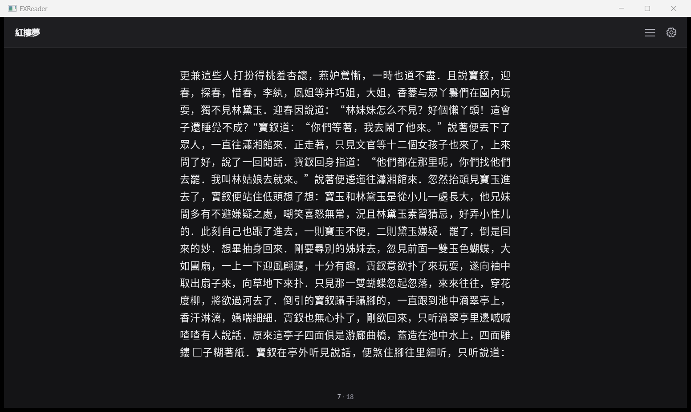 | 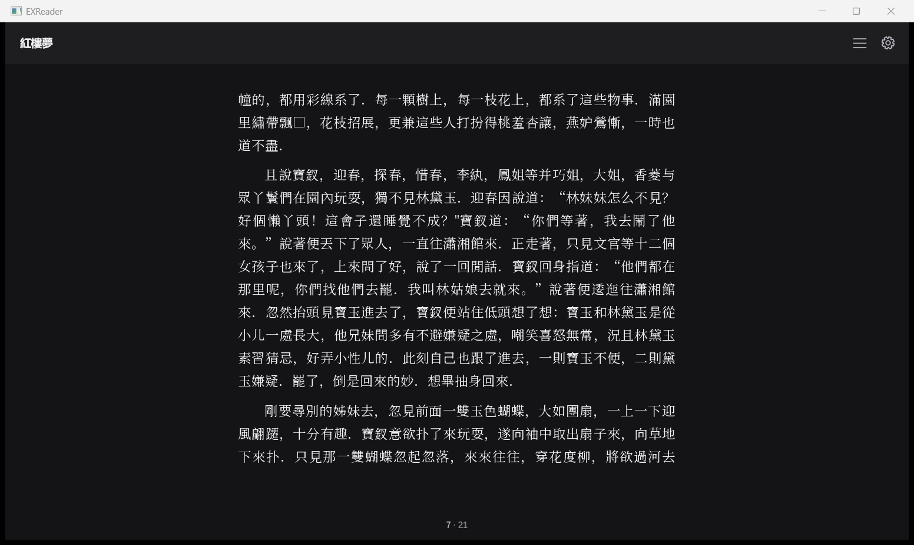 |
| 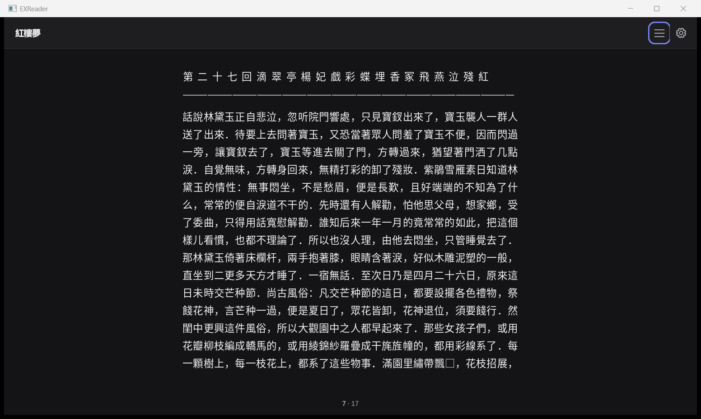 | 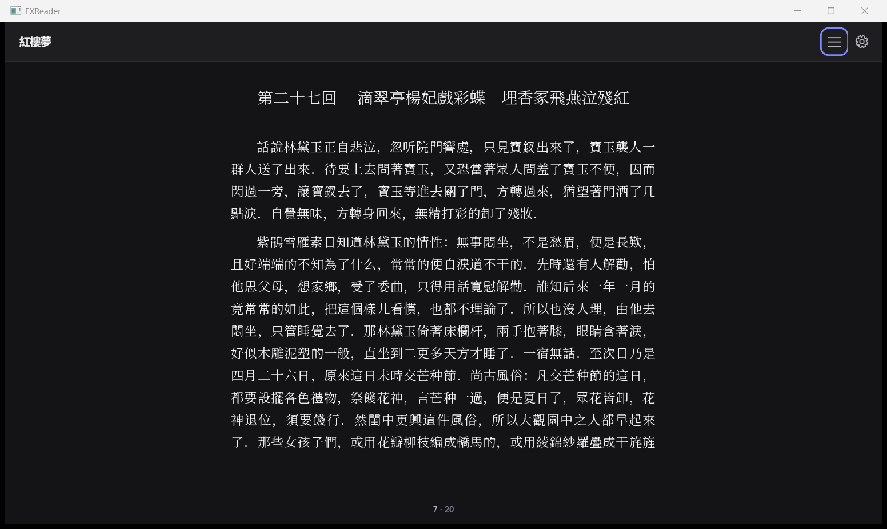 |

### Chapter transition and indentation

| Chapter 26 end — 7·19 | One next action — 7·20 |
| --- | --- |
| 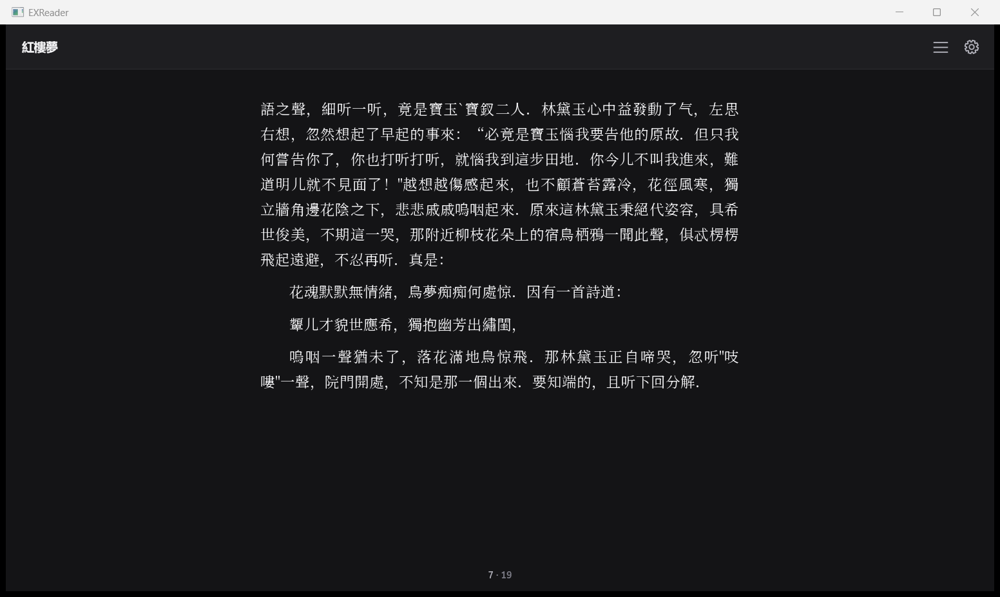 |  |

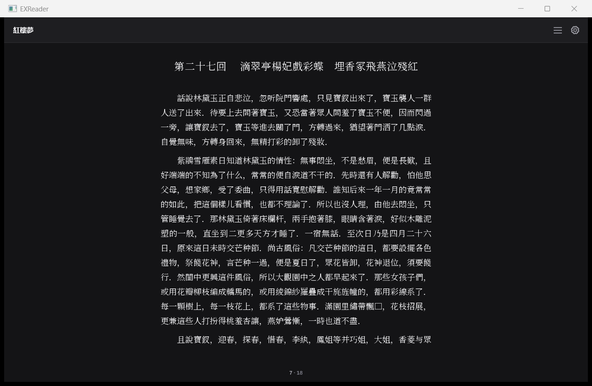

### Latin visual checks

The first and middle pages retain legible baselines and spacing; the last page has the same authored truncated `Eng` ending in both versions. Neither version shows clipped line boxes. Ordinals 22 and final refer to different source offsets after reflow; the comparison JSON supplies those offsets.

| Ordinal | Before | After |
| --- | --- | --- |
| 1 | 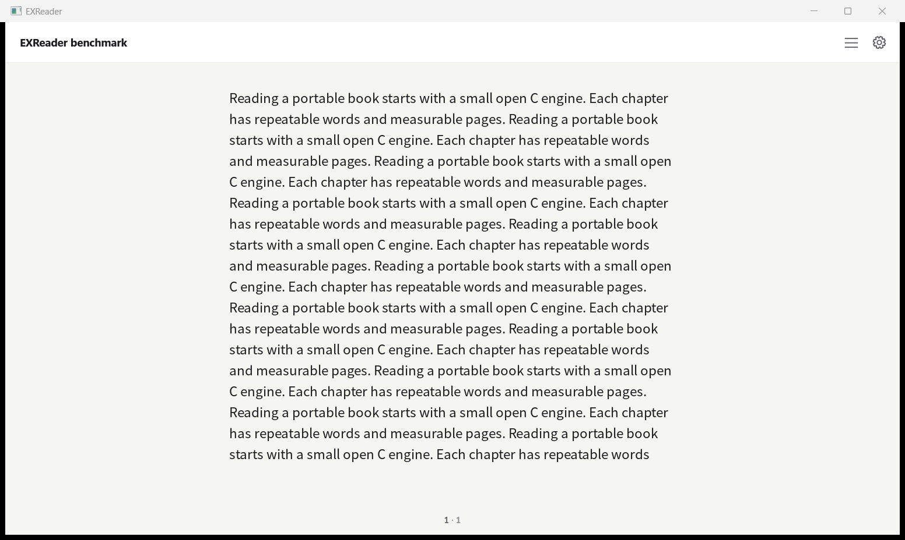 | 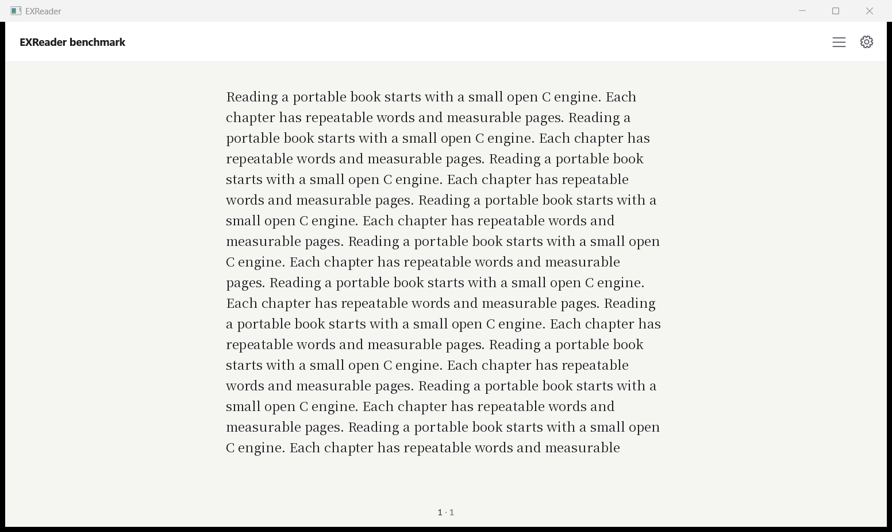 |
| 22 | 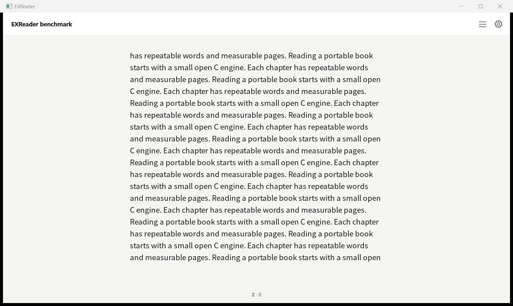 | 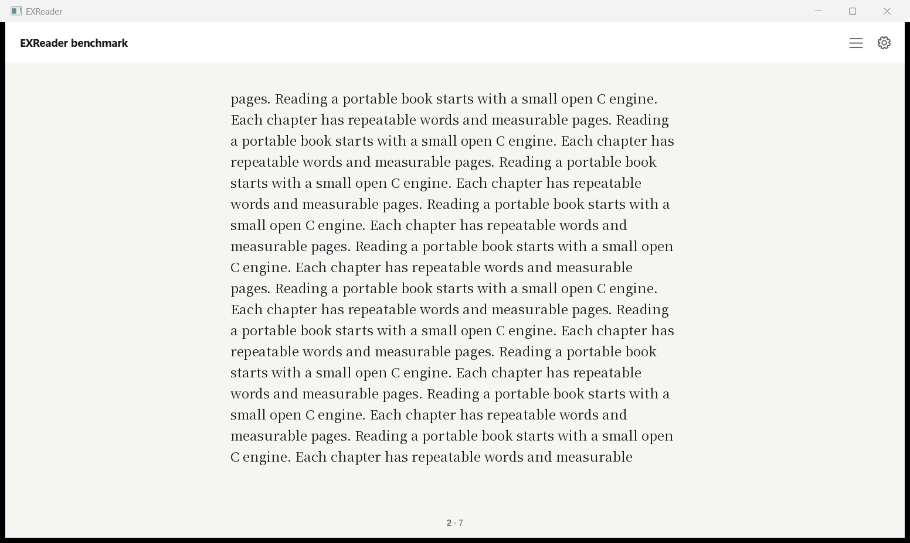 |
| Final (42 / 45) | 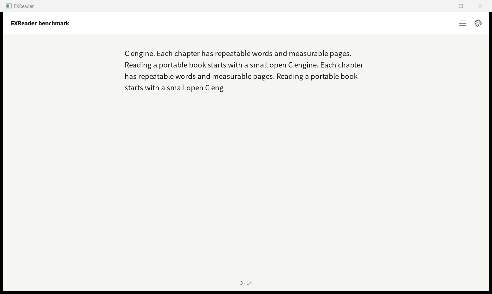 | 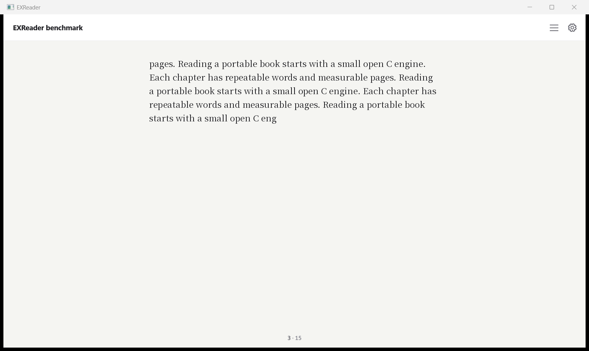 |

## Reproduce

Use the task's supplied dependencies; PowerShell requires the quoted `"-L$b"` argument:

```powershell
$b = 'C:\Users\Oscar\Documents\Codex\cjk-justify-20261106\build'
gcc -O2 -DEXR_READER_WINDOWS_SHELL=1 -I include -I examples\windows -c examples\reader.c -o out\reader.o
g++ -O2 -std=c++17 -I include -I examples\windows -c examples\windows\shell_d2d.cpp -o out\d2d.o
g++ -O2 -std=c++17 -I include -I examples\windows -c examples\windows\shell_epub.cpp -o out\epub.o
g++ out\reader.o out\d2d.o out\epub.o -o out\EXReader.exe "-L$b" -lexreader "$b\_deps\expat-build\libexpat.a" "$b\_deps\miniz-build\libminiz.a" -ld2d1 -ldwrite -lgdi32 -lcomdlg32 -lshell32 -lole32 -loleaut32 -luuid -luiautomationcore -lm
Copy-Item "$b\libexreader.dll" out\libexreader.dll
```

Place the bundled Reader.otf beside the executable. `check_typography.py EXE DRIVE DEST CAPTURE [CHECKPOINT ...]` runs a retained `.drive` file with a fresh profile and calls the specified capture script at named checkpoints. Build `check_typography_font.c` with the same C flags and link it with the shell objects/libraries above as `out/font-test.exe`, then verify the resulting evidence:

```powershell
python -X utf8 docs/ui/acceptance/verify_typography.py docs/ui/evidence/2a-typography/resume out/font-test.exe
ctest --test-dir $b --output-on-failure -j 4
```

The verifier passes the observed 42→45 reflow; it does **not** grant the strict 42-page or 169/169 acceptance targets. Hashes of source, executables, DLL, fonts, original books and capture script are in [`resume/metadata.json`](resume/metadata.json). Profile databases are disposable local caches, excluded from version control.
