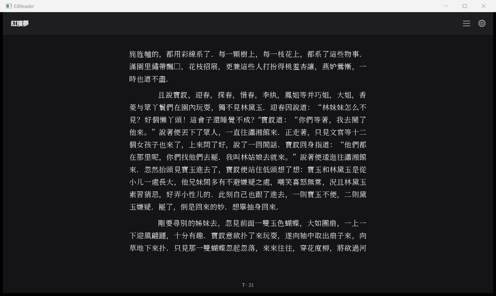
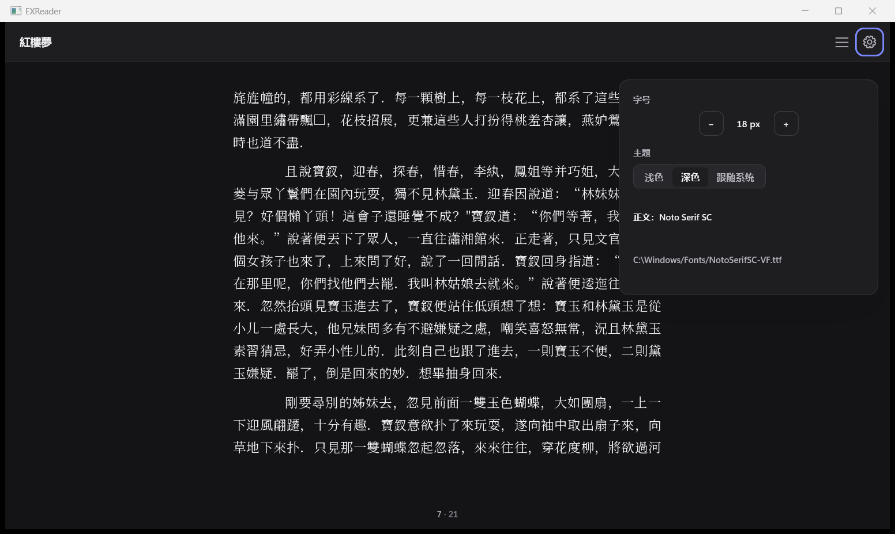
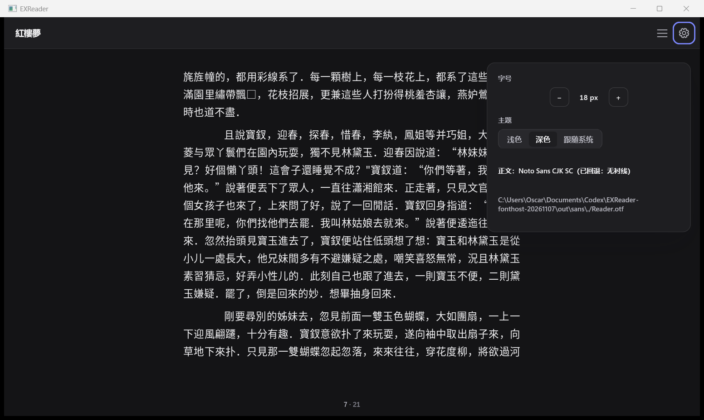

# Windows host font manager — 2026-11-07

The host now creates one SDK font manager before opening any book. The SDK
indexes the executable directory and platform user/system directories, selects
the CJK serif request and creates its fallback font. The host retains #70's
variable body weight 400. The manager and font are freed after layout workers
stop. `--font` also uses the manager; `--font-config` loads its version-1 config.

Settings display the resolved family and actual loaded file. A serif request
resolved to a configured sans family displays **已回退：无衬线**, including when
that family appears in the config's `fallback` sequence. Paths wrap in the panel.
The same information and SDK cache/timing counters are written to `typography.log`.

`shell_epub.cpp` contains presentation processing and no font path lookup; it
needs no source change. The old font-byte reader, filename search/probe loops
and fallback loader were removed from `reader.c`. Its diff deletes **114 lines**:
**96** in the old loader/logging block, **7** in startup path construction and
**11** in the old loading branch. Seven existing misleading-indentation warnings
in `shell_toc.inc` were fixed by splitting statements, allowing strict compilation.

## Six acceptance results

All final evidence below uses the SDK built from this checkout's unchanged
`src/`, `include/` and `tests/` at **3aa9af50**. Baseline and managed hosts load
the identical DLL; its SHA-256 and input/build hashes are in [metadata.json](metadata.json).

| Check | Result | Evidence |
| --- | --- | --- |
| 1. 紅樓夢 and layout | Noto Serif SC VF, **400** weight. Full book **1,684 → 1,684 pages**. DPI-aware body captures **1552×928**, **0 changed pixels**; text, ranges, lines and glyph positions identical. | [comparison](screenshot-comparison.json), [font instance](font-instance.txt), screenshots below |
| 2. Visible resolution/fallback | Normal: **Noto Serif SC**, `C:\Windows/Fonts/NotoSerifSC-VF.ttf`. Isolated Reader.otf: **Noto Sans CJK SC（已回退：无衬线）**, complete file path visible. Both default sans step and explicitly configured sans fallback pass. | [normal font](managed/font.txt), [fallback font](fallback/font.txt), [startup checks](startup/results.json) |
| 3. Cold/hot creation | Cold **138.500 / 111.618 / 119.561 ms**; hot **3.112 / 3.407 / 2.878 ms**. Hot maximum **3.407 ms ≤ 150 ms**. | [six raw runs](startup/results.json), individual `pair-*-cold/hot.txt` |
| 4. 19 real books | **19/19**, **11,484 → 11,484 pages**, **0 changed page hashes**, glyph totals unchanged (**8,648,640**). | [before](books-before.json), [after](books-after.json), [diff](books.diff.json) |
| 5. Delete old lookup | **114 old font lines removed** from `reader.c`; one manager integration in `host_font.inc`, one startup caller. No host filename search chain remains. | `git diff --numstat 3aa9af50 -- examples/reader.c`: **10 added / 114 deleted** |
| 6. Build/tests | MinGW GCC/G++ **16.2.0**, **-Wall -Wextra -Werror** on all three host sources and the console/shared font probe. **ctest 188/188**, **39.58 s**; host self-test **26/26**. | [host build commands](build.txt), [SDK build](sdk-build.txt), [ctest](ctest-current.txt), [self-test](selftest.json) |

Cold means a fresh profile with no SDK font index; hot immediately reuses that
profile's cache. Times are the SDK's `summary.elapsed_ms`, including index I/O.
Each cold run parsed **350 files**; each hot run parsed **0**, restored **350**
and reported `EXR_FONT_CACHE_HIT`. Font construction and book opening occur
after this measurement. No book is opened during the timing runs.

The 19-book check reuses `tools/regress/run_realbooks.py` at its committed
720×1040 layout and RGBA pixel contract. Only its font opener is replaced by a
compiled bridge calling the actual before/after host helper. Each book's source
hash, every page's pixel SHA-256 and geometry, and glyph counts are retained.
Both runs have content fingerprint
`19ac4d53590effd0c7218f5df669b7771c5f1e02e75f6c81597c3f753d9e8a65`.

The baseline bridge was compiled against `reader.c` at 3aa9af50 before editing.
The managed bridge is `examples/windows/check_typography_font.c`, built with
`-shared`; it calls the production helper without copying its selection logic.
Its module-path override points the helper at the tested application's font
directory. Discovery, selection and file loading still run inside the SDK.

## Screenshots

All captures use the supplied DPI-aware `ops/capture_window.py` on the running
host. The retained drive logs report no failed steps; process records report
exit 0 and zero foreground ownership observations.

| Before, original #70 helper | After, SDK manager |
| --- | --- |
|  |  |

| Resolved serif family and file | Sans-only discovery with explicit fallback notice |
| --- | --- |
|  |  |

## Reproduce

Build a current SDK with its shared aggregate library and tests enabled; the
configuration used here is recorded in [sdk-configure.txt](sdk-configure.txt).
Then, from the repository root:

```powershell
docs/ui/acceptance/build_font_manager_host.ps1 -SdkBuild out/sdk -Output out/current
# Place the same licensed Reader.otf beside the executable.
python -X utf8 docs/ui/acceptance/check_font_manager_startup.py out/current/EXReader.exe out/current/Reader.otf out/new-startup
out/current/font-test.exe NotoSerifSC-VF.ttf 0
ctest --test-dir out/sdk --output-on-failure -j 4

python -X utf8 docs/ui/acceptance/check_font_manager_host.py --dll out/before/libexreader.dll --bridge out/before/font_bridge.dll --font out/before/Reader.otf --output out/books-before.json
python -X utf8 docs/ui/acceptance/check_font_manager_host.py --dll out/current/libexreader.dll --bridge out/current/font_bridge.dll --font out/current/Reader.otf --output out/books-after.json --baseline out/books-before.json
```

`check_typography.py` can replay the retained `.drive` files in fresh output
directories. Its `run(..., font_config=...)` argument supplies the isolated
sans-only SDK configuration. The startup checker additionally verifies a
missing required directory exits **2**, and explicit `--font Reader.otf` loads
exactly **one** face. Disposable profile databases, caches and superseded
exploratory runs are excluded from version control.
