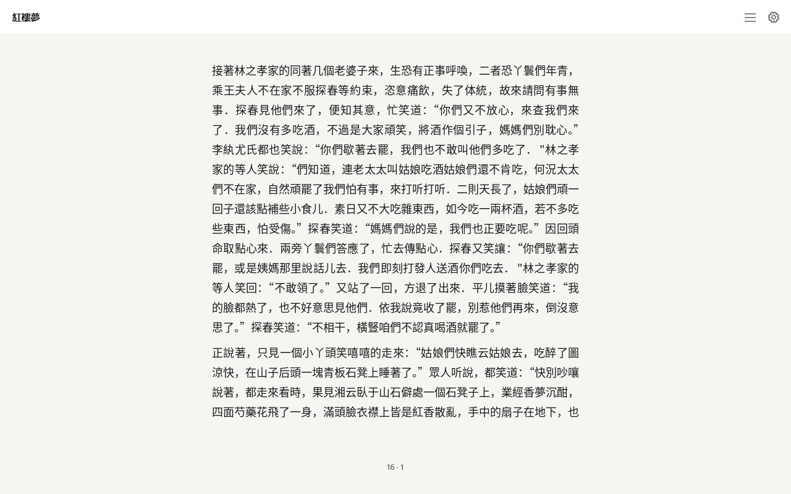

# U+3000／NBSP 空白折叠 — 2026-11-07

基线 `8ee4bd6bef8533b38f5a0b3011343a4311e8efc3`，分支 `codex/cjk-u3000-20261107`。七项本地验收通过。

`src/document.c` 的共用判定现在将 U+3000、U+00A0 与原 ASCII 空白一起折叠，U+3000 移出 CJK 字符集合。连续混合空白只设置一个 pending 标志；遇到下一个字符时，两侧都在既有 CJK／中文标点集合内则删除，否则输出一个 U+0020。块首不生成 pending，块尾清除 pending，首行缩进由 CSS `text-indent` 负责。流式章节索引调用同一个空白函数，保证字节偏移与整文档投影一致。

## 七项验收

| 项目 | 改前 → 改后／结果 |
|---|---|
| 1. 紅樓夢：汉字＋任意空白＋汉字 | **370 → 0** |
| 2. 汉字＋空白＋中文标点；标点＋空白＋汉字 | **0 → 0；1,719 → 0** |
| 3. 全书页数 | **1,077 → 1,073（减少 4 页）** |
| 4. 拉丁 Sample.epub | **42 → 42 页；逐页像素 SHA-256 差异 0/42** |
| 5. 混合用例单测 | 全通过，具体输出见下表 |
| 6. ctest | **169/169，通过；0 失败；37.13 秒** |
| 7. 紅樓夢改后正文截图 | **1280×800**；实际窗口 DPI **120**；已目视检查 |

原包 31 个 HTML/XHTML 内容文件中 U+3000 **4,684** 次、NBSP **128** 次、汉字＋ASCII 空格＋汉字 **5** 处，与实测一致。SDK 正文块投影中 U+3000 **4,660→0**、NBSP **128→0**、U+0020 **4,223→4,240**；正文排除了标题中的 24 个 U+3000。包含标题的全部投影块也得到相同的三类边界统计：**370→0、0→0、1,719→0**。

### 统计口径与命令

统计 [space_probe.c](../cjk-space-collapse-20261106/space_probe.c) 通过公开 SDK API 导出的实际投影，覆盖完整 **31 parts**。每个正文块是一条记录，LF 是块分隔符，不作为正文内空白。计数器使用 `\s+`（包括 U+3000、U+00A0、U+0020），零宽左右断言允许 `你 好 吗` 的两处边界都被计入。汉字使用既有 Unicode 扩展范围；中文标点取既有投影范围中的 Unicode P 类字符及显式弯引号、破折号、省略号、中点。

在仓库根目录执行，`before`／`after` 分别放置基线／修复构建的 `libexreader.dll` 与导入库；构建参数见 [CONFIGURE.json](CONFIGURE.json)。

```powershell
$wsRaw = 'C:/Users/Oscar/Documents/Codex/cjk-u3000-20261107'
$wsBook = 'C:/Users/Oscar/Documents/Codex/exr-cjk-corpus/hongloumeng-24264.epub'
foreach ($wsPhase in @('before', 'after')) {
  gcc -O2 -Wall -Wextra -Werror -I include evidence/cjk-space-collapse-20261106/space_probe.c -L "$wsRaw/$wsPhase" -lexreader -o "$wsRaw/$wsPhase/space_probe.exe"
  New-Item -ItemType Directory -Force "$wsRaw/$wsPhase/text" | Out-Null
  & "$wsRaw/$wsPhase/space_probe.exe" $wsBook "$wsRaw/$wsPhase/text"
}
python evidence/cjk-u3000-20261107/count_whitespace.py "$wsRaw/before/text" "$wsRaw/after/text"
```

[count_whitespace.py](count_whitespace.py) 输出的三个计数字段依次为 `han_ws_han`、`han_ws_punct`、`punct_ws_han`。数字汇总见 [RESULTS.json](RESULTS.json)。

### 分页与像素命令

中文全书复用 [justify_probe.c](../cjk-justify-20261106/justify_probe.c)，固定 Reader.otf、**612×624 / margin 0 / font 18 / line 1.6 / paragraph 14.4**，强制横排；与截图正文配置一致。31 parts 全部遍历，前后 status 均为 0。

```powershell
$wsPayload = 'C:/Users/Oscar/Documents/Codex/EXReader-Windows-delivery-20261104/payload'
foreach ($wsPhase in @('before', 'after')) {
  gcc -O2 -Wall -Wextra -I include evidence/cjk-justify-20261106/justify_probe.c -L "$wsRaw/$wsPhase" -lexreader -lm -o "$wsRaw/$wsPhase/justify_probe.exe"
  & "$wsRaw/$wsPhase/justify_probe.exe" $wsBook "$wsPayload/Reader.otf" - > "$wsRaw/$wsPhase-geometry.log"
  gcc -O2 -Wall -Wextra -Werror -I include evidence/cjk-u3000-20261107/sample_pixels.c -L "$wsRaw/$wsPhase" -lexreader -ladvapi32 -o "$wsRaw/$wsPhase/sample_pixels.exe"
  & "$wsRaw/$wsPhase/sample_pixels.exe" "$wsPayload/Sample.epub" C:/Windows/Fonts/arial.ttf > "$wsRaw/$wsPhase-pixels.log"
}
ctest --test-dir "$wsRaw/build" --output-on-failure -j 4
```

Sample 固定 Arial、**800×1040 / margin 36 / font 28 / line 1.5 / paragraph 10**。[sample_pixels.c](sample_pixels.c) 对小端 width/height/channels 三个 DWORD 及逐行有效 RGBA 字节做 SHA-256，不含 stride padding；必须完整得到 42 页才退出 0。前后 42 个哈希均与既有 Sample 闸门一致，逐页记录见 [SAMPLE-PAGES.csv](SAMPLE-PAGES.csv)。

### 单测结果

| 输入 | 结果与判定 |
|---|---|
| `GPU 加速` | `GPU 加速`：左侧为拉丁字母，保留 U+0020 |
| `你\u3000好` | `你好`：两侧为汉字 |
| `你\u00A0好` | `你好`：两侧为汉字 |
| `第一回\u3000甄士隱` | `第一回甄士隱`：相邻的“回”“甄”均为汉字；标题也遵循同一规则 |
| `你 \u3000\u00A0\t 好` | `你好`：整个混合空白串一起判定 |
| `GPU \u3000\u00A0 加速` | `GPU 加速`：保留恰好一个 U+0020 |
| 段首 `\u3000\u00A0好` | `好`：首行缩进空白不进入正文 |

构造测试还覆盖汉字／标点两种顺序、数字、反向拉丁边界、段尾、跨 inline 节点。章节索引使用 1／2／3／7／31／32768 字节分块，覆盖 UTF-8 拆分、实体、全空白段；章节窗口验证前置段折叠后的全局偏移及选中正文一致性。

新构造测试配基线 DLL 退出 **1**，见 [NEW-TEST-BASELINE.txt](NEW-TEST-BASELINE.txt)。首轮 **168/169**，旧 `native-text` 仍要求投影 NBSP 不断行，见 [CTEST-INITIAL.txt](CTEST-INITIAL.txt)。更新为验证 `A B`、`A\u00A0B`、`A\u3000B` 均投影为 `A B` 并按普通空格断行；底层 Unicode NBSP 分析断言继续执行。标点压缩排除测试改用仍保留的窄 NBSP U+202F。最终 [CTEST.txt](CTEST.txt) 为 **169/169**。

### 截图



原始 EPUB，part=15 / page=0；真实 P0 宿主，替换为修复后的 SDK DLL。窗口位于 **(-32000,-32000)**；[screenshot.drive](screenshot.drive) 在排版完成后以 `probe_wait` 保持消息循环，供指定脚本抓取：

```powershell
python -X utf8 ops/capture_window.py <reader-pid> "$wsRaw/ui/wsfix-body-window.png"
```

[ops/capture_window.py](../../ops/capture_window.py) 在取几何和分配位图前启用 Per-Monitor V2 DPI 感知，PrintWindow 得到 **1298×847** 外框；按返回的 client_box `[9,38,1280,800]` 裁成最终 **1280×800** 原始像素。系统实际 DPI **120**，宿主内部排版目标 DPI **96**。进程／捕获命令与哈希见 [SCREENSHOT.json](SCREENSHOT.json)，版面参数见 [SCREENSHOT-LAYOUT.json](SCREENSHOT-LAYOUT.json)，驱动步骤全部通过，见 [SCREENSHOT-DRIVE.txt](SCREENSHOT-DRIVE.txt)。

受保护 src 树登记于 [R-PROTECTED-TREES.md](../ci-packaging-20261103/R-PROTECTED-TREES.md)。输入、源码、前后 DLL 和原始测量输出哈希见 [PROVENANCE.json](PROVENANCE.json)。未手动触发 CI，未取消 workflow run，提交信息不含 CI 跳过标记。
