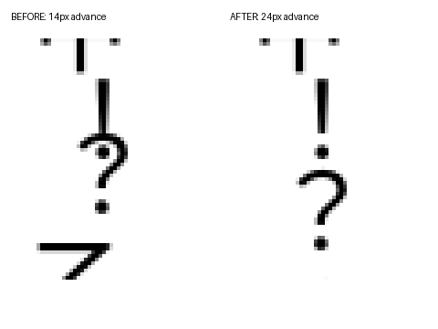

# A5 竖排扩充验收

四本新增 EPUB，逐本 **7/7**。两本中文、一本带振假名的日文、一本图文混排；均为本次原创 MIT 自造语料。四本均有诊断附页，因此 ruby、图片等七项逐本适用。

固定 SDK 版面：504×720，四边36 px，正文28 px、行距1.5、段距10 px；Reader.otf SHA-256 `2c76254f6fc379fddfce0a7e84fb5385bb135d3e399294f6eeb6680d0365b74b`。当前源码 MinGW 与 MSVC 产出的26页像素哈希完全一致。字体复用既有19本回归字体，未随证据重新分发。

| 语料 | 语言 | 页数 | 七项通过 | SDK截图数 | 宿主截图数 |
|---|---|---:|---:|---:|---:|
| [湖上晨读](corpus/zh-lake.epub) | zh-Hans | 7 | 7/7 | 7 | 2 |
| [山城夜记](corpus/zh-hill.epub) | zh-Hant | 6 | 7/7 | 6 | 2 |
| [星の観察日記](corpus/ja-stars.epub) | ja | 7 | 7/7 | 7 | 2 |
| [图与文字的方向](corpus/vertical-images.epub) | zh-Hans | 6 | 7/7 | 6 | 2 |

[语料来源与文件哈希](corpus/manifest.json) · [逐项测量摘要](summary.json) · [完整逐字形/逐页测量](measurements.json.gz) · [构建与源码指纹](provenance.json) · [四本宿主翻页记录](host-turns.json)

## 七项逐本结论与截图

“右上”以当前直立字格的物理坐标为准：句号和逗号的墨迹位于列中心右侧、字格上半部。日文的「、」「。」和中文全角逗号、句号均测量。下文间距为变换后轮廓包围盒的y间隔，包含贝塞尔控制点，截图另作视觉核验。

### 湖上晨读（7页）

| 项目 | 结论 | 数值/判定与截图 |
|---|---|---|
| 1 列方向 | PASS | 所有页面为 vertical-rl；正文列 x 递减，列内 y 递增。[1页](zh-lake-01.png) |
| 2 标点位置 | PASS | 句号/逗号可见轮廓在列中心右侧、字格上半部，无缺字。[4页](zh-lake-04.png) |
| 3 标点挤压 | PASS | `。，`、`」』`：56→42 px；`！？`：56→52 px，轮廓间距分别3.892/3.928/3.552 px。[4页](zh-lake-04.png) |
| 4 合字 | PASS | `12`、`……`、三个四位数的 digits 4 样例，各组合总 advance=28 px，单一簇、同列、同 y、不旋转。[4页](zh-lake-04.png) |
| 5 ruby | PASS | 16个14 px小字；正文28 px，注音均在对应基字右侧，页面/列边界不溢出。[3页](zh-lake-03.png) |
| 6 图片 | PASS | 整页图432×648 px、混排图80×120 px；四角 RGB 逐像素取样全部正确，无占位图，箭头向上。整页[5页](zh-lake-05.png)、混排[6页](zh-lake-06.png) |
| 7 翻页 | PASS | 实际Windows宿主左边缘点击(25,400)，页脚1-1→1-2。[点击前](host-zh-lake-before.jpg) / [点击后](host-zh-lake-after-left.jpg) |

完整SDK页面：[1页](zh-lake-01.png) · [2页](zh-lake-02.png) · [3页](zh-lake-03.png) · [4页](zh-lake-04.png) · [5页](zh-lake-05.png) · [6页](zh-lake-06.png) · [7页](zh-lake-07.png)。

### 山城夜记（6页）

| 项目 | 结论 | 数值/判定与截图 |
|---|---|---|
| 1 列方向 | PASS | 所有页面为 vertical-rl；正文列 x 递减，列内 y 递增。[1页](zh-hill-01.png) |
| 2 标点位置 | PASS | 句号/逗号可见轮廓在列中心右侧、字格上半部，无缺字。[3页](zh-hill-03.png) |
| 3 标点挤压 | PASS | `。，`、`」』`：56→42 px；`！？`：56→52 px，轮廓间距分别3.892/3.928/3.552 px。[3页](zh-hill-03.png) |
| 4 合字 | PASS | `12`、`……`、三个四位数的 digits 4 样例，各组合总 advance=28 px，单一簇、同列、同 y、不旋转。[3页](zh-hill-03.png) |
| 5 ruby | PASS | 16个14 px小字；正文28 px，注音均在对应基字右侧，页面/列边界不溢出。[2页](zh-hill-02.png) |
| 6 图片 | PASS | 整页图432×648 px、混排图80×120 px；四角 RGB 逐像素取样全部正确，无占位图，箭头向上。整页[4页](zh-hill-04.png)、混排[5页](zh-hill-05.png) |
| 7 翻页 | PASS | 实际Windows宿主左边缘点击(25,400)，页脚1-1→1-2。[点击前](host-zh-hill-before.jpg) / [点击后](host-zh-hill-after-left.jpg) |

完整SDK页面：[1页](zh-hill-01.png) · [2页](zh-hill-02.png) · [3页](zh-hill-03.png) · [4页](zh-hill-04.png) · [5页](zh-hill-05.png) · [6页](zh-hill-06.png)。

### 星の観察日記（7页）

| 项目 | 结论 | 数值/判定与截图 |
|---|---|---|
| 1 列方向 | PASS | 所有页面为 vertical-rl；正文列 x 递减，列内 y 递增。[1页](ja-stars-01.png) |
| 2 标点位置 | PASS | 句号/逗号可见轮廓在列中心右侧、字格上半部，无缺字。[4页](ja-stars-04.png) |
| 3 标点挤压 | PASS | `。，`、`」』`：56→42 px；`！？`：56→52 px，轮廓间距分别3.892/3.928/3.552 px。[4页](ja-stars-04.png) |
| 4 合字 | PASS | `12`、`……`、三个四位数的 digits 4 样例，各组合总 advance=28 px，单一簇、同列、同 y、不旋转。[4页](ja-stars-04.png) |
| 5 ruby | PASS | 79个14 px小字；正文28 px，注音均在对应基字右侧，页面/列边界不溢出。[1页](ja-stars-01.png) |
| 6 图片 | PASS | 整页图432×648 px、混排图80×120 px；四角 RGB 逐像素取样全部正确，无占位图，箭头向上。整页[5页](ja-stars-05.png)、混排[6页](ja-stars-06.png) |
| 7 翻页 | PASS | 实际Windows宿主左边缘点击(25,400)，页脚1-1→1-2。[点击前](host-ja-stars-before.jpg) / [点击后](host-ja-stars-after-left.jpg) |

完整SDK页面：[1页](ja-stars-01.png) · [2页](ja-stars-02.png) · [3页](ja-stars-03.png) · [4页](ja-stars-04.png) · [5页](ja-stars-05.png) · [6页](ja-stars-06.png) · [7页](ja-stars-07.png)。

### 图与文字的方向（6页）

| 项目 | 结论 | 数值/判定与截图 |
|---|---|---|
| 1 列方向 | PASS | 所有页面为 vertical-rl；正文列 x 递减，列内 y 递增。[1页](vertical-images-01.png) |
| 2 标点位置 | PASS | 句号/逗号可见轮廓在列中心右侧、字格上半部，无缺字。[3页](vertical-images-03.png) |
| 3 标点挤压 | PASS | `。，`、`」』`：56→42 px；`！？`：56→52 px，轮廓间距分别3.892/3.928/3.552 px。[3页](vertical-images-03.png) |
| 4 合字 | PASS | `12`、`……`、三个四位数的 digits 4 样例，各组合总 advance=28 px，单一簇、同列、同 y、不旋转。[3页](vertical-images-03.png) |
| 5 ruby | PASS | 16个14 px小字；正文28 px，注音均在对应基字右侧，页面/列边界不溢出。[2页](vertical-images-02.png) |
| 6 图片 | PASS | 整页图432×648 px、混排图80×120 px；四角 RGB 逐像素取样全部正确，无占位图，箭头向上。整页[4页](vertical-images-04.png)、混排[5页](vertical-images-05.png) |
| 7 翻页 | PASS | 实际Windows宿主左边缘点击(25,400)，页脚1-1→1-2。[点击前](host-vertical-images-before.jpg) / [点击后](host-vertical-images-after-left.jpg) |

完整SDK页面：[1页](vertical-images-01.png) · [2页](vertical-images-02.png) · [3页](vertical-images-03.png) · [4页](vertical-images-04.png) · [5页](vertical-images-05.png) · [6页](vertical-images-06.png)。

## 失败定位及修复

`src/inline.c::punctuation_room()` 原来对等宽标点一律允许挤掉半 em，`！` 的可见轮廓伸到这段空间内。28 px正文中，原 `！` 的 advance=14 px、轮廓 y=65.984…87.068；后一个 `？` 的轮廓 y=80.620…102.068，重叠6.448 px。现按 FreeType 竖排 bearing/height 分别限制开括号的前部空白与相邻标点的尾部空白，advance=24 px，轮廓间隔3.552 px。

`src/inline.c::punctuation_width()` 原列尾规则还会把整串标点强压成一 em，绕开上述安全余量。竖排改用逐字的尾部空白预算，保留标点墨迹；横排路径不变。原始矩形字体反例在旧 DLL 上失败，修复版通过。另新增非对称括号：上部留白600单位、墨迹300单位，确保列首裁剪前部空白时保留原位置。



[修复前完整页](punctuation-before.png) · [修复后完整页](zh-lake-04.png) · [原基线失败输出](boundaries-before.log) · [首轮修复的开括号反例](boundaries-first-fix.log)

## 合字及连续标点边界

| 输入 | `digits 2` | `digits 4` |
|---|---|---|
| `2026` | 四位整串拒绝合字；4字形，0 combined，竖向总advance64 px | 4字形同簇，4 combined，竖向总advance28 px |
| `1234` | 四位整串拒绝合字；4字形，0 combined，竖向总advance64 px | 4字形同簇，4 combined，竖向总advance28 px |
| `0000` | 四位整串拒绝合字；4字形，0 combined，竖向总advance64 px | 4字形同簇，4 combined，竖向总advance28 px |

`text-combine-upright:all` 的 `12`、`……` 各占一格。另有8个换列/跨页用例：2026、1234、0000、……，分别放到只剩半格的列尾，整个组合移到下一列/下一页，保持同一簇和28 px总advance。省略号遵循禁则，前一个汉字随它换列，所以组合从新列第二格开始。

连续标点三例（四本均截图）：`。，`、`！？`、`」』`。自动测试再覆盖 `。。`/`。。。`/`。。。。` 以及 `！？`/`！！？`/`！？！？`，分别放在段中及列尾；短标点可压缩，长标点轮廓不相交。

## 19本横排真书回归

先在未修改的 `3076d3dd` 构建保存完整基线，再用修复后的同一配置逐页重绘。720×1040，margin36、font28、line-height1.5、paragraph-spacing10；所有语料 SHA、字体、CSS、像素合同保持一致。未修改版本亦复现了既存 perf-optimize 集成基线。

首次候选有两页哈希变化（库存中的竖排《草枕》，0基页462/463），原因是开括号使用了尾部空白预算，导致38/61个字形移动6.28 px。修正前/后空白预算后完整重跑，最终下列差异为0；[首轮差异](initial-realbooks.diff.json)与[首轮结果](initial-final-realbooks.json.gz)保留。

**19/19，11,318页，8,648,571字形；页数变化0，逐页像素哈希变化0。**

[本轮基线](baseline-realbooks.json.gz) · [修复后结果](final-realbooks.json.gz) · [本轮差异](realbooks.diff.json) · [历史基线复现](historical-baseline.diff.json)

| 真实语料ID | 修改前页数 | 修改后页数 | 哈希变化页 |
|---|---:|---:|---:|
| a-raisin-in-the-sun | 356 | 356 | 0 |
| between-the-world-and-me | 228 | 228 | 0 |
| black-boy | 1016 | 1016 | 0 |
| born-a-crime | 502 | 502 | 0 |
| crying-in-h-mart | 524 | 524 | 0 |
| how-does-it-feel-to-be-a-problem-being-young-and-arab-in-america | 493 | 493 | 0 |
| i-know-why-the-caged-bird-sings | 625 | 625 | 0 |
| pachinko | 1248 | 1248 | 0 |
| the-absolutely-true-diary-of-a-part-time-indian | 560 | 560 | 0 |
| the-autobiography-of-malcolm-x. | 279 | 279 | 0 |
| the-distance-between-us-a-memoir | 702 | 702 | 0 |
| the-fire-next-time | 189 | 189 | 0 |
| the-fire-this-time-a-new-generation-speaks-about-race | 333 | 333 | 0 |
| the-house-on-mango-street | 182 | 182 | 0 |
| zami-a-new-spelling-of-my-name---a-biomythography | 646 | 646 | 0 |
| hongloumeng-24264 | 1686 | 1686 | 0 |
| xingshihengyan-24239 | 1202 | 1202 | 0 |
| tangshi300-52323 | 83 | 83 | 0 |
| kusamakura-japanese-vertical-writing | 464 | 464 | 0 |

## 测试

**MSVC Release ctest 260/260，全绿，53.92秒。新增3组：**

- `native-vertical-expand-boundaries`：27个配置/边界场景，含旧版会失败的列尾压缩与高标点轮廓相交反例。
- `native-vertical-expand-ruby`：20组、40个小字，多页、右侧关系和页内边界。
- `native-vertical-expand-images`：6张实际解码图片、多页、长宽比及四角像素方向。

[完整ctest日志](ctest.log) · [层检查](layers.log)：119对象、1366符号引用，0逆向引用、0逆向include。未新增src头文件。

首轮 MinGW 为259/260；唯一失败是 SDK 发布测试用 README 的 MSVC 命令链接 MinGW 包，缺少exreader.lib。随后使用匹配的MSVC构建执行完整套件，未跳过该测试。[首轮日志](ctest-mingw-initial.log)。ICC、PDF crypto、JPX启用，WebP/TIFF/AVIF关闭。

既有测试断言未改。新测试编写时修正两处错误预期：20组×2小字应为40（不是80）；省略号受列首禁则保护，前一个汉字也换列，因此起点为64（不是36）。对应fixture和生产禁则逻辑均保留。

## 复现

```powershell
python tests/vertical_expand.py --library build/msvc-a5/exreader.dll --font C:/Users/Oscar/exr-deps/reader-font/Reader.otf --output build/a5-evidence
ctest --test-dir build/msvc-a5 --output-on-failure --parallel 6
python tools/regress/run_realbooks.py --manifest tools/regress/corpus.json --dll build/a5/libexreader.dll --font C:/Users/Oscar/exr-deps/reader-font/Reader.otf --layout tools/regress/layout.json --source-revision <build-source> --workers 3 --baseline build/baseline-realbooks.json --output build/final-realbooks.json
```

语料生成仅用Python标准库；测试使用已提交的原始矩形字体。只有重新生成字体才需要开发用fontTools（`python tools/generate_combine_test_font.py`）。宿主截图与SDK页数采用各自版面；宿主翻页截图的1-1/1-2不当作504×720下的页码。
